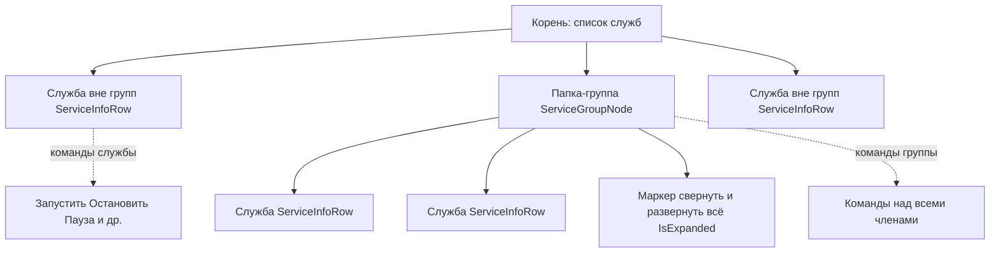

# План исправлений — версия 1.0.0.14 (issues #3 «Серверы 1С», #11 «Управление службами»)

## 0. Цель и рамки

- Базовая версия: 1.0.0.13. Целевая: **1.0.0.14** (меняется только последнее число).
- Источник требований — последние комментарии пользователя 7OH (2026-10-18): issue #3 — 4 пункта, issue #11 — 7 пунктов.
- Стек: WPF (Windows) + Avalonia (Linux); вся чистая бизнес-логика — в общих ViewModel/сервисах (файлы без суффиксов), платформенная часть — в `*.xaml`/`*.xaml.cs` (WPF) и `*.Avalonia.cs`/`*.axaml` (Linux).
- Правила: не менять формат `services.json` на диске без обратной совместимости; не ломать сборку обеих платформ; все новые ключи локализации добавлять в `ru.json` и `en.json` (проверяется тестами `LocalizationCoverageServicesTests`, `ServerMonitorWindowsLocalizationTests`).

Версия приложения задаётся в [`Workspace1C/Workspace1C.csproj`](Workspace1C/Workspace1C.csproj:62): `<Version>`, `<AssemblyVersion>`, `<FileVersion>`, `<InformationalVersion>` — все четыре значения 1.0.0.13 → 1.0.0.14.

## 1. Текущее состояние кода (результаты рекогносцировки)

### Окно «Серверы 1С» (issue #3)
- Окно: [`ServerMonitorWindow.xaml.cs`](Workspace1C/Views/ServerMonitorWindow.xaml.cs:25) (WPF) и [`ServerMonitorWindow.Avalonia.cs`](Workspace1C/Views/ServerMonitorWindow.Avalonia.cs:40) (Avalonia); логика — [`ServerMonitorViewModel.cs`](Workspace1C/ViewModels/ServerMonitorViewModel.cs).
- Свойства базы: [`RacInfobasePropertiesWindow.xaml`](Workspace1C/Views/RacInfobasePropertiesWindow.xaml:1) (WPF, `Height="620" MinHeight="520"`) и [`RacInfobasePropertiesWindow.Avalonia.cs`](Workspace1C/Views/RacInfobasePropertiesWindow.Avalonia.cs:23); VM — [`RacInfobasePropertiesViewModel.cs`](Workspace1C/ViewModels/RacInfobasePropertiesViewModel.cs:21).
  - Вкладка «Основная» — вертикальный `StackPanel` (сквозные блоки: админ-учётка, имя/безопасное соединение, описание, сервер СУБД/СУБД, БД/пользователь/пароль и в самом низу чекбокс «Разрешить выдачу лицензий» [`RacInfobasePropertiesWindow.xaml`](Workspace1C/Views/RacInfobasePropertiesWindow.xaml:174)). Прокрутки нет, поэтому на низком разрешении чекбокс обрезается.
  - Порядок вкладок: «Основная» первая, «Настройки» вторая ([`RacInfobasePropertiesWindow.xaml`](Workspace1C/Views/RacInfobasePropertiesWindow.xaml:79) и :182).
- Удаление базы: диалог [`RacInfobaseDropWindow.xaml.cs`](Workspace1C/Views/RacInfobaseDropWindow.xaml.cs:12) (вариант «с удалением БД» виден при `canDropDatabase`). Решение — [`ServerMonitorViewModel.CanDropDatabaseOnServer`](Workspace1C/ViewModels/ServerMonitorViewModel.cs:502) → [`IsClientServerDbms`](Workspace1C/ViewModels/ServerMonitorViewModel.cs:506): клиент-серверная только если `Dbms` непустое и не равно `RacDbms.File` ("FILE", регистронезависимо). Модель [`RacInfobaseSummary.Dbms`](Workspace1C/Models/RacModels.cs:379) документирует файловую базу кластера как пустую — но на практике 7OH получает для файловых баз оба варианта, т.е. значение `Dbms` для файловой базы имеет иной вид (вероятно, разные версии rac отдают «File»/пусто/иное). Парсер вывода — [`RacOutputParser.ToInfobaseSummaries`](Workspace1C/Services/RacOutputParser.cs:757) (табличный и блочный форматы).
- Кнопка «СЛУЖБЫ» внизу левой колонки ([`ServerMonitorWindow.xaml`](Workspace1C/Views/ServerMonitorWindow.xaml:169), [`ServerMonitorWindow.Avalonia.cs`](Workspace1C/Views/ServerMonitorWindow.Avalonia.cs:161)). Меню строится через общий [`ServiceTrayMenuBuilder`](Workspace1C/Services/ServiceTrayMenuBuilder.cs), но адаптеры [`ToWpfServiceMenuItem`](Workspace1C/Views/ServerMonitorWindow.xaml.cs:343) и [`ToAvaloniaMenuItem`](Workspace1C/Views/ServerMonitorWindow.Avalonia.cs:1141) создают пункты БЕЗ иконок и цветных глифов — в отличие от меню трея главного окна (WPF: [`MainWindow.Tray.cs`](Workspace1C/Views/MainWindow.Tray.cs:783), где пункты получают иконки `GetTrayIcon`/`DrawCommandGlyph` и цвета команд из [`ServiceCommandGlyphs`](Workspace1C/ViewModels/ServiceCommandGlyphs.cs)).

### Окно «Управление службами» (issue #11)
- VM: [`ServicesWindowViewModel.cs`](Workspace1C/ViewModels/ServicesWindowViewModel.cs:261).
  - Список — плоский `ObservableCollection<ServiceListRow> Rows` (строки-службы [`ServiceInfoRow`](Workspace1C/ViewModels/ServicesWindowViewModel.cs:42) и строки-группы [`ServiceGroupRow`](Workspace1C/ViewModels/ServicesWindowViewModel.cs:122) как «братья»).
  - Команды: службы, группы (`StartGroupCommand` и т.п.), «Все сервисы», перемещение `Move(-1/+1)`, CRUD групп, `AvailableServicesForGroup` (логика «доступные»).
- Модель/хранилище: [`ServiceModels.cs`](Workspace1C/Services/ServiceModels.cs:229) (`ServiceStoreData`: `Services` — вне групп, `Groups`, `Order`) и [`ServicesStore.cs`](Workspace1C/Services/ServicesStore.cs) (`services.json`, `Normalize`).
- Окно WPF: [`ServicesWindow.xaml`](Workspace1C/Views/ServicesWindow.xaml:1) (панель: «Настроить»/«Системный диалог»/«Выдать права»; тулбар: `MoveUp`/`MoveDown`/разделитель/«Добавить·Изменить·Удалить группу»/разделитель/«Обновить»/разделитель/команды/разделитель/«Все сервисы»); список — `ListBox`.
- Окно Avalonia: [`ServicesWindow.Avalonia.cs`](Workspace1C/Views/ServicesWindow.Avalonia.cs:31) — строит интерфейс в коде.
- Редактирование группы: [`ServiceGroupEditViewModel.cs`](Workspace1C/ViewModels/ServiceGroupEditViewModel.cs:23), окна [`ServiceGroupEditWindow.xaml.cs`](Workspace1C/Views/ServiceGroupEditWindow.xaml.cs:19)/[`ServiceGroupEditWindow.Avalonia.cs`](Workspace1C/Views/ServiceGroupEditWindow.Avalonia.cs:31). Списки «Управляемый» и «Все службы»; «Все службы» фильтруются уже входным списком.
- Трей:
  - WPF: [`MainWindow.Tray.cs`](Workspace1C/Views/MainWindow.Tray.cs:741) `ShowServicesTrayMenu`, [`OnTrayIconMouseUp`](Workspace1C/Views/MainWindow.Tray.cs:765) — Ctrl+ПКМ. Задержка ~1 с: меню строится на UI-потоке с синхронным опросом статусов `services.GetStatus(name)` для всех служб ([`BuildServicesMenuItems`](Workspace1C/Views/MainWindow.Tray.cs:704)); `ServiceController.GetStatus` на Windows медленный; плюс возможна гонка со штатным контекстным меню WinForms `NotifyIcon`.
  - Avalonia: [`MainWindow.Avalonia.Tray.cs`](Workspace1C/Views/MainWindow.Avalonia.Tray.cs:237) `BuildServicesNativeItem` — статусы опрашиваются при пересборке меню; нативные меню не умеют иконок (это норм для Linux).
- Контекстные меню строк и «Все сервисы» в окне служб уже унифицированы с красивыми иконками (WPF: [`ServicesWindow.xaml.cs`](Workspace1C/Views/ServicesWindow.xaml.cs:186)); для Avalonia следует выверить эквивалент.

## 2. Этапы работ

### Этап 0. Служебный (версия, заметки)
- [`Workspace1C/Workspace1C.csproj`](Workspace1C/Workspace1C.csproj:62): 1.0.0.13 → 1.0.0.14 в четырёх тегах.
- Создать/обновить релизные заметки по образцу [`rel_notes_1.0.0.13.md`](rel_notes_1.0.0.13.md): `rel_notes_1.0.0.14.md`; дополнить `CHANGELOG.md`/`README.md` при наличии принятого формата.

### Этап 1. Issue #3

#### 1.1 Правка свойств базы: видимость «Разрешить выдачу лицензий» (компактность формы)
Файлы:
- [`Workspace1C/Views/RacInfobasePropertiesWindow.xaml`](Workspace1C/Views/RacInfobasePropertiesWindow.xaml:1)
- [`Workspace1C/Views/RacInfobasePropertiesWindow.Avalonia.cs`](Workspace1C/Views/RacInfobasePropertiesWindow.Avalonia.cs:23)

Подход:
1. Уплотнить вертикальные отступы: стиль `FieldLabel` (сейчас `Margin=0,8,0,3`) → `0,5,0,2`; уменьшить `Padding` внутренних `Border`-групп (`10,4,10,10` → компактнее); `Margin` между блоками.
2. Поднять чекбокс «Разрешить выдачу лицензий» выше (в блок рядом с полями «Сервер СУБД/СУБД» или сразу после блока админ-учётки), чтобы он был виден без прокрутки на типовых разрешениях; либо перевести часть полей в 2–3 колонки.
3. Страховочно обернуть контент вкладок в `ScrollViewer` (WPF: `ScrollViewer` вокруг `StackPanel`; Avalonia: `ScrollViewer` вокруг панели вкладки) — форма остаётся пригодной на малом экране.
4. Синхронно внести те же правки в Avalonia-версию (раскладка строится кодом, [`RacInfobasePropertiesWindow.Avalonia.cs`](Workspace1C/Views/RacInfobasePropertiesWindow.Avalonia.cs:142)).

Проверка: на разрешении 1366×768 и ниже чекбокс виден целиком без прокрутки; окно не должно выходить за рабочую область.

#### 1.2 Вкладка «Настройки» первой (или открытие на ней)
Файлы:
- [`Workspace1C/Views/RacInfobasePropertiesWindow.xaml`](Workspace1C/Views/RacInfobasePropertiesWindow.xaml:79)
- [`Workspace1C/Views/RacInfobasePropertiesWindow.Avalonia.cs`](Workspace1C/Views/RacInfobasePropertiesWindow.Avalonia.cs:127)

Подход: переставить `TabItem` «Настройки» на первое место (в XAML и в `BuildRoot` Avalonia). Альтернатива — в `OnLoaded`/после инициализации выбрать вкладку по индексу; предпочтительнее физический порядок, т.к. он соответствует требованию «вкладка первая». Ключи локализации `ServerMonitor.Infobase.Props.Tab.Basic/Settings` не меняются.

#### 1.3 Удаление базы: корректное определение файловой базы
Файлы:
- [`Workspace1C/ViewModels/ServerMonitorViewModel.cs`](Workspace1C/ViewModels/ServerMonitorViewModel.cs:502)
- [`Workspace1C/Services/RacOutputParser.cs`](Workspace1C/Services/RacOutputParser.cs:757)
- [`Workspace1C/Models/RacModels.cs`](Workspace1C/Models/RacModels.cs:379) (документация семантики `Dbms`)
- `Workspace1C/Views/RacInfobaseDropWindow.xaml|.xaml.cs|.Avalonia.cs` (визуальная часть менять не должна)

Подход:
1. Собрать реальные примеры вывода `rac infobase summary list` для файловых баз кластера (табличный и блочный форматы; разные версии rac: 8.3.x и 8.5.4) — оформить как фикстуры в тестах.
2. Усилить предикат `IsClientServerDbms`/`CanDropDatabaseOnServer`: файловой считать базу, если (а) `Dbms` пуст; (б) `Dbms` равен `RacDbms.File` (уже есть); (в) `Dbms` не входит в известный набор клиент-серверных СУБД (`MSSQLServer`, `PostgreSQL`, `IBMDB2`, `OracleDatabase`, `SQLite`, `ServerODBC`) — «белый список» вместо «не FILE»; (г) как вспомогательный признак — `DbServer` выглядит как путь файловой системы (`\\`, `/`, заканчивается на `1Cv8.1CD`) или `DbName == "1Cv8.1CD"`.
3. Добавить диагностический лог при разборе сводки (raw `dbms`/`db-server`), чтобы при необходимости доисследовать на реальном стенде.
4. Проверить, что парсер корректно снимает кавычки и пробелы в обоих форматах; при необходимости поправить `ToInfobaseSummaries`.
5. Связанная правка: `RacInfobasePropertiesViewModel.NormalizeDbms` (пустое значение → `MSSQLServer`, [`RacInfobasePropertiesViewModel.cs`](Workspace1C/ViewModels/RacInfobasePropertiesViewModel.cs:339)) — при правке файловой базы не должна подставлять MSSQL; для файловых баз `Dbms` должен оставаться `RacDbms.File`/пустым (согласовать с 1.1).

#### 1.4 Меню «СЛУЖБЫ» — тот же вид, что в основном окне
Файлы:
- [`Workspace1C/Views/ServerMonitorWindow.xaml.cs`](Workspace1C/Views/ServerMonitorWindow.xaml.cs:298) — `OnServicesMenu_Click`, `ToWpfServiceMenuItem`
- [`Workspace1C/Views/ServerMonitorWindow.Avalonia.cs`](Workspace1C/Views/ServerMonitorWindow.Avalonia.cs:1107) — `ShowServicesMenu`, `ToAvaloniaMenuItem`
- эталоны оформления: [`MainWindow.Tray.cs`](Workspace1C/Views/MainWindow.Tray.cs:783) (WPF-иконки через `GetTrayIcon`/`DrawCommandGlyph`/`CommandColorHex`), [`ServiceCommandGlyphs.cs`](Workspace1C/ViewModels/ServiceCommandGlyphs.cs) (глифы и цвета команд), [`ServicesWindow.xaml.cs`](Workspace1C/Views/ServicesWindow.xaml.cs:130) (`CommandItem` с цветной иконкой)

Подход:
1. Выделить общий построитель пункта меню служб для WPF-`ContextMenu` (статический помощник, например `ServiceContextMenuBuilder.BuildWpfMenuItem(ServiceMenuItem)`) и использовать его в обоих местах: окно «Серверы 1С» (кнопка «СЛУЖБЫ») и окно «Управление службами» (контекстное меню строки/«Все сервисы») — чтобы вид гарантированно совпадал.
2. Вид пунктов: «Настроить…» — иконка-шестерёнка; служба — кружок статуса (`StatusColorHex`, через `BrushFromHexConverter`); группа — иконка-папка; команды — цветные глифы из `ServiceCommandGlyphs` (`▶ #16A34A`, `■ #DC2626`, `❚❚ #D97706`, `▶| #0EA5E9`, `⟲ #2563EB`); разделители и `IsEnabled` из модели.
3. Avalonia: `MenuItem.Icon` поддерживает контент — повторить те же визуальные элементы (Ellipse/TextBlock с цветом), синхронно с WPF.
4. Структура/порядок пунктов уже обеспечивается общим `ServiceTrayMenuBuilder` — не дублировать.

### Этап 2. Issue #11

#### 2.1 Правка группы: «доступные» — не в других группах И не в этой же
Файлы:
- [`Workspace1C/ViewModels/ServicesWindowViewModel.cs`](Workspace1C/ViewModels/ServicesWindowViewModel.cs:947) — `AvailableServicesForGroup`
- [`Workspace1C/ViewModels/ServiceGroupEditViewModel.cs`](Workspace1C/ViewModels/ServiceGroupEditViewModel.cs:42) — конструктор
- [`Workspace1C/Views/ServicesWindow.xaml.cs`](Workspace1C/Views/ServicesWindow.xaml.cs:102) и соответствующая часть [`ServicesWindow.Avalonia.cs`](Workspace1C/Views/ServicesWindow.Avalonia.cs) — провайдер `ShowGroupEditor` (убедиться, что передаётся именно отфильтрованный список)

Подход:
1. Единая точка фильтрации: `AvailableServicesForGroup` должна возвращать «службы вне групп И не члены редактируемой группы» (сейчас она возвращает и своих членов — они отсеиваются уже внутри `ServiceGroupEditViewModel`, логика размазана по двум местам). Сконцентрировать правило в одном методе и покрыть тестами; `ServiceGroupEditViewModel` оставить без собственной фильтрации (или оставить как страховку, но с явным тестом).
2. Проверить обе платформы: окно должно вызывать провайдер со списком из `AvailableServicesForGroup`, а не «все службы системы» из `ServicesPickerViewModel`.
3. Важно: исключённый из группы член (кнопка «Вправо») должен возвращаться в негруппированные `Services` после сохранения (см. 2.2) — иначе он пропадёт из списка, а в новом дереве нарушится инвариант «служба ровно в одном месте».

#### 2.2 Иерархический список: группы-папки со службами внутри
Файлы:
- [`Workspace1C/ViewModels/ServicesWindowViewModel.cs`](Workspace1C/ViewModels/ServicesWindowViewModel.cs:261) — структура строк: вместо плоского списка дерево
- [`Workspace1C/Views/ServicesWindow.xaml`](Workspace1C/Views/ServicesWindow.xaml:193) — `ListBox` → `TreeView` + `HierarchicalDataTemplate`
- [`Workspace1C/Views/ServicesWindow.Avalonia.cs`](Workspace1C/Views/ServicesWindow.Avalonia.cs) — построение дерева кодом
- [`Workspace1C/Services/ServiceModels.cs`](Workspace1C/Services/ServiceModels.cs:273) — `ServiceStoreData.Normalize` (инварианты)
- Образец дерева и паттерна «развернуть/свернуть всё»: [`PlatformVersionTreeBuilder.cs`](Workspace1C/Services/PlatformVersionTreeBuilder.cs:42) (`IsExpanded` на узле), [`PlatformDownloadWindow.xaml`](Workspace1C/Views/PlatformDownloadWindow.xaml:147), [`MainViewModel.Theme.cs`](Workspace1C/ViewModels/MainViewModel.Theme.cs:687)

Подход:
1. Ввести узел-папку `ServiceGroupNode` (обёртка над `ServiceGroupRow`): имя, агрегированный статус, `Children` (ObservableCollection<ServiceInfoRow>), `IsExpanded`. Корневой список `Rows` = службы вне групп (плоские строки, как сейчас) + узлы-папки групп. Модели строк `ServiceInfoRow`/`ServiceGroupRow` остаются.
2. `RebuildRowsAsync` строит дерево по `ServiceStoreData.Order`: ключ группы → узел-папка, её члены — дети; остальные ключи — корневые службы.

Целевая структура представления:

Инвариант после 2.1 и 2.2: каждая служба отображается ровно один раз — либо в корне вне групп, либо внутри одной папки-группы; исключённые из группы при правке члены возвращаются в корневой список.
3. Инвариант модели «служба ровно в одном месте»: расширить `ServiceStoreData.Normalize` — если служба упомянута и в `Services`, и в группе (или в двух группах), оставлять первое вхождение (приоритет группе), остальные дубли удалять; миграция старого файла должна быть обратно-совместимой (существующие тесты миграции дополнить новыми кейсами).
4. Сохранение состава при правке группы: исключённые члены дописывать в `Services` (корень), чтобы ни одна служба не «терялась» (правка `EditGroupAsync`/`ServiceGroupEditViewModel.Save`).
5. `MoveUp`/`MoveDown` — только для верхнего уровня (перемещение папок и корневых служб), порядок внутри папки задаётся в редакторе группы (существующие кнопки «Вверх/Вниз»). Кэш статусов и `RefreshAsync` сохраняются.
6. Выбор узла: служба внутри папки → команды службы; папка/корневая служба → как раньше. `SelectedRow`-логика адаптируется (ключ = имя службы / `group:имя`).

#### 2.3 Запуск всего в папке и выборочно (следствие дерева)
- Уже реализованные командные серии группы (`StartGroupCommand` и т.п.) привязываются к узлу-папке и контекстному меню папки; выборочный запуск — щелчок по отдельной службе. Отдельных новых сущностей не требуется; проверяется в рамках 2.2 и 2.6.

#### 2.4 Кнопки «Свернуть все»/«Развернуть все» перед «Выше/Ниже»
Файлы:
- [`Workspace1C/Views/ServicesWindow.xaml`](Workspace1C/Views/ServicesWindow.xaml:90) — тулбар
- [`Workspace1C/Views/ServicesWindow.Avalonia.cs`](Workspace1C/Views/ServicesWindow.Avalonia.cs) — тулбар в коде
- [`Workspace1C/ViewModels/ServicesWindowViewModel.cs`](Workspace1C/ViewModels/ServicesWindowViewModel.cs) — команды `ExpandAllCommand`/`CollapseAllCommand`

Подход:
1. В начало тулбара (перед `MoveUpButton`) добавить две кнопки-иконки «Развернуть все» и «Свернуть все» (иконки как в основном окне: WPF — `PackIcon ExpandAll/CollapseAll`, Avalonia — `IconExpandAllBox`/`IconCollapseAllBox` из тем; см. [`MainWindow.xaml`](Workspace1C/Views/MainWindow.xaml:563) и [`MainWindow.Avalonia.Columns.cs`](Workspace1C/Views/MainWindow.Avalonia.Columns.cs:463)). После них — разделитель (стиль `ToolbarSeparator`).
2. Команды VM меняют `IsExpanded` у всех узлов-папок (двусторонняя привязка `TreeViewItem.IsExpanded` → `IsExpanded`, паттерн `PlatformDownloadWindow`); доступность команд — при наличии групп.
3. WPF: обновление `IsExpanded` через контейнеры (`ItemContainerGenerator`) либо через привязку; Avalonia: привязка `IsExpanded` в шаблоне узла.

#### 2.5 Кнопка «Перенести в группу» рядом с «Изменить группу» + диалог выбора групп
Файлы:
- [`Workspace1C/Views/ServicesWindow.xaml`](Workspace1C/Views/ServicesWindow.xaml:112) и [`ServicesWindow.Avalonia.cs`](Workspace1C/Views/ServicesWindow.Avalonia.cs) — кнопка
- [`Workspace1C/ViewModels/ServicesWindowViewModel.cs`](Workspace1C/ViewModels/ServicesWindowViewModel.cs) — `MoveToGroupAsync`, `CanMoveToGroup`
- новые окна `ServiceGroupPickerWindow` (WPF `xaml`+`cs`) и `ServiceGroupPickerWindow.Avalonia.cs` (диалог: список групп + пункт «Без группы», ОК/Отмена)
- [`Workspace1C/Views/ServicesWindow.xaml.cs`](Workspace1C/Views/ServicesWindow.xaml.cs) — провайдер диалога

Подход:
1. Кнопка-иконка «Перенести в группу» (например, справа от «Изменить группу»): доступна, когда выбрана служба и есть хотя бы одно место для переноса (есть группы для переноса в группу; если служба уже в группе — доступен перенос «без группы»/в другую группу).
2. `MoveToGroupAsync(ServiceName, targetGroupName?)`: удалить службу из текущего места (`Services` или группы), добавить в целевое (`targetGroupName == null` → корневой список `Services`), обновить `Order` (при переносе в группу ключ службы остаётся на верхнем уровне? — нет: служба, находящаяся в группе, не должна оставаться ключом верхнего `Order`; верхний `Order` хранит только корневые службы и группы. Определить правило согласованно с `Normalize`), сохранить и перестроить дерево с сохранением выбора.
3. В контекстное меню службы добавить пункт «В группу…» (аналог основного окна).
4. Диалог: список групп (по алфавиту или в порядке `Order`) + «Без группы»; пустая группа в списке допустима.

#### 2.6 Контекстное меню и подменю «Все сервисы» — как в основном окне
Файлы:
- [`Workspace1C/Views/ServicesWindow.xaml.cs`](Workspace1C/Views/ServicesWindow.xaml.cs:186) (WPF: уже выровнено в 1.0.0.13)
- [`Workspace1C/Views/ServicesWindow.Avalonia.cs`](Workspace1C/Views/ServicesWindow.Avalonia.cs) (Avalonia: выверить)
- [`Workspace1C/ViewModels/ServiceCommandGlyphs.cs`](Workspace1C/ViewModels/ServiceCommandGlyphs.cs) — единый источник глифов/цветов

Подход:
1. Переиспользовать общий построитель из 1.4 (WPF) и повторить вид в Avalonia: иконки, подписи, доступность по статусу (`CanStart/…`); «Восстановить» — глиф с палочкой, цвета команд.
2. Для узла-папки: команды группы; для службы: команды службы + «В группу…» (2.5); разделители в тех же местах, что в основном окне.
3. Подменю «Все сервисы» (кнопка на панели): Запустить / Остановить / разделитель / Перезапустить — с теми же иконками; доступность по `CanStartAll/…`.
4. Обновить `LocalizationCoverageServicesTests`/`ServerMonitorWindowsLocalizationTests` под новые ключи.

#### 2.7 Ctrl+клик в трее — мгновенное появление меню
Файлы:
- [`Workspace1C/Views/MainWindow.Tray.cs`](Workspace1C/Views/MainWindow.Tray.cs:741) — `ShowServicesTrayMenu`, [`OnTrayIconMouseUp`](Workspace1C/Views/MainWindow.Tray.cs:765), [`BuildServicesMenuItems`](Workspace1C/Views/MainWindow.Tray.cs:704)
- [`Workspace1C/Views/MainWindow.Avalonia.Tray.cs`](Workspace1C/Views/MainWindow.Avalonia.Tray.cs:237) — `BuildServicesNativeItem` (Linux: пересборка по статусам)
- Участвуют также: [`ServicesStore.cs`](Workspace1C/Services/ServicesStore.cs), [`ServiceControllerService.Windows.cs`](Workspace1C/Services/ServiceControllerService.Windows.cs), [`ServiceControllerService.Linux.cs`](Workspace1C/Services/ServiceControllerService.Linux.cs)

Подход:
1. Новый общий компонент — кэш статусов служб `ServiceStatusCache` (чистый .NET, тестируемый): `GetStatus(name)` из памяти мгновенно; обновление — фоновая задача/периодический таймер (или обновление по требованию после команд/открытия окна служб). Используется там, где статусы нужны «сейчас»: построители меню трея и «СЛУЖБЫ».
2. WPF: `OnTrayIconMouseUp` (Ctrl+ПКМ) — показывать меню немедленно, из кэша; если кэш пуст/протух — показать пункты со статусами `Unknown` и пересобрать открытое меню после фонового опроса (обновление элементов в уже открытом `ToolStrip`). Исключить гонку со штатным контекстным меню `NotifyIcon` (корректно временно сбрасывать/восстанавливать `ContextMenuStrip` или управлять показом через `MouseDown`), чтобы не было двойного меню.
3. Avalonia: `BuildServicesNativeItem`/`RefreshTrayServicesMenu` — брать статусы из кэша; фоновая пересборка статусов не на UI-потоке.
4. После каждой операции (Start/Stop/…) — инвалидация кэша и пересборка меню (существующий поток `RebuildTrayMenuFromServices`/`RefreshTrayServicesMenu` сохраняется).

### Этап 3. Тесты (см. также «Тесты» ниже) и локализация
- Все новые строки — в [`Workspace1C/Localization/Languages/ru.json`] и `en.json` (проверят тесты покрытия).
- Обновить существующие юнит-тесты, изменившиеся из-за новой семантики (например, ожидание `AvailableServicesForGroup` для своих членов), синхронно с кодом.

## 3. Затрагиваемые файлы (сводно)

| Область | WPF (Windows) | Avalonia (Linux) | Общая логика |
|---|---|---|---|
| Свойства базы | `Views/RacInfobasePropertiesWindow.xaml` | `Views/RacInfobasePropertiesWindow.Avalonia.cs` | `ViewModels/RacInfobasePropertiesViewModel.cs` |
| Удаление базы | `Views/RacInfobaseDropWindow.xaml`, `.xaml.cs` | `Views/RacInfobaseDropWindow.Avalonia.cs` | `Services/RacOutputParser.cs`, `Models/RacModels.cs`, `ViewModels/ServerMonitorViewModel.cs` |
| Окно «Серверы 1С» / «СЛУЖБЫ» | `Views/ServerMonitorWindow.xaml(.cs)` | `Views/ServerMonitorWindow.Avalonia.cs` | `Services/ServiceTrayMenuBuilder.cs`, `ViewModels/ServiceCommandGlyphs.cs` |
| Окно служб (дерево, тулбар, кнопки, диалог переноса) | `Views/ServicesWindow.xaml(.cs)`, `Views/ServiceGroupPickerWindow.xaml(.cs)`, `Views/ServiceGroupEditWindow.xaml(.cs)` | `Views/ServicesWindow.Avalonia.cs`, `Views/ServiceGroupPickerWindow.Avalonia.cs`, `Views/ServiceGroupEditWindow.Avalonia.cs` | `ViewModels/ServicesWindowViewModel.cs`, `ViewModels/ServiceGroupEditViewModel.cs`, `Services/ServiceModels.cs`, `Services/ServicesStore.cs` |
| Трей, Ctrl+клик | `Views/MainWindow.Tray.cs` | `Views/MainWindow.Avalonia.Tray.cs` | новый `Services/ServiceStatusCache.cs` |
| Версия/заметки | — | — | `Workspace1C.csproj`, `rel_notes_1.0.0.14.md`, `CHANGELOG.md` |

## 4. Риски и зависимости

1. **WPF ⇄ Avalonia расхождение**: вся платформенная часть дублируется; критично вводить изменения сразу в обе, опираясь на общие VM/сервисы. Риск выше всего в дереве служб (разные модели деревьев: `TreeView`+`HierarchicalDataTemplate` vs построение в коде; раскрытие узлов, обновление `IsExpanded`).
2. **Обратная совместимость `services.json`**: новый инвариант Normalize («служба в одном месте») может «переставить» существующие пользовательские данные — миграция должна быть аккуратной и покрытой тестами; не удалять данные безвозвратно (дубли резолвить предсказуемо: приоритет группе).
3. **Некорректное определение файловой базы (1.3)**: правка опирается на реальный вывод rac; риск ошибиться в «белом списке» СУБД (например, неизвестная/локальная СУБД). Нужны фикстуры реального вывода; при сомнении — консервативная политика: разрешать `--drop-database` только для заведомо клиент-серверных значений.
4. **Трей (2.7)**: риск сломать обычный ПКМ по трею (двойное меню, потеря меню при сбое кэша). Требуется осторожная работа с `NotifyIcon.ContextMenuStrip` и ручная проверка обоих сценариев (обычный и Ctrl+ПКМ).
5. **Локализация**: новые ключи обязаны быть в обоих словарях; автотесты покрытия (`LocalizationCoverageServicesTests`, `ServerMonitorWindowsLocalizationTests`) упадут при пропуске.
6. **Существующие тесты с изменённой семантикой** (например, `AvailableServicesForGroup` и ожидания «свои члены доступны», дерево вместо `Rows`) — обновлять в том же коммите, что и код, чтобы не раздувать красную сборку.
7. **Зависимости по этапам**: 2.2 (дерево) — базовый; 2.3/2.4/2.5/2.6 опираются на него; 1.1 и 1.2 — изолированы; 1.3 — изолирован, но связан с 1.1 (пустой `Dbms` файловой базы в диалоге правки); 2.7 — изолирован от окна, но требует нового общего кэша.

## 5. Тесты: добавить/обновить

### Существующие файлы (обновить)
- `Workspace1C.Tests/ServerMonitorViewModelTests.cs` — расширить `CanDropDatabaseOnServer_ClientServer_True_File_False` (рег. примеры: `Dbms=""`, `"FILE"`, `"File"`, путь в `DbServer`, `DbName="1Cv8.1CD"`, незнакомое значение → файловая; `MSSQLServer`/`PostgreSQL`/… → клиент-серверная).
- `Workspace1C.Tests/RacOutputParserTests.cs` (если есть) — фикстуры «файловая база в кластере» в табличном и блочном форматах; утверждения на разобранный `Dbms`/`DbServer`.
- `Workspace1C.Tests/ServicesGroupViewModelTests.cs` — `AvailableServicesForGroup`: теперь НЕ включает членов редактируемой группы (обновить ожидания); новый кейс «исключённый член возвращается в Services».
- `Workspace1C.Tests/ServicesWindowViewModelTests.cs` — дерево вместо плоского списка: построение (`RebuildRowsAsync`), выбор/восстановление выбора по ключу.
- `Workspace1C.Tests/ServicesStoreTests.cs` / `ServicesStoreGroupMigrationTests.cs` — нормализация «оверлапов» (служба в двух местах), миграция старого файла к новым инвариантам.
- `Workspace1C.Tests/ServiceGroupEditViewModelTests.cs` — если фильтрация переносится в VM-окно группы, обновить кейсы входных списков.
- `Workspace1C.Tests/LocalizationCoverageServicesTests.cs`, `ServerMonitorWindowsLocalizationTests.cs` — новые ключи.

### Новые тесты
- `ServiceStatusCache` (новый файл): мгновенный возврат из кэша без обращения к контроллеру; обновление по таймеру/по требованию; fallback `Unknown`; инвалидация после команд; потокобезопасность (кэш читается из UI/window-построителей и фоновых задач).
- Построители меню из кэша: «меню строится без блокирующих вызовов» (передача fake-провайдера статусов из кэша; счётчик вызовов контроллера = 0 на первом показе).
- `MoveToGroupAsync` (в ServicesWindowViewModelTests): перенос корневой службы в группу; перенос из группы в «без группы»; перенос между группами; сохранение `Order` и восстановление выбора; инвариант «служба в одном месте».
- Дерево: команды `ExpandAll`/`CollapseAll` меняют `IsExpanded` всех узлов; `MoveUp/Down` — только для корневых строк.
- `RacInfobasePropertiesViewModel`: правка файловой базы не подменяет `Dbms` на `MSSQLServer`.

## 6. Порядок реализации (рекомендуемый)

1. **Этап 0** — версия 1.0.0.14, релиз-заметки.
2. **Issue #3, изолированные**: 1.2 (порядок вкладок), 1.1 (компактность), 1.3 (файловая база при удалении + тесты фикстур).
3. **Issue #11, фундамент**: 2.2 (дерево + нормализация модели + тесты), 2.1 (единая фильтрация доступных служб).
4. **Issue #11, UI поверх дерева**: 2.4 (Свернуть/Развернуть всё), 2.5 (перенос в группу + диалог), 2.6 (контекстные меню/«Все сервисы»), 2.3 (команды папок).
5. **Issue #3, меню**: 1.4 (общий построитель меню «СЛУЖБЫ»/контекстных меню).
6. **Issue #11, трей**: 2.7 (кэш статусов + мгновенный Ctrl+ПКМ).
7. Финальная проверка: сборка обеих платформ, прогон всех тестов, ручные проверки по чек-листу 7OH (обе платформы), заполнение `rel_notes_1.0.0.14.md`.