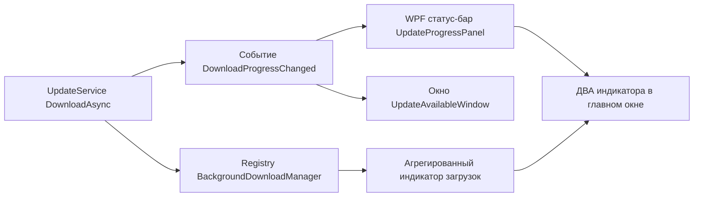
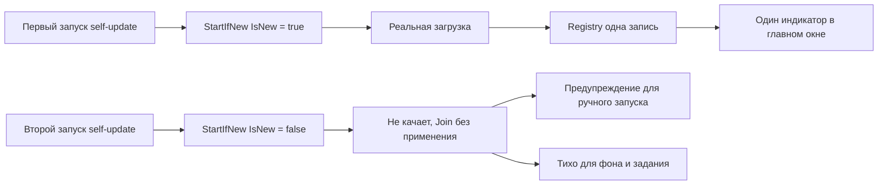

# План исправления 1.0.0.28 — issue #22 «Пересечение процессов»

Версия: **1.0.0.27 → 1.0.0.28** (увеличивается только последнее число).
Issue: **#22 «Пересечение процессов»** — открыт. Issues **НЕ закрывать** (закрытие — только после подтверждения пользователем).

---

## 1. Контекст и статус

Исправление 1.0.0.26 (единый реестр загрузок по `TargetPath` в [`BackgroundDownloadManager`](Workspace1C/Services/BackgroundDownloadManager.cs:34) + [`DownloadConflictGuard`](Workspace1C/Services/DownloadConflictGuard.cs:30) для ручных закачек) **не устранило проблему для self-update**:

- Комментарий 2 (7OH): «Всё ещё накладывается. Обновление по заданию и обновление вручную. По индикаторам видно — 2 штуки».
- Комментарий 3 (7OH): «Если просто запускаешь обновление сам — всё равно 2 индикатора».

При **простом ручном обновлении** (фоновая проверка/кнопка «Проверить обновления» при включённом автообновлении) появляется **два индикатора прогресса одной загрузки**.

---

## 2. Диагноз — корневые причины (два независимых дефекта)

### Дефект 1. Прогресс self-update публикуется в ДВА независимых UI-канала одновременно



**WPF (Windows):**
- Канал А: событие [`DownloadProgressChanged`](Workspace1C/Services/UpdateService.cs:63) → подписка в [`MainWindow.xaml.cs`](Workspace1C/Views/MainWindow.xaml.cs:149) → панель `UpdateProgressPanel`/`UpdateProgressBar` в статус-баре ([`MainWindow.xaml`](Workspace1C/Views/MainWindow.xaml:3209)).
- Канал Б: [`ReportToBackgroundManager`](Workspace1C/Services/UpdateService.cs:656) → реестр → агрегированный индикатор `HasActiveDownloads/DownloadsStatusText/ActiveDownloadsProgress` ([`MainViewModel.Downloads.cs`](Workspace1C/ViewModels/MainViewModel.Downloads.cs:172), разметка [`MainWindow.xaml`](Workspace1C/Views/MainWindow.xaml:3249)).
- С 1.0.0.26 self-update регистрируется в реестре (`app-update:{versionKey}`), поэтому одна загрузка видна в **обоих** местах статус-бара → «2 индикатора» (комментарий 3).

**Avalonia (Linux):**
- Канал А: отдельное окно [`UpdateProgressWindowAvalonia`](Workspace1C/Services/UpdateProgressWindow.Avalonia.cs:21), показываемое в автопути через [`DownloadWithProgressAsync`](Workspace1C/Services/UpdateService.Avalonia.cs:644).
- Канал Б: реестр → тот же агрегированный индикатор главного окна ([`MainWindow.Avalonia.cs`](Workspace1C/Views/MainWindow.Avalonia.cs:2082)).
- Автопуть показывает окно прогресса И индикатор главного окна → «2 индикатора».

### Дефект 2. Реестр дедуплицирует только ЗАПИСЬ, но не саму загрузку (параллельная запись в файл)

[`Start`](Workspace1C/Services/BackgroundDownloadManager.cs:134) возвращает существующую запись при активной загрузке того же `id`/`TargetPath`, но **не сообщает вызывающему, создал ли он новую запись**. Поэтому:

- [`DownloadAsync`](Workspace1C/Services/UpdateService.cs:316) (WPF, строки 330–332) и [`DownloadNewBinaryAsync`](Workspace1C/Services/UpdateService.Avalonia.cs:701) (Avalonia, строки 713–714) **всегда** продолжают реальное скачивание в один и тот же временный файл (`dest`), даже если загрузка уже идёт.
- Пересечение «задание UpdateApp + ручная проверка» (комментарий 2) = два одновременных запуска, оба пишут в `dest`: `ParallelDownloader`/`FileStream(FileShare.None)` конфликтуют, полоса «скачет», файл не докачивается — исходный текст issue.
- Дополнительно: `_downloadEntryId` ([`UpdateService.cs`](Workspace1C/Services/UpdateService.cs:45)) — общее поле на экземпляр; при двух параллельных загрузках поздний старт перетирает id, `finally` в [`DownloadNewExeCoreAsync`](Workspace1C/Services/UpdateService.cs:706) закрывает/ломает отчёты чужой загрузки.

Итого: фикс 1.0.0.26 закрыл «пересечение» для платформы и цепочек обновлений (там стоит `DownloadConflictGuard`), но **self-update не использует гуард**, а `Start` без признака «новая запись» не защищает от повторной реальной загрузки.

---

## 3. Решение

### Часть 1. Один индикатор self-update

Канонический индикатор — агрегированный индикатор загрузок главного окна (реестр `BackgroundDownloadManager`, issue #334). Убираем дублирующие локальные индикаторы из автопути.

#### WPF — [`Workspace1C/Views/MainWindow.xaml`](Workspace1C/Views/MainWindow.xaml:3209)

- Удалить `StackPanel UpdateProgressPanel` (строки 3209–3222 вместе с `UpdateProgressText` и `UpdateProgressBar`).

#### WPF — [`Workspace1C/Views/MainWindow.xaml.cs`](Workspace1C/Views/MainWindow.xaml.cs:147)

- Удалить блок подписки на `DownloadProgressChanged`/`DownloadFinished` (строки 147–156).
- Удалить обработчики `OnUpdateDownloadProgressChanged` (1139–1164) и `OnUpdateDownloadFinished` (1170–1185).
- События `DownloadProgressChanged`/`DownloadFinished` в [`UpdateService.cs`](Workspace1C/Services/UpdateService.cs:63) **сохранить**: их по-прежнему использует окно [`UpdateAvailableWindow`](Workspace1C/Services/UpdateAvailableWindow.xaml.cs:127).

#### Avalonia — [`Workspace1C/Services/UpdateService.Avalonia.cs`](Workspace1C/Services/UpdateService.Avalonia.cs:510)

- В автопути [`DownloadAndInstallAutoAsync`](Workspace1C/Services/UpdateService.Avalonia.cs:546): заменить `DownloadWithProgressAsync(release)` на прямой вызов `DownloadNewBinaryAsync(release.DownloadUrl!, release.TagName, release.AssetSize)` **без** окна прогресса — прогресс виден в агрегированном индикаторе главного окна.
- `DownloadWithProgressAsync` (с окном `UpdateProgressWindowAvalonia`) **оставить только для диалогового пути** (`ShowSelfUpdateDialogAsync`/`ShowPrivilegedUpdateDialogAsync`) — там модальный диалог и окно прогресса — канонический индикатор этого пути (осознанный выбор пользователя, `AutoUpdateEnabled=false`). Служебное окно не участвует в автопути — жалоба «просто запустил обновление → 2 индикатора» закрыта.
- Обновить устаревший комментарий о «двух разных отображениях» (строки 809–811).

### Часть 2. Защита от параллельной записи (single-writer для self-update)

#### [`Workspace1C/Services/BackgroundDownloadManager.cs`](Workspace1C/Services/BackgroundDownloadManager.cs:134)

- Добавить метод **`StartIfNew`**:
  ```csharp
  public (ActiveDownload Entry, bool IsNew) StartIfNew(string id, string title, string? targetPath = null)
  ```
  Семантика — как у `Start` (дедупликация по активному `id` и по нормализованному `TargetPath`), но дополнительно возвращает `IsNew`: `true` — запись создана этим вызовом (можно начинать реальную загрузку), `false` — активная запись уже есть (загрузку не начинать).
- Рефакторинг: общую логику «найти существующую активную или создать новую» вынести в приватный метод, чтобы `Start` и `StartIfNew` не дублировали код. **`Start` не меняет поведение** — существующие тесты [`BackgroundDownloadManagerTests.cs`](Workspace1C.Tests/BackgroundDownloadManagerTests.cs) остаются зелёными.
- `RaiseChanged()` вызывать только при создании новой записи (`IsNew`).

#### WPF — [`Workspace1C/Services/UpdateService.cs`](Workspace1C/Services/UpdateService.cs:316)

- [`DownloadAsync`](Workspace1C/Services/UpdateService.cs:316): заменить `Start` на `StartIfNew` (строки 330–332):
  - `IsNew == true` → продолжать загрузку, `_downloadEntryId = entry.Id` (поле выставляется **только** фактически качающим вызовом — гонка `_downloadEntryId` закрыта).
  - `IsNew == false` → **не** качать и **не** писать в `dest`: вернуть `(null, JoinedExisting: true)`.
  - Сигнатура: `private Task<(string? Path, bool JoinedExisting)> DownloadAsync(...)`.
- [`DownloadNewExeCoreAsync`](Workspace1C/Services/UpdateService.cs:706): пробросить `(string? Path, bool JoinedExisting)`; `finally` (Complete/Fail + сброс `_downloadEntryId`) — только на самом скачивающем вызове.
- [`DownloadAndInstallAutoAsync`](Workspace1C/Services/UpdateService.cs:239): при `JoinedExisting` → **не применять обновление повторно**, вернуть `true` (первый запуск скачает, применит и перезапустит; для фона/задания — тихо).
- [`CheckForUpdatesManualAsync`](Workspace1C/Services/UpdateService.cs:142): перед `DownloadAndInstallAutoAsync` — предпроверка через внутренний хелпер `IsUpdateDownloadInProgress(release)` (вычисляет `dest = Path.Combine(Path.GetTempPath(), UpdateTempDir, TempFileName(release.TagName))` и вызывает `BackgroundDownloadManager.Default.IsFileBeingDownloaded(dest)`); при активной загрузке — инфо-сообщение `Update.AlreadyDownloading` и выход (повторный запуск блокируется предупреждением, как и задумано в 1.0.0.26).

#### [`Workspace1C/Services/UpdateAvailableWindow.xaml.cs`](Workspace1C/Services/UpdateAvailableWindow.xaml.cs:145)

- [`OnDownloadClick`](Workspace1C/Services/UpdateAvailableWindow.xaml.cs:113): при `JoinedExisting` — показать в диалоге сообщение «обновление уже скачивается» и прекратить (не применять).

#### Avalonia — [`Workspace1C/Services/UpdateService.Avalonia.cs`](Workspace1C/Services/UpdateService.Avalonia.cs:701)

- [`DownloadNewBinaryAsync`](Workspace1C/Services/UpdateService.Avalonia.cs:701): `Start` → `StartIfNew`; `IsNew == false` → возврат `(null, true)` без скачивания; сигнатура `(string? Path, bool JoinedExisting)`.
- [`DownloadWithProgressAsync`](Workspace1C/Services/UpdateService.Avalonia.cs:644) и диалоги (`ShowSelfUpdateDialogAsync` строка 318, `ShowPrivilegedUpdateDialogAsync` строка 395): пробросить флаг; при `JoinedExisting` — сообщение в диалоге/тихо.
- [`DownloadAndInstallAutoAsync`](Workspace1C/Services/UpdateService.Avalonia.cs:510): при `JoinedExisting` → `true` без повторного применения; вызывать `DownloadNewBinaryAsync` напрямую (Часть 1).
- [`CheckForUpdatesManualAsync`](Workspace1C/Services/UpdateService.Avalonia.cs:186): предпроверка `IsUpdateDownloadInProgress(release)` (dest = `Path.Combine(EnsureUpdateDirectory(), "Workspace1C.<key>.new")`) → инфо `Update.AlreadyDownloading`.

#### Локализация — [`Workspace1C/Localization/Languages/ru.json`](Workspace1C/Localization/Languages/ru.json:2909), [`en.json`](Workspace1C/Localization/Languages/en.json:2909)

- Добавить ключ `Update.AlreadyDownloading` (ru: «Обновление уже скачивается. После завершения загрузки приложение обновится и перезапустится автоматически.»; en — аналогично), рядом с ключами `Update.*`.



---

## 4. Юнит-тесты

### [`Workspace1C.Tests/BackgroundDownloadManagerTests.cs`](Workspace1C.Tests/BackgroundDownloadManagerTests.cs) — добавить

- `StartIfNew_NewTargetPath_CreatesNewEntry_IsNewTrue` — новый путь → `IsNew == true`, `ActiveCount == 1`.
- `StartIfNew_SameIdWhileActive_ReturnsExisting_IsNewFalse` — повторный старт с тем же `id` → та же запись, `IsNew == false`.
- `StartIfNew_SameTargetPath_DifferentId_ReturnsExisting_IsNewFalse` — «фоновая + ручная» закачка одного файла через разные id → та же запись (кейс issue #22 по `TargetPath`).
- `StartIfNew_AfterCompletion_StartsNew_IsNewTrue` — после `Complete`/`Fail` повторный старт создаёт новую запись.
- `StartIfNew_SelfUpdate_NoDuplicateOperation` — два вызова `StartIfNew("app-update:v1.0.0.28", "Workspace1C.exe", <временный dest>)` → `ActiveCount == 1`, второй возвращает `IsNew == false` и ту же запись. **Прямо кодирует критерий «повторный запуск обновления не создаёт вторую операцию/второй индикатор».**
- Совместимость: все существующие тесты `Start` (включая дедупликацию по id/пути, рестарт после завершения) должны остаться зелёными без изменений.

### [`Workspace1C.Tests/DownloadConflictGuardTests.cs`](Workspace1C.Tests/DownloadConflictGuardTests.cs) — добавить

- `FindActiveDownload_SeesStartIfNewEntry` — запись, созданная через `StartIfNew`, видна гуарду (`FindActiveDownload` находит по нормализованному пути, включая запись `app-update:*`).

### Замечание

Логика «второй запуск не качает» размещается в `BackgroundDownloadManager.StartIfNew` (тестируется напрямую). Сами платформенные `UpdateService` (WPF/Avalonia) не покрываются юнит-тестами (зависимы от HttpClient/диалогов) — их правильность проверяется сборкой и ручным сценарием (критерии ниже).

---

## 5. Версия и документация

### [`Workspace1C/Workspace1C.csproj`](Workspace1C/Workspace1C.csproj:62)

- Строки 62–65: `Version`, `AssemblyVersion`, `FileVersion`, `InformationalVersion`: `1.0.0.27` → `1.0.0.28`.

### [`CHANGELOG.md`](CHANGELOG.md:13)

- Новый раздел `## [1.0.0.28] — 2026-10-20` вверху (перед `## [1.0.0.27]`), стиль — как существующий: «### Исправлено» + пункт про issue #22 (оба дефекта: один индикатор self-update; блокировка повторного запуска обновления/загрузки того же файла; Windows и Linux).

### [`README.md`](README.md:3)

- Строка 3: бейдж `Версия-1.0.0.27` → `Версия-1.0.0.28`.
- Строка 9: «актуальная версия — **1.0.0.27**» → `1.0.0.28`.
- Раздел истории исправлений (пункты формата `(1.0.0.x, issue #N, Windows и Linux)`, ~строки 240–330): добавить пункт `(1.0.0.28, issue #22, Windows и Linux)` — единый индикатор self-update и блокировка повторного запуска загрузки того же файла.

### Новый файл [`rel_notes_1.0.0.28.md`](rel_notes_1.0.0.27.md) (в корне)

- По образцу [`rel_notes_1.0.0.27.md`](rel_notes_1.0.0.27.md): заголовок «# Workspace 1C 1.0.0.28», дата, «Доступен для Windows (WPF) и Linux (Avalonia)», раздел «Исправлено» (пункт про issue #22), ссылка на релиз `https://github.com/sivatorov/Workspace1C/releases/tag/v1.0.0.28`, примечание «issue #22 остаётся открытым до подтверждения пользователем (автозакрытие issues отключено)», ссылка на CHANGELOG.

---

## 6. Порядок выполнения

1. [`BackgroundDownloadManager.cs`](Workspace1C/Services/BackgroundDownloadManager.cs:34): метод `StartIfNew` + рефакторинг `Start`; тесты `BackgroundDownloadManagerTests`/`DownloadConflictGuardTests` (сначала «красные», затем зелёные).
2. WPF [`UpdateService.cs`](Workspace1C/Services/UpdateService.cs:23): `StartIfNew`, флаг `JoinedExisting`, предпроверка в `CheckForUpdatesManualAsync`, правки `DownloadAndInstallAutoAsync`.
3. WPF UI: удаление `UpdateProgressPanel` из [`MainWindow.xaml`](Workspace1C/Views/MainWindow.xaml:3209) и подписки/обработчиков из [`MainWindow.xaml.cs`](Workspace1C/Views/MainWindow.xaml.cs:147); обработка `JoinedExisting` в [`UpdateAvailableWindow.xaml.cs`](Workspace1C/Services/UpdateAvailableWindow.xaml.cs:145).
4. Avalonia [`UpdateService.Avalonia.cs`](Workspace1C/Services/UpdateService.Avalonia.cs:510): зеркально п.2; автопуть — без окна `UpdateProgressWindowAvalonia`.
5. Локализация: ключ `Update.AlreadyDownloading` в `ru.json`/`en.json`.
6. Прогон юнит-тестов (`dotnet test Workspace1C.Tests`), сборка WPF (`build-windows-single-file.ps1`) и Avalonia (`build-linux-single-file.ps1`), ручная проверка сценариев.
7. Версия 1.0.0.28: `csproj`, `CHANGELOG.md`, `README.md`, `rel_notes_1.0.0.28.md`.
8. **GitHub (отдельная задача, НЕ входит в реализацию):** комментарий к issue #22 «Исправлено в версии 1.0.0.28 …», push, релиз `v1.0.0.28`. Issue не закрывать.

---

## 7. Критерии готовности

- **Windows:** ручная проверка обновлений при включённом автообновлении → в статус-баре **ровно один** индикатор (агрегированный, текстовый + полоса); панели `UpdateProgressPanel` в коде/разметке нет.
- **Windows:** запуск «задание UpdateApp + ручная проверка» одновременно → в реестре одна запись, реальное скачивание одно (нет параллельной записи в `dest`), файл докачивается до конца без ошибок; ручной запуск получает предупреждение «обновление уже скачивается», фоновый/задачный — тихий пропуск.
- **Linux:** автопуть self-update не показывает окно `UpdateProgressWindowAvalonia` (только индикатор главного окна); диалоговый путь (`AutoUpdateEnabled=false`) сохраняет окно прогресса.
- Повторная загрузка после `Complete`/`Fail` (повторное обновление до той же/новой версии) работает: новая запись, новая загрузка.
- Юнит-тесты проходят, включая новые (`StartIfNew_*`, `FindActiveDownload_SeesStartIfNewEntry`); регистра «Start» существующие тесты не изменились.
- Версия `1.0.0.28` проставлена в `csproj`, `CHANGELOG.md`, `README.md`, `rel_notes_1.0.0.28.md`.
- Сборки Windows и Linux проходят; релиз и комментарий к issue #22 — отдельной задачей.