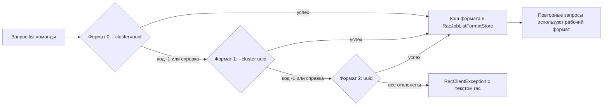

# План исправления 1.0.0.30 — issues #25 «Ошибка импорта списка баз из кластера», #26 «Акцентные цвета и контраст HEX-полей», #27 «Связь импорта с серверами»

Версия: **1.0.0.29 → 1.0.0.30** (увеличивается только последнее число).
Issues: **#25, #26, #27** — все открыты, комментариев нет, НЕ закрываем (закрытие — только после подтверждения пользователем по итогам релиза).

**Вывод по feasibility:** все три исправления независимы по зонам кода (парсер rac / логика тем / окно «Серверы 1С» + окно импорта), пересекаются минимально:
- #25 и #27 обе затрагивают [`ClusterImportViewModel`](Workspace1C/ViewModels/ClusterImportViewModel.cs) (окно импорта), но правят разные слои: #25 — [`RacClient`](Workspace1C/Services/RacClient.cs)/[`RacOutputParser`](Workspace1C/Services/RacOutputParser.cs) (источник данных), #27 — источник выбора сервера и окна. Изменения аддитивны.
- #26 — полностью отдельная область (настройки тем).
Поэтому **все три правки выполняются последовательно в одной версии 1.0.0.30**: одна сборка (Windows + Linux), один релиз, три комментария к issues после релиза.

---

## 1. Issue #25 «Ошибка импорта списка баз из кластера серверов»

### 1.1. Контекст и наблюдение

Воспроизведение (из тела issue): «Утилиты → Операции → Импорт из кластера 1С…» → указывается пользователь и пароль (адрес/порт не трогаются — по умолчанию `localhost:1540`) → «Подключиться» → ошибка. Среда: Windows 2025 Server, платформа 1С **8.5.1**. Первый rac-вызов окна импорта — `cluster list` ([`ClusterImportViewModel.ConnectAsync`](Workspace1C/ViewModels/ClusterImportViewModel.cs:219) → [`RacClient.GetClustersAsync`](Workspace1C/Services/RacClient.cs:81)). Ошибка возникает на нём либо на последующей загрузке баз (`infobase summary list`).

В проекте уже есть прецедент совместимости с rac 8.5.x — issue #324 (rac 8.5.4.1878):
- переименование ключей в блочном формате (`fullName`/`displayName` вместо `name`, `conn-id`, `infobase-id`, `job-id` — [`RacOutputParser.cs`](Workspace1C/Services/RacOutputParser.cs:275));
- отклонение аргумента `--cluster=<uuid>` командой `job list` (код -1) — решено перебором форматов [`JobListArgs`](Workspace1C/Services/RacClient.cs:406) с персистентным кэшем [`RacJobListFormatStore`](Workspace1C/Services/RacJobListFormatStore.cs);
- декодирование вывода UTF-8/cp866/cp1251 ([`RacClient.DecodeRacOutput`](Workspace1C/Services/RacClient.cs:1001)).

Платформа 8.5.1 (ниже 8.5.4) — **новая ветка для проекта**: ни один формат/команда под неё ещё не проверялись.

### 1.2. Гипотезы (по убыванию вероятности)

1. **rac 8.5.x отклоняет `--cluster=<uuid>` не только в `job list`, но и в `infobase summary list` (а возможно, и в `cluster list`)** → `RacClientException` «rac завершился с кодом -1…» (текст ошибки разбора параметра). Для `job list` это уже обрабатывается перебором форматов, для остальных list-команд — нет ([`GetInfobasesAsync`](Workspace1C/Services/RacClient.cs:243) использует фиксированный `--cluster={clusterId}`).
2. **rac 8.5.1 изменил формат вывода** `cluster list` / `infobase summary list` (новые имена ключей/стартeров блока, как в 8.5.4.1878, либо ещё один вариант) → `RacOutputParseException` «Вывод rac не распознан: exit=0, 0 строк» ([`RacClient.EnsureParsedOrThrow`](Workspace1C/Services/RacClient.cs:619)).
3. Проблема кодировки вывода на Windows 2025 Server (иная системная OEM/ANSI-кодовая страница, чем cp866/cp1251) → нераспознанный текст.

Точная причина определяется по тексту ошибки со скриншота issue #25 (вложение загружается по ссылке из тела issue) и по журналу приложения (`RAC:`-строки). Пункт 1.4.1 — обязательная диагностика до правок.

### 1.3. Решение

#### 1.3.1. Диагностика (первый шаг реализации)

- Извлечь текст ошибки со скриншота issue #25 и сопоставить с обработчиком [`ClusterImportViewModel.ConnectAsync`](Workspace1C/ViewModels/ClusterImportViewModel.cs:244) (`RacClientException` vs `RacOutputParseException`).
- Запросить у автора issue #25: (а) текст сообщения из окна импорта, (б) фрагмент журнала со строками `RAC:` (команда, код выхода, начало вывода), (в) вывод из терминала `rac localhost:1540 cluster list` и `rac localhost:1540 infobase summary list --cluster=<uuid> --help` (или `<uuid>` без флагов) на этой платформе — это однозначно определяет формат аргументов и вывода 8.5.1.
- Результат зафиксировать в issue #25 комментарием/или в коде тестами-образцами вывода.

#### 1.3.2. RacClient: обобщённый перебор форматов `--cluster` для list-команд

- В [`RacClient.cs`](Workspace1C/Services/RacClient.cs) вынести перебор `JobListArgs(index, clusterId)` в общий helper (например `ClusterArgs(index, clusterId)`), а для `infobase summary list` — попытку по форматам 0 (`--cluster=<uuid>`), 1 (`--cluster <uuid>`), 2 (`<uuid>`) с запоминанием рабочего формата по ключу подключения (расширить [`RacJobListFormatStore.cs`](Workspace1C/Services/RacJobListFormatStore.cs): ключ формата дополнить именем команды, чтобы кэш для `job list` и `infobase summary list` не конфликтовал).
- Первый успешный формат запоминается на диск (как для `job list`) — повторные подключения не тратят раc-запуски на заведомо падающие попытки (каждый запуск rac ~1.1 с на Windows).
- По необходимости (если диагностика покажет, что и `cluster list` падает с -1) — применить перебор и в `GetClustersAsync`, и в остальных list-командах (`process/session/connection/lock list`) единообразно.
- Поведение по умолчанию не меняется: формат 0 остаётся первым, для rac 8.3/8.4 всё работает как раньше.

#### 1.3.3. RacOutputParser: расширить распознавание форматов 8.5.x

- [`ToClusters`](Workspace1C/Services/RacOutputParser.cs:210): алиасы стартeра блока `cluster`/`cluster-id` (по аналогии с `infobase`/`infobase-id`); расширить список алиасов имени (`name`/`fullName`/`displayName`/`descr`/`description` + возможный `display-name`); значения без кавычек уже обрабатываются `Unquote`.
- [`ToInfobaseSummaries`](Workspace1C/Services/RacOutputParser.cs:789): стартeры `infobase`/`infobase-id` дополнить возможным `infobase-summary-id`; поля — алиасы `db-server`/`dbServer`, `db-name`/`dbName`, `security-level`/`securityLevel`.
- Улучшить сообщение [`RacOutputParseException`](Workspace1C/Services/RacOutputParseException.cs): включить первые ~200 символов вывода rac (без пароля — маскировка через [`SensitiveDataMasker`](Workspace1C/Services/SensitiveDataMasker.cs)), чтобы при следующем новом формате причина была видна сразу в issue-сообщении.

#### 1.3.4. Декодирование (по результатам журнала)

- Если логи покажут «кракозябры» при уже корректных аргументах — расширить fallback-кодировки в [`RacClient.DecodeRacOutput`](Workspace1C/Services/RacClient.cs:1001) (например, cp850/Windows-1252) с выбором варианта с наименьшим числом nonchar-замен. Шаг выполняется только при подтверждённой кодировочной симптоматике, чтобы не плодить ложные декодирования.

### 1.4. Затронутые файлы

| Файл | Изменение |
|---|---|
| [`Workspace1C/Services/RacClient.cs`](Workspace1C/Services/RacClient.cs) | Helper `ClusterArgs` + перебор форматов для `infobase summary list` (и при необходимости остальных list-команд); использование кэша формата с ключом команды |
| [`Workspace1C/Services/RacJobListFormatStore.cs`](Workspace1C/Services/RacJobListFormatStore.cs) | Ключ кэша с именем команды (job list / infobase summary list) |
| [`Workspace1C/Services/RacOutputParser.cs`](Workspace1C/Services/RacOutputParser.cs) | Новые алиасы стартeров/ключей для `cluster list` и `infobase summary list` (формат 8.5.x) |
| [`Workspace1C/Services/RacOutputParseException.cs`](Workspace1C/Services/RacOutputParseException.cs) | Префикс вывода rac в тексте ошибки (маскированный) |
| [`Workspace1C.Tests/IbasesV8iImporterTests.cs`](Workspace1C.Tests/IbasesV8iImporterTests.cs) → нет | См. тесты ниже (отдельные файлы) |

### 1.5. Тесты

- [`Workspace1C.Tests/RacOutputParserTests.cs`](Workspace1C.Tests/RacOutputParserTests.cs): образцы вывода 8.5.x — блоки `cluster list` со стартером `cluster-id` и `infobase summary list` со стартером `infobase-summary-id`/`infobase-id`, алиасы полей (`dbServer`, `displayName`); регресс существующих форматов (8.3-таблица, 8.5.4-блоки).
- [`RacClient`-тесты форматов] (искать существующий файл, напр. `RacClientTests` / тесты `JobListArgs`): перебор форматов `infobase summary list` — первый успех кэшируется, повторные запросы не запускают rac повторно; оба падающих формата дают понятную ошибку.
- [`ClusterImportViewModelTests.cs`](Workspace1C.Tests/ClusterImportViewModelTests.cs): при фейковом клиенте, «отклоняющем» `--cluster=<uuid>`, подключение и загрузка баз всё равно проходят (пробуются форматы 1–2) — регрессионный сценарий issue #25 без установленной платформы.

### 1.6. Риски

- **Главный:** точная причина зависит от вывода/журнала среды 8.5.1, которую нельзя воспроизвести в репозитории. Если после диагностики окажется иной симптом (например, ошибка сети/аутентификации RAS на Windows Server 2025), парсерные правки не закроют issue — потребуется уточняющий цикл с автором до релиза.
- Перебор форматов на первом подключении к новому серверу добавляет до 2 запусков rac (~2,2 с) — компенсируется персистентным кэшем формата.
- Правки парсера не должны задеть рабочие форматы 8.3/8.4 — регресс покрыт тестами.

### 1.7. CHANGELOG / README (черновик формулировок — в итоговый текст п. 8)

CHANGELOG `## [1.0.0.30]` → «Исправлено»: **«Импорт из кластера 1С» на платформе 8.5.1 (Windows Server 2025): подключение к кластеру и загрузка списка баз (issue #25, Windows и Linux)** — перебор форм передачи идентификатора кластера в командах rac (как для «job list» в 1.0.0.25–1.0.0.27) и распознавание новых имён ключей/стартeров формата 8.5.x; ошибки парсинга rac теперь содержат префикс вывода — быстрее диагностируются новые форматы. README — пункт истории исправлений `(1.0.0.30, issue #25, Windows и Linux)`.

---

## 2. Issue #26 «Исправить отображение сохраненных акцентных цветов и контрастность HEX-полей в тёмной теме»

### 2.1. Контекст и наблюдение

«Цветовое оформление»: изменение «Акцентный цвет» (`AccentColor`) и «Акцент (наведение)» (`AccentHoverColor`) применяется (по словам автора — «с задержкой»), но при повторном входе в настройки поля показывают дефолтные `#FDBF00` и `#E0A800` (это дефолты **светлой** палитры [`ColorScheme.DefaultLightPalette`](Workspace1C/Models/ColorScheme.cs:334)). Второй пункт: текст HEX-формата чёрный и «практически сливается» с формой в тёмной теме.

Места кода:
- [`SettingsViewModel.cs`](Workspace1C/ViewModels/SettingsViewModel.cs:49) — `CurrentColorScheme = _viewModel.ActiveColorScheme.Clone()` при создании; [`SetColor`](Workspace1C/ViewModels/SettingsViewModel.cs:228) пишет в палитру по `EditingDarkPalette`; [`PersistEditedSchemes`](Workspace1C/ViewModels/SettingsViewModel.cs:185) вызывается только из «ОК» ([`SettingsWindow.xaml.cs:657`](Workspace1C/Views/SettingsWindow.xaml.cs:657)); [`LoadEditableScheme`](Workspace1C/ViewModels/SettingsViewModel.cs:130) для встроенных имён возвращает схему из [`AvailableColorSchemes`](Workspace1C/ViewModels/SettingsViewModel.cs:66) — там встроенные темы без правок пользователя.
- [`MainViewModel.Theme.cs`](Workspace1C/ViewModels/MainViewModel.Theme.cs:54) — `ApplyFullTheme` перезаписывает `_activeColorScheme` схемой полноценной темы (`theme.Scheme.Clone()`), что может затирать активную (сохранённую/отредактированную) схему; [`ApplyActiveColorSchemeToUi`](Workspace1C/ViewModels/MainViewModel.Theme.cs:266) и порядок «ApplyFullTheme → ApplyScheme(сохранённая схема)» при старте критичны.
- [`ThemeManager.ApplyScheme`](Workspace1C/Themes/ThemeManager.cs:62) — наложение палитры на ресурсы; `CurrentFullTheme.Scheme = scheme` (строка 74) — синхронизация схемы и полноценной темы.
- [`ThemeFeatureMap.cs`](Workspace1C/Themes/ThemeFeatureMap.cs:329) — акцент полноценной темы `theme.AccentColor` с дефолтом `#FDBF00`: если схема меняет акцент, а `ThemeDefinition.AccentColor` не синхронизирован, часть применённых «фич» может отставать (симптом «задержки»).
- HEX-поля: [`SettingsWindow.xaml:1135`](Workspace1C/Views/SettingsWindow.xaml:1135) (HEX-текст редактора цветов), [`ColorPickerControl.xaml:122`](Workspace1C/Controls/ColorPickerControl.xaml:122) (`HexBox` — TextBox палитры), Avalonia-аналоги [`SettingsWindow.Avalonia.Schemes.cs`](Workspace1C/Views/SettingsWindow.Avalonia.Schemes.cs:78).

### 2.2. Диагноз (порядок проверки при реализации)

Требуется воспроизведение с двумя сценариями (разделяет две возможные корневые причины):

- **Сценарий А — повторный вход без перезапуска приложения.** Изменён цвет → «ОК» → снова «Настройки → Цветовое оформление». Если поля сброшены в `#FDBF00`/`#E0A800` — при открытии окна `CurrentColorScheme` теряет правки: кандидат — [`SettingsViewModel`](Workspace1C/ViewModels/SettingsViewModel.cs:49) клонирует `ActiveColorScheme`, но затем (или при выборе схемы в комбобоксе) [`LoadEditableScheme`](Workspace1C/ViewModels/SettingsViewModel.cs:130)/[`AvailableColorSchemes`](Workspace1C/ViewModels/SettingsViewModel.cs:66) возвращает встроенную схему **без пользовательских правок** (для встроенных имён правки живут в `AppSettings.ActiveColorScheme`/слоте, а не в `ThemeManager.EnumerateAllSchemes`).
- **Сценарий Б — после перезапуска приложения.** Если поля сброшены только после restart — кандидат: порядок инициализации при старте — `ApplyFullTheme(_fullTheme)` перезаписывает `_activeColorScheme` дефолтной схемой темы ([`MainViewModel.Theme.cs:54-70`](Workspace1C/ViewModels/MainViewModel.Theme.cs:54)) после того, как была прочитана сохранённая схема ([`MainViewModel.cs:349`](Workspace1C/ViewModels/MainViewModel.cs:349)).
- Дополнительно проверить: редактируемая палитра (`EditingDarkPalette`) показывается по текущему варианту темы ([`SettingsWindow.Schemes.cs:43`](Workspace1C/Views/SettingsWindow.Schemes.cs:43)) — автор жалоб работает в тёмной теме, а дефолтные значения `#FDBF00/#E0A800` соответствуют СВЕТЛОЙ палитре; убедиться, что правки применялись к той же палитре, которая показывается (переключатель палитры).

### 2.3. Решение

1. **Единый источник правок для встроенных тем:** `LoadEditableScheme(name)` для встроенных имён («Светлая»/«Тёмная» и полноценных встроенных) должен возвращать **сохранённые правки** (слот/`ActiveColorScheme`), а не «чистую» встроенную схему. Точка исправления — [`SettingsViewModel.LoadEditableScheme`](Workspace1C/ViewModels/SettingsViewModel.cs:130) + согласование с [`MainViewModel.AvailableColorSchemes`](Workspace1C/ViewModels/MainViewModel.Theme.cs:272)/`ThemeManager.EnumerateAllSchemes`.
2. **Порядок применения при старте:** гарантировать, что сохранённая активная схема применяется **после** `ApplyFullTheme` (или `ApplyFullTheme` использует схему из слота). Точки: инициализация темы в [`MainViewModel.cs`](Workspace1C/ViewModels/MainViewModel.cs:349) и [`MainViewModel.Theme.cs:54`](Workspace1C/ViewModels/MainViewModel.Theme.cs:54). Результат: применённый акцент/наведение в UI и редактор при повторном входе совпадают.
3. **Синхронизация акцента полноценной темы:** `ThemeFeatureMap` берёт акцент из `theme.AccentColor` ([`ThemeFeatureMap.cs:330`](Workspace1C/Themes/ThemeFeatureMap.cs:330)); при применении схемы синхронизировать `CurrentFullTheme.Scheme`/акцент (в `ThemeManager.ApplyScheme` это частично есть — строка 74). Симптом «изменение применяется с задержкой» — из-за пересборки дерева/перерисовки; оставить (не критично), но убедиться, что сохранение происходит при «ОК» единократно и в одном месте.
4. **Контрастность HEX-текста:**
   - [`ColorPickerControl.xaml:122`](Workspace1C/Controls/ColorPickerControl.xaml:122) (`HexBox`): явный `Foreground` из ресурсов темы (например `TextPrimaryBrush`/`TextOnAccentBrush` по темноте) вместо наследования «чёрного из стиля» в тёмной теме; проверить стиль `ModernTextBox` в тёмной теме на жёсткий чёрный.
   - [`SettingsWindow.xaml:1135`](Workspace1C/Views/SettingsWindow.xaml:1135): HEX-текст редактора — контрастная кисть по активной палитре (белый/светлый в тёмной, тёмный в светлой); утилита выбора контрастного цвета по luminance (одна для обеих платформ, без UI-зависимостей, тестируемая).
   - Avalonia: аналогично в [`SettingsWindow.Avalonia.Schemes.cs`](Workspace1C/Views/SettingsWindow.Avalonia.Schemes.cs:78) и `ColorPickerControl.Avalonia.cs`.
5. **Сохранение при «ОК»:** оставить единственную точку `PersistEditedSchemes()` + `ApplyColorScheme()` в [`SettingsWindow.xaml.cs:657-659`](Workspace1C/Views/SettingsWindow.xaml.cs:657); если диагностика покажет потерю правок при закрытии через ✕/Esc — НЕ сохранять молча, а лишь убедиться, что «Применить» (превью) не выдаётся за сохранение (поведение не менять). Заслон-тест — из п. 2.4.

### 2.4. Затронутые файлы

| Файл | Изменение |
|---|---|
| [`Workspace1C/ViewModels/SettingsViewModel.cs`](Workspace1C/ViewModels/SettingsViewModel.cs) | `LoadEditableScheme`: правки встроенных тем из слота/`ActiveColorScheme` |
| [`Workspace1C/ViewModels/MainViewModel.Theme.cs`](Workspace1C/ViewModels/MainViewModel.Theme.cs) | Порядок применения схемы при старте/при `ApplyFullTheme`; схема не перетирается дефолтом |
| [`Workspace1C/Themes/ThemeManager.cs`](Workspace1C/Themes/ThemeManager.cs) | Синхронизация акцента полноценной темы при `ApplyScheme` (при необходимости) |
| [`Workspace1C/Models/ColorScheme.cs`](Workspace1C/Models/ColorScheme.cs) | (при необходимости) хелпер контрастного цвета текста по фону — чистый, без UI |
| [`Workspace1C/Views/SettingsWindow.xaml`](Workspace1C/Views/SettingsWindow.xaml) | Контрастная кисть HEX-текста редактора (строка 1135–1136) |
| [`Workspace1C/Controls/ColorPickerControl.xaml`](Workspace1C/Controls/ColorPickerControl.xaml) | `HexBox`: Foreground по теме (строка 122) |
| [`Workspace1C/Views/SettingsWindow.Avalonia.Schemes.cs`](Workspace1C/Views/SettingsWindow.Avalonia.Schemes.cs) | Avalonia-аналог контраста HEX |
| [`Workspace1C/Controls/ColorPickerControl.Avalonia.cs`](Workspace1C/Controls/ColorPickerControl.Avalonia.cs) | Avalonia-аналог `HexBox` |

### 2.5. Тесты

- [`Workspace1C.Tests/AppSettingsThemeMigrationTests.cs`](Workspace1C.Tests/AppSettingsThemeMigrationTests.cs): сохранение встроенной схемы через слот и повторное чтение возвращает отредактированные `AccentColor`/`AccentHoverColor` (не дефолты).
- [`Workspace1C.Tests/FullThemeSelectionTests.cs`](Workspace1C.Tests/FullThemeSelectionTests.cs): после `ApplyFullTheme` + `ApplyColorScheme(отредактированная схема)` активная схема сохраняет правки акцентов (не перетирается дефолтом темы).
- [`Workspace1C.Tests/CustomSchemeNameConflictTests.cs`](Workspace1C.Tests/CustomSchemeNameConflictTests.cs): без регрессий (логика правок тем пользовательских схем не менялась).
- [`Workspace1C.Tests/ColorSchemeThemeTests.cs`](Workspace1C.Tests/ColorSchemeThemeTests.cs): без регрессий (`#FDBF00`/#`E0A800` остаются дефолтами, но редактор обязан показывать сохранённые значения).
- Новый тест контраста: для тёмной палитры цвет текста HEX ≠ чёрный и контраст ≥ порога (напр. WCAG 4.5:1) — хелпер контрастного цвета.

### 2.6. Риски

- Логика тем связана (слоты, полноценные темы, превью issue #378): менять минимально и адресно; существующие темы-тесты обязаны остаться зелёными.
- Некорректный контраст в светлой теме (сделать хорошо в обеих) — проверка в обоих режимах.
- Сценарий Б (перезапуск) может потребовать правки порядка инициализации в обоих приложениях (WPF и Avalonia пути) — искать общий момент ([`MainViewModel.cs:349`](Workspace1C/ViewModels/MainViewModel.cs:349) и [`MainViewModel.Avalonia.cs:721`](Workspace1C/ViewModels/MainViewModel.Avalonia.cs:721)).

### 2.7. CHANGELOG / README (черновик)

CHANGELOG: **«Цветовое оформление»: сохранённые акцентные цвета и их оттенки корректно отображаются при повторном входе в настройки; HEX-значения цветов контрастны в тёмной теме (issue #26, Windows и Linux)** — редактор и палитра показывают сохранённые правки встроенных тем; цвет текста HEX выбирается по контрасту с фоном. README — пункт `(1.0.0.30, issue #26, Windows и Linux)`.

---

## 3. Issue #27 «Связь импорта с серверами»

### 3.1. Контекст и требование (из тела issue)

В окне «Серверы 1С»:
1. Сделать немного шире колонку «Базы» — последняя кнопка не влезает (кнопки стали шире после 1.0.0.25: `MinWidth=40` у `IconOnlyButton`/`BuildIconButton`).
2. Под списком баз добавить кнопку «Импорт» (по аналогии с кнопкой «Службы» под списком серверов).
3. По кнопке открывать существующее окно «Импорт из кластера 1С».
4. В окне импорта заменить 4 поля (адрес/порт/логин/пароль) на один список выбора из справочника «Сервера 1С».
5. При открытии из окна «Серверы 1С» подставлять сервер, выбранный на момент нажатия кнопки, и **сразу подключаться**.

### 3.2. Текущее устройство

- Окно «Серверы 1С» (WPF [`ServerMonitorWindow.xaml`](Workspace1C/Views/ServerMonitorWindow.xaml:165)): Grid-колонки `280 / 230 / *`; колонка «Базы» — 230 px ([`ServerMonitorWindow.xaml:168`](Workspace1C/Views/ServerMonitorWindow.xaml:168)), список баз — [`DockPanel`](Workspace1C/Views/ServerMonitorWindow.xaml:295) с кнопками над списком и подсказкой; кнопка «СЛУЖБЫ» под списком серверов — [`DockPanel.Dock="Bottom"`](Workspace1C/Views/ServerMonitorWindow.xaml:237). Avalonia: колонки [`280/230/*`](Workspace1C/Views/ServerMonitorWindow.Avalonia.cs:382) — те же значения.
- Окно импорта: WPF — поля в [`ClusterImportWindow.xaml:50-72`](Workspace1C/Views/ClusterImportWindow.xaml:50) (`AddressBox`-подобные TextBox/`PasswordBox`); Avalonia — разметка [`ClusterImportWindow.axaml`](Workspace1C/Views/ClusterImportWindow.Avalonia.cs:76) (`AddressBox`/`PortBox`/`UserBox`/`PasswordBox`), префилл из настроек — [`LoadSavedConnectionSettings`](Workspace1C/Views/ClusterImportWindow.Avalonia.cs:74).
- VM импорта [`ClusterImportViewModel.cs`](Workspace1C/ViewModels/ClusterImportViewModel.cs:21): `ServerAddress/ServerPort/UserName/Password`, `BuildParams` ([`ClusterImportViewModel.cs:372`](Workspace1C/ViewModels/ClusterImportViewModel.cs:372)).
- Справочник серверов: [`ManagementServer`](Workspace1C/Models/ManagementServer.cs:10) (`Address/Port/User/Password/Description`, пароль хранится открыто в `server_list.json`), [`IServerListStore`](Workspace1C/Services/ServerListStore.cs:14) (`Load()`/`Save()`).
- Открытие импорта: WPF [`MainViewModel.Tools.cs:2822`](Workspace1C/ViewModels/MainViewModel.Tools.cs:2822), Avalonia [`MainViewModel.Avalonia.Tools.cs:1773`](Workspace1C/ViewModels/MainViewModel.Avalonia.Tools.cs:1773) — команда `ImportClusterInfobasesCommand`, без параметров; добавление баз/групп — внутри этих методов.

### 3.3. Решение

#### Шаг 3.3.1. Окно «Серверы 1С» (обе платформы)

- Ширина колонки «Базы»: `230` → минимум, вмещающий 5 кнопок (`40×5 + 4×spacing + 2×разделитель` ≈ 250) → **260 px** (WPF [`ServerMonitorWindow.xaml:168`](Workspace1C/Views/ServerMonitorWindow.xaml:168), Avalonia [`ServerMonitorWindow.Avalonia.cs:385`](Workspace1C/Views/ServerMonitorWindow.Avalonia.cs:385)). Проверить визуально фактическую ширину кнопок (глифы ＋/✎/А↓/Я↓/🗑) в обеих темах.
- Кнопка «Импорт» под списком баз: `DockPanel.Dock="Bottom"` по образцу «СЛУЖБЫ» (WPF [`ServerMonitorWindow.xaml:237`](Workspace1C/Views/ServerMonitorWindow.xaml:237), Avalonia [`ServerMonitorWindow.Avalonia.cs:199`](Workspace1C/Views/ServerMonitorWindow.Avalonia.cs:199)); текст — новый ключ локализации `ServerMonitor.Infobase.Import`; обработчик `OnImport_Click`.
- Текущий сервер для импорта: `_vm.SelectedServer ?? _vm.ConnectedServer ?? Servers.FirstOrDefault()`; если серверов нет — подсказка (локализация) и выход.

#### Шаг 3.3.2. Интеграция открытия импорта из окна серверов

- Открытие окна импорта с подстановкой сервера и автоподключением должен выполнять [`MainViewModel`](Workspace1C/ViewModels/MainViewModel.Tools.cs) (там уже живёт логика применения результата импорта). Способ: в местах создания `ServerMonitorWindow` (`OpenServerMonitor` в [`MainViewModel.Tools.cs:2700+`](Workspace1C/ViewModels/MainViewModel.Tools.cs) и Avalonia-аналоге) передать окну делегат `Action<ManagementServer?> openClusterImport` → внутри — новый метод `ExecuteImportClusterInfobases(server, autoConnect: true)`.
- Рефакторинг [`ExecuteImportClusterInfobases`](Workspace1C/ViewModels/MainViewModel.Tools.cs:2822) и Avalonia-версии: параметризовать `(ManagementServer? initialServer = null, bool autoConnect = false)`; команда меню «Утилиты → Операции → Импорт из кластера 1С…» вызывает без параметров (окно импорта по умолчанию не подключается; можно предвыбрать первый сервер справочника, без авто-подключения).
- Логику «добавить базы/группы, сохранить, пересобрать дерево» вынести в общий приватный метод `ApplyClusterImportResult(IReadOnlyList<Infobase> selected)` — вызывается из обоих путей (WPF и Avalonia), код не дублируется.

#### Шаг 3.3.3. VM импорта: выбор сервера из справочника

- [`ClusterImportViewModel`](Workspace1C/ViewModels/ClusterImportViewModel.cs:21): новые опциональные параметры/свойства:
  - `AvailableServers` (`IReadOnlyList<ManagementServer>`, заполняется окном через новый опциональный параметр конструктора или сеттер — без поломки существующих тестов);
  - `SelectedServerId`/`SelectedServer` (`ManagementServer?`) — при выборе заполняет `ServerAddress/ServerPort/UserName/Password` (пароль — только в памяти VM/окна, на диск не пишется — политика не меняется);
  - метод `InitializeFromServer(ManagementServer server, bool autoConnect)` — префилл параметров и (при `autoConnect`) запуск `ConnectAsync()` (вызывается окном после `Loaded`, в UI-потоке, с защитой флага `IsBusy`).
- `BuildParams` ([`ClusterImportViewModel.cs:372`](Workspace1C/ViewModels/ClusterImportViewModel.cs:372)) — без изменений: берёт значения из свойств, которые теперь заполняются из выбранного сервера.

#### Шаг 3.3.4. Окно импорта: одна строка выбора сервера

- WPF [`ClusterImportWindow.xaml:50-72`](Workspace1C/Views/ClusterImportWindow.xaml:50): панель «Адрес/Порт/Логин/Пароль» + кнопка заменяется на `ComboBox` «Сервер 1С:» (ItemsSource = `AvailableServers`, DisplayMember = `Description`/`ToString()`, SelectedItem ↔ `SelectedServer`) + кнопка «Подключиться» (без изменений).
- [`ClusterImportWindow.xaml.cs`](Workspace1C/Views/ClusterImportWindow.xaml.cs): убрать чтение `PasswordBox` (пароль приходит из записи сервера); префилл из настроек RAS оставить только как резервный источник, если серверов в справочнике нет (первый запуск), либо убрать вовсе — по решению на этапе реализации (рекомендуется: если справочник пуст — показать локализованную подсказку «Нет серверов в справочнике. Добавьте сервер в окне „Серверы 1С“» и отключить «Подключиться»).
- Avalonia [`ClusterImportWindow.Avalonia.cs:76`](Workspace1C/Views/ClusterImportWindow.Avalonia.cs:76) и разметка `ClusterImportWindow.axaml`: аналогично — убрать 4 поля, добавить `ComboBox` серверов; пароль из `ManagementServer`.
- Локализация: `ru.json`/`en.json` — ключи `ClusterImport.Server` («Сервер 1С:»), `ClusterImport.ServersEmpty` («Нет серверов в справочнике…», при пустом списке), `ServerMonitor.Infobase.Import` («Импорт»).

### 3.4. Затронутые файлы

| Файл | Изменение |
|---|---|
| [`Workspace1C/ViewModels/ClusterImportViewModel.cs`](Workspace1C/ViewModels/ClusterImportViewModel.cs) | `AvailableServers`, `SelectedServer`/`SelectedServerId`, `InitializeFromServer(server, autoConnect)`; конструктор расширяется без поломки тестов |
| [`Workspace1C/ViewModels/ClusterImportRow.cs`](Workspace1C/ViewModels/ClusterImportRow.cs) | Без изменений (чистая модель) |
| [`Workspace1C/Views/ClusterImportWindow.xaml`](Workspace1C/Views/ClusterImportWindow.xaml) | Панель полей → ComboBox серверов + кнопка «Подключиться» |
| [`Workspace1C/Views/ClusterImportWindow.xaml.cs`](Workspace1C/Views/ClusterImportWindow.xaml.cs) | Источник серверов (IServerListStore), префилл из выбранного сервера, автоподключение после `Loaded`, убрать PasswordBox |
| [`Workspace1C/Views/ClusterImportWindow.Avalonia.cs`](Workspace1C/Views/ClusterImportWindow.Avalonia.cs) | То же для Avalonia |
| [`Workspace1C/Views/ClusterImportWindow.axaml`](Workspace1C/Views/ClusterImportWindow.axaml) | Разметка Avalonia: ComboBox вместо 4 полей |
| [`Workspace1C/Views/ServerMonitorWindow.xaml`](Workspace1C/Views/ServerMonitorWindow.xaml) | Колонка «Базы» 230→260 (строка 168), кнопка «Импорт» под списком баз |
| [`Workspace1C/Views/ServerMonitorWindow.Avalonia.cs`](Workspace1C/Views/ServerMonitorWindow.Avalonia.cs) | Колонка 230→260 (строка 385), кнопка «Импорт» под списком баз, делегат открытия импорта |
| [`Workspace1C/ViewModels/MainViewModel.Tools.cs`](Workspace1C/ViewModels/MainViewModel.Tools.cs) | `ExecuteImportClusterInfobases(server, autoConnect)`, `ApplyClusterImportResult`, передача делегата в окно серверов |
| [`Workspace1C/ViewModels/MainViewModel.Avalonia.Tools.cs`](Workspace1C/ViewModels/MainViewModel.Avalonia.Tools.cs) | Зеркально |
| [`Workspace1C/Localization/Languages/ru.json`](Workspace1C/Localization/Languages/ru.json), [`en.json`](Workspace1C/Localization/Languages/en.json) | Ключи `ClusterImport.Server`, `ClusterImport.ServersEmpty`, `ServerMonitor.Infobase.Import` |

### 3.5. Тесты

- [`ClusterImportViewModelTests.cs`](Workspace1C.Tests/ClusterImportViewModelTests.cs): конструктор со списком серверов (совместимость со старыми вызовами); выбор сервера заполняет адрес/порт/логин/пароль; `InitializeFromServer(..., autoConnect: true)` вызывает `GetClustersAsync` (fake-клиент) с параметрами выбранного сервера; `autoConnect: false` — без обращения к rac.
- Регресс: все существующие тесты VM импорта (префилл по умолчанию `localhost:1540` сохраняется, когда сервер не выбран).
- UI-логика (кнопка окна серверов, ширина колонки, делегат MainViewModel) покрывается сборкой обеих платформ и ручной проверкой (см. критерии).

### 3.6. Риски

- **Раздвоение логики импорта:** добавление баз/групп должно остаться в одном месте (MainViewModel). Передача делегата в окно серверов — самое безопасное; прямое обращение окна к репозиторию запретить.
- **Безопасность:** пароль сервера попадает в VM окна импорта (в памяти) — на диск не пишем (политика неизменна).
- **Компоновка:** ширина колонки «Базы» — проверить в обеих темах и на минимальной ширине окна (MinWidth 1120); Avalonia и WPF могут требовать разные значения — единое 260 как стартовая точка.
- **Валидация:** если справочник серверов пуст, кнопка «Подключиться» в окне импорта должна быть недоступна с внятной подсказкой (не «тихий» отказ).

### 3.7. CHANGELOG / README (черновик)

CHANGELOG: **«Серверы 1С»: импорт баз из кластера через справочник серверов (issue #27, Windows и Linux)** — колонка «Базы» расширена, под списком баз добавлена кнопка «Импорт»; окно «Импорт из кластера 1С» вместо четырёх полей подключения использует список серверов из справочника (адрес/порт/логин/пароль — из записи), при открытии из окна «Серверы 1С» подставляется выбранный сервер и подключение выполняется сразу. README — пункт `(1.0.0.30, issue #27, Windows и Linux)`.

---

## 4. Сводка затронутых файлов (общая)

| Файл | Issue | Изменение |
|---|---|---|
| [`Workspace1C/Services/RacClient.cs`](Workspace1C/Services/RacClient.cs) | #25 | Перебор форматов `--cluster`, хелпер `ClusterArgs` |
| [`Workspace1C/Services/RacJobListFormatStore.cs`](Workspace1C/Services/RacJobListFormatStore.cs) | #25 | Ключ кэша с именем команды |
| [`Workspace1C/Services/RacOutputParser.cs`](Workspace1C/Services/RacOutputParser.cs) | #25 | Алиасы стартeров/ключей 8.5.x |
| [`Workspace1C/Services/RacOutputParseException.cs`](Workspace1C/Services/RacOutputParseException.cs) | #25 | Префикс вывода rac в ошибке |
| [`Workspace1C/ViewModels/ClusterImportViewModel.cs`](Workspace1C/ViewModels/ClusterImportViewModel.cs) | #25/#27 | (#25 тесты поведения при «отклонённом» формате; #27 — `AvailableServers`/`SelectedServer`/`InitializeFromServer`) |
| [`Workspace1C/ViewModels/SettingsViewModel.cs`](Workspace1C/ViewModels/SettingsViewModel.cs) | #26 | `LoadEditableScheme`: правки встроенных тем |
| [`Workspace1C/ViewModels/MainViewModel.Theme.cs`](Workspace1C/ViewModels/MainViewModel.Theme.cs) | #26 | Порядок применения схемы при старте/FullTheme |
| [`Workspace1C/Themes/ThemeManager.cs`](Workspace1C/Themes/ThemeManager.cs) | #26 | Синхронизация акцента FullTheme |
| [`Workspace1C/Views/SettingsWindow.xaml`](Workspace1C/Views/SettingsWindow.xaml) | #26 | Контраст HEX-текста (строка 1135) |
| [`Workspace1C/Controls/ColorPickerControl.xaml`](Workspace1C/Controls/ColorPickerControl.xaml) | #26 | HexBox Foreground по теме (строка 122) |
| [`Workspace1C/Views/SettingsWindow.Avalonia.Schemes.cs`](Workspace1C/Views/SettingsWindow.Avalonia.Schemes.cs) | #26 | Контраст HEX (Avalonia) |
| [`Workspace1C/Controls/ColorPickerControl.Avalonia.cs`](Workspace1C/Controls/ColorPickerControl.Avalonia.cs) | #26 | Контраст HexBox (Avalonia) |
| [`Workspace1C/Views/ClusterImportWindow.xaml`](Workspace1C/Views/ClusterImportWindow.xaml) | #27 | ComboBox серверов вместо 4 полей |
| [`Workspace1C/Views/ClusterImportWindow.xaml.cs`](Workspace1C/Views/ClusterImportWindow.xaml.cs) | #27 | Источник серверов, префилл, автоподключение |
| [`Workspace1C/Views/ClusterImportWindow.axaml`](Workspace1C/Views/ClusterImportWindow.axaml) | #27 | Разметка Avalonia |
| [`Workspace1C/Views/ClusterImportWindow.Avalonia.cs`](Workspace1C/Views/ClusterImportWindow.Avalonia.cs) | #27 | То же (Avalonia) |
| [`Workspace1C/Views/ServerMonitorWindow.xaml`](Workspace1C/Views/ServerMonitorWindow.xaml) | #27 | Колонка 260, кнопка «Импорт» |
| [`Workspace1C/Views/ServerMonitorWindow.Avalonia.cs`](Workspace1C/Views/ServerMonitorWindow.Avalonia.cs) | #27 | То же (Avalonia), делегат |
| [`Workspace1C/ViewModels/MainViewModel.Tools.cs`](Workspace1C/ViewModels/MainViewModel.Tools.cs) | #27 | Параметризация импорта, `ApplyClusterImportResult`, делегат |
| [`Workspace1C/ViewModels/MainViewModel.Avalonia.Tools.cs`](Workspace1C/ViewModels/MainViewModel.Avalonia.Tools.cs) | #27 | То же (Avalonia) |
| [`Workspace1C/Localization/Languages/ru.json`](Workspace1C/Localization/Languages/ru.json), [`en.json`](Workspace1C/Localization/Languages/en.json) | #27 | Ключи импорта/кнопки «Импорт» |
| [`Workspace1C/Workspace1C.csproj`](Workspace1C/Workspace1C.csproj) | все | Версия `1.0.0.29 → 1.0.0.30` |
| [`CHANGELOG.md`](CHANGELOG.md), [`README.md`](README.md), новый [`rel_notes_1.0.0.30.md`](rel_notes_1.0.0.29.md) | все | Разделы под 1.0.0.30 |

---

## 5. Порядок работ

1. **Диагностика #25** (обязательный первый шаг): текст ошибки со скриншота issue #25 + запрос журнала/вывода rac у автора (п. 1.3.1). Параллельно воспроизведение #26 (сценарии А/Б, п. 2.2).
2. **#27 — модель/VM** (не зависит от #25/#26): `ClusterImportViewModel` (серверы, автоподключение) + тесты VM; рефакторинг `MainViewModel` (параметризация + `ApplyClusterImportResult`).
3. **#27 — UI** обеих платформ: окно «Серверы 1С» (ширина, кнопка «Импорт»), окно импорта (ComboBox вместо полей), делегаты; локализация.
4. **#25 — RacClient/парсер:** helper `ClusterArgs`, перебор форматов для `infobase summary list` (+ при необходимости другие list-команды), алиасы парсера, префикс в ошибке; тесты.
5. **#26 — темы:** единый источник правок встроенных тем, порядок применения при старте, контраст HEX-текста; тесты.
6. **Прогон юнит-тестов** (`dotnet test Workspace1C.Tests`), сборка WPF ([`build-windows-single-file.ps1`](Workspace1C/build-windows-single-file.ps1)) и Avalonia ([`build-linux-single-file.sh`](Workspace1C/build-linux-single-file.sh)), ручная проверка сценариев (критерии ниже).
7. **Версия 1.0.0.30:** [`Workspace1C.csproj`](Workspace1C/Workspace1C.csproj) (Version/AssemblyVersion/FileVersion/InformationalVersion), [`CHANGELOG.md`](CHANGELOG.md), [`README.md`](README.md), новый [`rel_notes_1.0.0.30.md`](rel_notes_1.0.0.29.md).
8. **GitHub (отдельная задача, вне реализации):** push, релиз `v1.0.0.30`, комментарии к issues #25, #26, #27: «Исправлено в версии 1.0.0.30 (Windows и Linux)… Релиз: <url>». Issues не закрывать.

---

## 6. Критерии готовности

- **#25:** подключение «Импорт из кластера 1С» к платформе 8.5.1 (Windows Server 2025) и загрузка чеклиста баз завершаются без ошибки; при невозможности воспроизвести среду в репозитории — симптом закрыт фиксами совместимости (перебор форматов + алиасы парсера), подтверждение автором issue. На rac 8.3/8.4 регресса нет (тесты).
- **#26:** изменение «Акцентный цвет»/«Акцент (наведение)» + «ОК» → повторный вход в «Цветовое оформление» показывает сохранённые значения (не `#FDBF00`/`#E0A800`), в т.ч. после перезапуска приложения. HEX-тексты (редактор цветов и окно выбора цвета) контрастны в тёмной и светлой темах.
- **#27:** колонка «Базы» в окне «Серверы 1С» вмещает все кнопки; кнопка «Импорт» под списком баз открывает окно импорта с выбранным сервером и сразу подключается; в окне импорта нет четырёх полей — только список серверов и «Подключиться»; импорт добавляет базы/группы как раньше (WPF и Avalonia).
- Юнит-тесты зелёные (включая новые по пп. 1.5, 2.5, 3.5), без регрессий в темах-тестах и тестах VM импорта.
- Версия `1.0.0.30` проставлена; `CHANGELOG.md`, `README.md`, `rel_notes_1.0.0.30.md` обновлены; сборки Windows и Linux проходят; релиз и комментарии — отдельной задачей (issues остаются открытыми).
