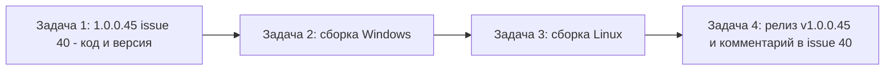

# План исправлений 1.0.0.45 — issue #40 «Иконки в трее»

Версия: **1.0.0.44 → 1.0.0.45** (увеличивается ТОЛЬКО последнее число; одна микро-версия на issue — см. [`Workspace1C.csproj`](Workspace1C/Workspace1C.csproj:62)).
Issue: **#40 «Иконки в трее»** (автор 7OH, 0 комментариев → работаем по описанию) — после релиза добавляется комментарий «что исправлено и в какой версии», issue **НЕ закрывается**. Пропускаемые (последний комментарий от владельца): **#21, #25, #26, #29, #30, #32, #33, #36, #37, #38, #39 — в план не входят**.
Link: [#40](https://github.com/sivatorov/Workspace1C/issues/40).

Каждая задача — **отдельный `new_task` (mode `code`)**. Задачи идут **строго последовательно** (общий файл версии/CHANGELOG/README — серийный bump, по образцу практики `PLAN_1.0.0.37`).

**Feasibility:** правка затрагивает только отрисовку иконок меню —
- Windows-трей (WinForms): вся геометрия в [`DrawMaterialTrayIcon(kind, size)`](Workspace1C/Views/MainWindow.Tray.cs:404) и [`DrawCommandGlyph(action, size)`](Workspace1C/Views/MainWindow.Tray.cs:1102) **уже параметризована размером** (`s = size`) — достаточно поднять размер вызова/ImageScalingSize; захардкожены только кружки [`DrawStatusDot`](Workspace1C/Views/MainWindow.Tray.cs:1172) и [`DrawGroupStatusIcon`](Workspace1C/Views/MainWindow.Tray.cs:1201) — их надо параметризовать;
- Avalonia (контекстные меню): `MenuGlyph` FontSize 13 и `MenuGroupIcon` 16×16 — точечные правки;
- трей Linux — `NativeMenu`, иконки не поддерживает, изменений не требует.

Общие файлы версии — один серийный bump. Риск регрессий низкий; защита — полный прогон `dotnet test` и ручная проверка меню на обеих платформах.

---

## 1. Декомпозиция на задачи (порядок и зависимости)

| № | Mode | Версия | Issue | Суть | Зависит от |
|---|---|---|---|---|---|
| 1 | code | 1.0.0.45 | #40 | Увеличить иконки меню трея Windows 16→20 px (иконки, команды служб, кружки статусов, группы), Avalonia-глифы меню 13→16; bump версии, CHANGELOG, README, `rel_notes_1.0.0.45.md`; прогон `dotnet test` | — |
| 2 | code | — | — | Сборка Windows single-file (`build-windows-single-file.ps1` → `dist/win-x64/Workspace1C.exe`), ручная проверка меню трея | 1 |
| 3 | code | — | — | Сборка Linux single-file (`build-linux-single-file.ps1` → `dist/linux-x64/Workspace1C`) | 2 |
| 4 | code | — | #40 | git commit/push, тег `v1.0.0.45`, GitHub Release (2 exe + текст rel_notes), комментарий в #40 со ссылкой на релиз (issue НЕ закрывать), итоговое Telegram-уведомление | 3 |

**Telegram-подтверждения** (`--telegram-confirm`, код выхода 0 = «да»): перед задачей 1 (подтверждение плана), перед сборкой Windows (задача 2) и перед push/релизом (задача 4). Итоговое уведомление `--telegram-send --kind success` — в задаче 4 (по образцу [`_telegram_1.0.0.44.md`](_telegram_1.0.0.44.md:1)).

---

## 2. Issue #40 «Иконки в трее» (задача 1, версия 1.0.0.45)

Автор 7OH, 0 комментариев → работаем по описанию: «иконки в трее сильно мелкие; высота надписей примерно одинаковая, но иконки видно, что можно сделать больше; возможно, после этого станет лучше видно кружочки на папках служб». Целевой размер: **20×20 px** для иконок WinForms-меню (компромисс: заметный рост +25%, строки меню не «раздуваются» при той же высоте надписей; 24 px при шрифте 9.5 pt даст слишком высокие строки).

### 2.1 Анализ (где искать код)

- **Windows-трей** — [`MainWindow.Tray.cs`](Workspace1C/Views/MainWindow.Tray.cs:1):
  - `GetTrayIcon(kind)` (строка 394) — вызов `DrawMaterialTrayIcon(kind, 16)` на строке 399; кэш `TrayIconCache` — [`MainWindow.xaml.cs:802`](Workspace1C/Views/MainWindow.xaml.cs:802) (статический, перезапуск приложения перерисует — сброс не требуется).
  - `DrawMaterialTrayIcon(kind, size)` (строка 404) — геометрия всех иконок уже относительно `s = size`, при увеличении `size` иконки станут крупнее автоматически.
  - `GetCommandGlyph(action)` (строка 1093) — вызов `DrawCommandGlyph(action, 16)` на строке 1097; сама `DrawCommandGlyph(action, size)` (строка 1102) параметризована.
  - `DrawStatusDot(colorHex)` (строка 1172) и `DrawGroupStatusIcon(colorHex)` (строка 1201) — **жёстко 16×16** (битмапы 16×16, координаты кружка 3,3,10,10 и 9.5,9.5,5.5,5.5) — требуют параметризации размером.
  - `ImageScalingSize` меню: `CreateModernTrayMenu` строка 232 `(16,16)`, `ApplyModernDropDownStyle` строка 1246 `(16,16)`, подменю в `AttachLaunchSubmenu` строка 340 наследует от ownerMenu. Критично: `CreateTrayItem` использует `ImageScaling = None` (строка 366) → bitmap подаётся «как есть», поэтому размер bitmap и `ImageScalingSize` должны совпадать.
  - `BuildServiceCommandItem` (строка 984) — тот же паттерн (`GetCommandGlyph`, `ImageScaling = None`).
  - Иконка самого значка в системном трее `CreateTraySizedIcon` 16×16 (строка 210) — **НЕ меняем** (для notification area 16 px корректно, issue про меню).
- **Linux/Avalonia** — контекстные меню служб/закладок, [`MainWindow.Avalonia.Hotkeys.cs`](Workspace1C/Views/MainWindow.Avalonia.Hotkeys.cs:1):
  - `MenuGlyph` (строка 696) — `FontSize = 13` (строка 701).
  - `StatusCircle` (строка 706) — кружок 9×9 (строки 710–714).
  - `MenuGroupIcon` (строка 727) — Grid 16×16, глиф «📦» FontSize 13, кружок 6×6 с белой обводкой (строки 729–753).
  - Трей Linux — `NativeMenu` ([`MainWindow.Avalonia.Tray.cs`](Workspace1C/Views/MainWindow.Avalonia.Tray.cs:83)): нативные иконки не поддерживаются — вне зоны изменения.
- Тестов на отрисовку иконок нет (поиск `TrayIcon|DrawMaterialTrayIcon|MenuGlyph|DrawCommandGlyph` в `Workspace1C.Tests` — 0 результатов).

### 2.2 Что менять — Windows ([`MainWindow.Tray.cs`](Workspace1C/Views/MainWindow.Tray.cs:1))

1. Константа `private const int TrayMenuIconSize = 20;` (рядом с `ServicesStatusRefreshInterval`, строка 46).
2. `GetTrayIcon` (строка 399): `DrawMaterialTrayIcon(kind, TrayMenuIconSize)` вместо 16.
3. `CreateModernTrayMenu` (строка 232): `ImageScalingSize = new Drawing.Size(TrayMenuIconSize, TrayMenuIconSize)`.
4. `ApplyModernDropDownStyle` (строка 1246): то же самое; убедиться, что подменю в `AttachLaunchSubmenu` (строка 340) наследуют обновлённый размер (наследование от ownerMenu уже есть).
5. `GetCommandGlyph` (строка 1097): `DrawCommandGlyph(action, TrayMenuIconSize)` вместо 16.
6. `DrawStatusDot` (строка 1172): параметризовать `DrawStatusDot(string? colorHex, int size)` — битмап `size×size`, кружок с пропорциональным отступом `size * 0.1875f` и диаметром `size * 0.625f` (для 20: отступ 3.75, диаметр 12.5; округлить до целых при желании). Обновить вызов в `ToServiceTrayItem` (строка 936).
7. `DrawGroupStatusIcon` (строка 1201): параметризовать `DrawGroupStatusIcon(string? statusColorHex, int size)` — папка уже рисуется от `s = 16` (строки 1223–1226) → перевести на `s = size`; кружок статуса справа-снизу: координаты/диаметр умножить на `size / 16f` (для 20: круг 11.9,11.9,6.9,6.9), белая обводка 1.2 → `size / 16f * 1.2f`. Обновить вызов в `ToServiceTrayItem` (строка 951).
8. `CreateTrayItem` (строка 370) и `BuildServiceCommandItem` (строка 995): при необходимости вертикальный `Padding` 3 → 4, чтобы строка не «резала» иконку 20 px (высота строки при `ImageScaling = None` и `MiddleLeft` выровняется автоматически; проверить на скриншоте, при 100% и 125% DPI).
9. Не трогать: `CreateTraySizedIcon` (16×16, системная зона), `ModernTrayMenuRenderer` ([`MainWindow.xaml.cs:807`](Workspace1C/Views/MainWindow.xaml.cs:807) — рендерер не управляет размером иконок).

### 2.3 Что менять — Avalonia ([`MainWindow.Avalonia.Hotkeys.cs`](Workspace1C/Views/MainWindow.Avalonia.Hotkeys.cs:1))

Те же «иконки меню» в контекстных меню (Ctrl+Shift+Alt+S и др.):
1. `MenuGlyph` (строка 701): `FontSize = 13` → `16`.
2. `StatusCircle` (строки 710–714): 9×9 → 11×11, `CornerRadius` 4.5 → 5.5.
3. `MenuGroupIcon` (строки 729–753): Grid 16×16 → 20×20, «📦» FontSize 13 → 16, кружок 6×6 → 7×7 (Margin `1,1` → чуть больше при необходимости).

### 2.4 Тесты

- Отдельных юнит-тестов на отрисовку иконок в проекте нет; добавлять тест GDI+/Avalonia-глифов нецелесообразно (визуальная проверка).
- Обязателен полный прогон `dotnet test` (регресс) — правки касаются только `#if WINDOWS` / `#if LINUX` веток отрисовки.
- **Ручная проверка Windows:** ПКМ по трею → иконки «Открыть», базы, службы, настройки, выход и команды служб заметно крупнее; кружок статуса службы (зелёный/жёлтый/серый) и микс «папка + кружок» у групп видны чётче; подменю «Службы» и Ctrl+ПКМ — тот же размер; на 100% и 125% DPI ничего не обрезается, строки не слипаются.
- **Ручная проверка Linux:** контекстное меню служб — глифы 16 px, группа 20×20, кружки больше; трей — без изменений (нативные иконки не поддерживаются).

### 2.5 Обновление версии и документации (та же задача)

1. [`Workspace1C.csproj`](Workspace1C/Workspace1C.csproj:62) (строки 62–65): `1.0.0.44` → `1.0.0.45` во всех четырёх свойствах (`Version`, `AssemblyVersion`, `FileVersion`, `InformationalVersion`).
2. [`CHANGELOG.md`](CHANGELOG.md:1): запись `## [1.0.0.45] — 2026-10-22` с разделом `### Исправлено`: «Иконки меню трея и меню служб увеличены с 16 до 20 px (Windows), глифы контекстных меню — с 13 до 16 px (Linux); кружочки статусов служб и групп теперь видны лучше». По образцу существующих записей.
3. [`README.md`](README.md:1): бейдж «Версия-1.0.0.45» и текст «актуальная версия — 1.0.0.45» (два места, по образцу правки 1.0.0.44).
4. Новый файл `rel_notes_1.0.0.45.md` — текст релизных заметок для GitHub Release (по образцу [`rel_notes_1.0.0.44.md`](rel_notes_1.0.0.44.md:1)).

---

## 3. Задача 2 — сборка Windows и проверка

- Полный прогон `dotnet test` (весь `Workspace1C.Tests`).
- Запуск `Workspace1C/build-windows-single-file.ps1` → результат `Workspace1C/dist/win-x64/Workspace1C.exe`.
- Ручная проверка на Windows: запустить exe, ПКМ по значку трея — меню с иконками 20×20 (скриншот для подтверждения).

## 4. Задача 3 — сборка Linux

- Запуск `Workspace1C/build-linux-single-file.ps1` (кросс-сборка, `-p:ForceLinux=true` согласно практике) → результат `Workspace1C/dist/linux-x64/Workspace1C`.
- Проверка, что артефакт создан и не пуст (размер файла, права на запуск).

## 5. Задача 4 — релиз v1.0.0.45 и комментарий в issue

- git add/commit/push с осмысленным сообщением (например, «v1.0.0.45: larger tray menu icons (issue #40)»).
- Тег `v1.0.0.45` + push тега.
- GitHub Release `v1.0.0.45` с преамбулой из `rel_notes_1.0.0.45.md` и двумя файлами: `Workspace1C/dist/win-x64/Workspace1C.exe` и `Workspace1C/dist/linux-x64/Workspace1C` (названия файлов в релизе уникальные, например `Workspace1C-1.0.0.45-win-x64.exe` / `Workspace1C-1.0.0.45-linux-x64`).
- Комментарий в issue #40: «Исправлено в версии 1.0.0.45 (Windows и Linux): иконки меню трея увеличены с 16 до 20 px, иконки контекстных меню — с 13 до 16 px, кружочки статусов служб и групп видны лучше. Релиз: <ссылка>». Issue **НЕ закрывать**.
- Итоговое подтверждение в Telegram (`--telegram-send --kind success`) по образцу [`_telegram_1.0.0.44.md`](_telegram_1.0.0.44.md:1).

---

## 6. Критерии готовности

- Иконки пунктов меню трея на Windows — 20×20 px, эталонное меню соответствует описанию issue (иконки заметно крупнее, кружочки статусов читаемы).
- Версия 1.0.0.45 во всех четырёх свойствах csproj + CHANGELOG + README + rel_notes.
- Собраны оба single-file артефакта, загружены в GitHub Release v1.0.0.45.
- Комментарий в issue #40 добавлен, issue остаётся открытым.
- Итоговое Telegram-уведомление отправлено.
