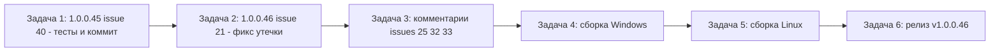

# План релиза 1.0.0.46 — issues #40, #21 + комментарии #25, #32, #33

Версия: **1.0.0.45 → 1.0.0.46** (увеличивается ТОЛЬКО последнее число; одна микро-версия на issue — см. [`Workspace1C.csproj`](Workspace1C/Workspace1C.csproj:62)).

## 0. Анализ открытых issues (2026-10-22)

| Issue | Комментариев | Последний комментарий | Вывод |
|---|---|---|---|
| **#40** «Иконки в трее» | 0 | — | **В работе по описанию.** Изменения уже в рабочем дереве (1.0.0.45), не закоммичены |
| **#21** «Долгое переключение вкладок» | 26 | 7OH 05:10 UTC: «Пока всё там же» + логи роста heapAfterGcMb 42→269 МБ | **Нужно исправление** (утечка памяти на Windows не устранена) |
| **#25** «Импорт из кластера» | 15 | 7OH 04:56 UTC: «Красота. Всё работает» | Подтверждено → только комментарий |
| **#32** «Горячие клавиши» | 6 | 7OH 04:59 UTC: «можно закрывать» | Подтверждено → только комментарий |
| **#33** «Версия платформы» | 6 | 7OH 05:01 UTC: «можно закрывать» | Подтверждено → только комментарий |
| #26, #29, #30 | — | Последний комментарий от владельца | Вне scope |

**Правила:** issues **НЕ закрываем** (только комментарии). Версия — только последнее число. Каждая задача — отдельный `new_task` (mode `code`), строго последовательно. Telegram-подтверждения перед ответственными действиями.

---

## 1. Задача 1 — issue #40, версия 1.0.0.45 (код уже готов в рабочем дереве)

**Суть:** проверить готовые изменения, прогнать тесты, закоммитить.

- [ ] Проверить полноту изменений в рабочем дереве (diff `MainWindow.Tray.cs`, `MainWindow.Avalonia.Hotkeys.cs`, `Workspace1C.csproj`, `CHANGELOG.md`, `README.md`, `rel_notes_1.0.0.45.md`)
- [ ] Полный прогон `dotnet test` (весь `Workspace1C.Tests`)
- [ ] **Telegram-confirm** перед коммитом
- [ ] `git add` + `git commit` (сообщение: `1.0.0.45: иконки меню трея и служб 16→20 px (issue #40)`)

## 2. Задача 2 — issue #21, версия 1.0.0.46 (утечка памяти на Windows)

**Суть:** устранить рост heapAfterGcMb при переключении вкладок «Все/Избранное/Недавние» на Windows.

### 2.1 Анализ (по логам 7OH от 05:10 UTC)

- `flushPanels=0` во ВСЕХ записях CM_TREESWITCH → [`FlushTreeRecycledContainers`](Workspace1C/Views/MainWindow.xaml.cs:502) не сбрасывает пул: при плоском дереве (группы не реализованы) `CollectTreeContainers` не находит дочерних контейнеров, `containers.Count <= 1` → **ранний return без сброса пула самого MainTree** (строки 513–514).
- `detach=0` после первой смены → узлы групп переиспользуются (кэш «Все»), утечка не в узлах.
- `rowsRealized/rowsCleared` 16–21 за смену → рециклированные контейнеры строк остаются в пуле `ItemContainerGenerator` и удерживают данные строк (рост ~5 МБ/смена).

### 2.2 Что менять

1. [`FlushTreeRecycledContainers`](Workspace1C/Views/MainWindow.xaml.cs:502): убрать ранний return при `containers.Count <= 1` — **всегда** переключать в Standard и обратно хотя бы для MainTree (плоский режим), чтобы очередь Recycler'а разбиралась.
2. Проверить, что `ScheduleTreePoolFlush` (строка 481) реально исполняется до следующей смены вкладки (ApplicationIdle может не наступить при быстром переключении) — при необходимости перепланировать на более ранний приоритет или выполнять синхронно после `QueueHeaderAlign`.
3. Дополнительно проверить подписки строк/контейнеров: `OnInfobaseRowGrid_Loaded/Unloaded` ([`MainWindow.Columns.cs`](Workspace1C/Views/MainWindow.Columns.cs:417)) — не остаются ли обработчики на старых контейнерах.
4. Если после п.1–3 рост сохранится — добавить в CM_TREESWITCH замер числа контейнеров в пуле Recycler'а (диагностика) и запросить у 7OH повторный лог.

### 2.3 Версия и документация (та же задача)

1. [`Workspace1C.csproj`](Workspace1C/Workspace1C.csproj:62): `1.0.0.45` → `1.0.0.46` (4 свойства).
2. [`CHANGELOG.md`](CHANGELOG.md:1): запись `## [1.0.0.46] — 2026-10-22` — «устранён рост памяти при переключении вкладок на Windows: сброс Recycling-пула выполняется и для корневого дерева в плоском режиме (flushPanels>0), старые контейнеры строк освобождаются».
3. [`README.md`](README.md:1): бейдж и «актуальная версия — 1.0.0.46».
4. Новый `rel_notes_1.0.0.46.md`.
5. Полный прогон `dotnet test`.
6. **Telegram-confirm** перед коммитом; `git commit`.

## 3. Задача 3 — комментарии в issues #25, #32, #33 (без кода)

**Суть:** пользователи подтвердили исправление; добавить комментарии «что исправлено и в какой версии» (issue НЕ закрывать).

- [ ] #25: подтверждение 7OH «Всё работает» — комментарий: исправлено в 1.0.0.30/31/33/35/36/42, подтверждено пользователем 22.10
- [ ] #32: подтверждение 7OH «можно закрывать» — комментарий: исправлено в 1.0.0.43, подтверждено
- [ ] #33: подтверждение 7OH «можно закрывать» — комментарий: исправлено в 1.0.0.44, подтверждено

## 4. Задача 4 — сборка Windows single-file

- [ ] **Telegram-confirm** перед сборкой
- [ ] `Workspace1C/build-windows-single-file.ps1` → `Workspace1C/dist/win-x64/Workspace1C.exe`
- [ ] Проверка: exe существует, версия 1.0.0.46

## 5. Задача 5 — сборка Linux single-file

- [ ] `Workspace1C/build-linux-single-file.ps1` (или `.sh`) → `Workspace1C/dist/linux-x64/Workspace1C`
- [ ] Проверка: файл существует, версия 1.0.0.46

## 6. Задача 6 — push, тег, GitHub Release, комментарии, Telegram

- [ ] **Telegram-confirm** перед push/релизом
- [ ] `git push origin main`
- [ ] Тег `v1.0.0.46`
- [ ] `gh release create v1.0.0.46` с двумя исполняемыми файлами и текстом `rel_notes_1.0.0.46.md`
- [ ] Комментарий в #40: «Исправлено в 1.0.0.45…» + ссылка на релиз (issue НЕ закрывать)
- [ ] Комментарий в #21: «Исправлено в 1.0.0.46…» + ссылка на релиз (issue НЕ закрывать)
- [ ] Итоговое **Telegram-уведомление** `--telegram-send --kind success` (по образцу [`_telegram_1.0.0.44.md`](_telegram_1.0.0.44.md:1))

---

## Схема зависимостей

**Telegram-подтверждения** (`--telegram-confirm`, код 0 = «да»): перед коммитом (задачи 1, 2), перед сборкой Windows (задача 4), перед push/релизом (задача 6). Итоговое уведомление `--telegram-send --kind success` — в задаче 6.