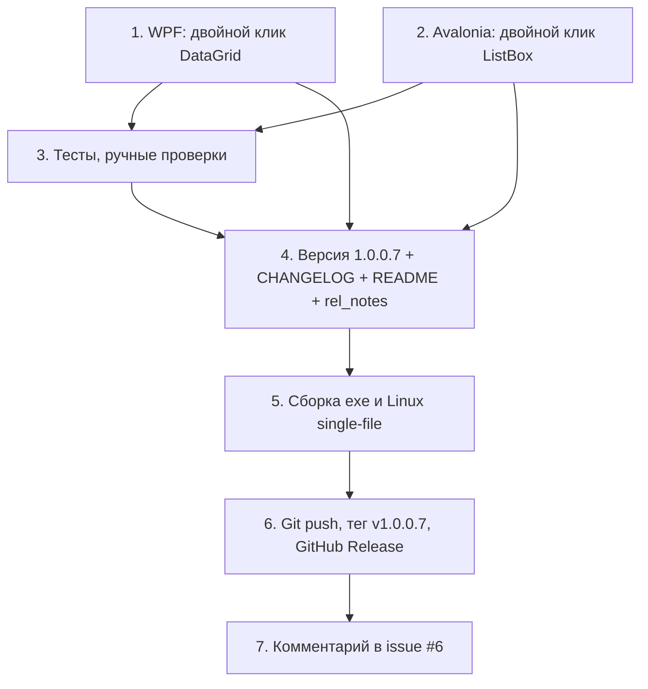

# План исправления issue #6 (финальный пункт): двойной клик по строке таблицы «Произвольные поля»

Репозиторий: https://github.com/sivatorov/Workspace1C (локально — `g:/Yandex.Disk/h/Workspace1C`).
Текущая версия: **1.0.0.6** (последний коммит `1471bcf`). Целевая версия: **1.0.0.7** (увеличивается только последнее число).

## 0. Сводка задачи

Последний комментарий пользователя `7OH` к issue #6 (2026-10-16T18:56:39Z):
> «Ну и мелочь - открывать правку строки доп параметра по двойному клику».

Все прочие требования issue #6 уже реализованы (версии 1.0.0.3–1.0.0.5). Единственное оставшееся изменение — **двойной клик по строке таблицы «Произвольные поля» открывает модальное окно правки** на обеих платформах:

- **Windows (WPF)**: [`ConnectionSettingsWindow.xaml`](Workspace1C/Views/ConnectionSettingsWindow.xaml:1330), DataGrid `AdditionalFieldsGrid` (`ItemsSource="{Binding AdditionalFields}"`, `SelectedItem="{Binding SelectedAdditionalField}"`).
- **Linux (Avalonia)**: [`ConnectionSettingsWindow.Avalonia.cs`](Workspace1C/Views/ConnectionSettingsWindow.Avalonia.cs:1271), ListBox `additionalList` (привязки `ItemsSource`/`SelectedItem`, `FuncDataTemplate<AdditionalFieldRow>` с Grid-строкой «№ | Значение»).

Требования к поведению (из ТЗ пользователя):
1. Двойной клик по строке/элементу таблицы открывает окно правки строки.
2. Двойной клик по пустой области или заголовку **не** открывает окно.
3. Двойной клик по ещё не выбранной строке должен **сначала выбрать строку**, затем открыть правку.
4. Логика правки — переиспользование существующего `OnEditAdditionalField_Click` (WPF) / `OnEditAdditionalField_Click()` (Avalonia), без изменений ViewModel-слоя.

Ограничения процесса:
- Каждый пункт работ — отдельная новая задача (запускается через new_task; этот файл — только план).
- Issues самостоятельно не закрывать; после релиза — комментарий в issue #6 о версии, в которой исправлено.
- Версия увеличивается только последним числом: 1.0.0.6 → 1.0.0.7.
- Обновить [`CHANGELOG.md`](CHANGELOG.md:1) и [`README.md`](README.md:1).
- Собрать 1 исполняемый файл для Windows и 1 для Linux.
- Изменения — на GitHub, затем новый релиз (сами процессы публикации — отдельные задачи).

---

## 1. Декомпозиция работ (отдельные задачи) и зависимости



| № | Задача (новая task) | Входные файлы | Результат | Зависит от |
|---|--------------------|---------------|-----------|------------|
| 1 | Реализация двойного клика **WPF** | [`ConnectionSettingsWindow.xaml`](Workspace1C/Views/ConnectionSettingsWindow.xaml:1330), [`ConnectionSettingsWindow.xaml.cs`](Workspace1C/Views/ConnectionSettingsWindow.xaml.cs:815) | Обработчик `OnAdditionalFieldsGrid_MouseDoubleClick`, атрибут `MouseDoubleClick` на DataGrid | — (стартует первой, параллельно с №2) |
| 2 | Реализация двойного клика **Avalonia** | [`ConnectionSettingsWindow.Avalonia.cs`](Workspace1C/Views/ConnectionSettingsWindow.Avalonia.cs:1271) | Подписка `DoubleTapped` на строке шаблона ListBox | — (параллельно с №1) |
| 3 | Тесты и ручные проверки | [`ConnectionSettingsViewModelTests.cs`](Workspace1C.Tests/ConnectionSettingsViewModelTests.cs:422), опционально новый XAML-static-тест | Зелёный `dotnet test`; зафиксированные ручные сценарии на двух платформах | №1, №2 |
| 4 | Версия 1.0.0.7 + [`CHANGELOG.md`](CHANGELOG.md:1) + [`README.md`](README.md:1) + `rel_notes_1.0.0.7.md` | [`Workspace1C.csproj`](Workspace1C/Workspace1C.csproj:62) | Все 4 места версии → 1.0.0.7; раздел CHANGELOG; бейдж и текст README; файл релизных заметок | №1, №2 |
| 5 | Сборка 1 файла Windows и 1 файла Linux | [`build-windows-single-file.ps1`](Workspace1C/build-windows-single-file.ps1:1), [`Workspace1C/build.sh`](Workspace1C/build.sh:1), [`package/linux/appimage.sh`](package/linux/appimage.sh:1) | `dist/win-x64/Workspace1C.exe` (WPF single-file); `package/linux/out/Workspace1C-1.0.0.7-x86_64.AppImage` (или `Workspace1C-linux-x64`) | №4 (версия в csproj) |
| 6 | Публикация на GitHub: commit + push + тег `v1.0.0.7` + GitHub Release | [`release.yml`](.github/workflows/release.yml:1) | Коммиты в `main`, тег `v1.0.0.7`, релиз с обоими артефактами | №5 |
| 7 | Комментарий в issue #6 | issue #6 на GitHub | Комментарий: «Исправлено в 1.0.0.7 — двойной клик по строке открывает правку (Windows и Linux)». Issue **не закрывается** | №6 |

Примечания по декомпозиции:

- №1 и №2 независимы: WPF-часть компилируется только на Windows, Avalonia — только на Linux ([`build.yml`](.github/workflows/build.yml:1) подтверждает раздельные конфигурации в csproj), поэтому их можно выполнять в любом порядке и параллельно.
- №3 можно выполнять после №1 и №2; локальные автотесты прогоняются на Windows (`dotnet test`), ручные проверки Avalonia — на Linux-сборке.
- №4 формально независим от №1/№2 (тексты известны), но порядок «сначала код, потом документы» исключает рассинхрон описания.
- №5 после №4: single-file publish читает версию из [`Workspace1C.csproj`](Workspace1C/Workspace1C.csproj:62), а `appimage.sh` читает `InformationalVersion` из того же csproj (см. строки 29–31 `appimage.sh`).
- №6 после №5: тег публикуется на `main`, workflow собирает артефакты заново на GitHub Actions (надёжнее, чем загрузка локально собранных файлов).
- №7 — строго последний, после публикации релиза.

---

## 2. Технический план реализации

### 2.1 WPF (задача №1)

**Файл**: [`ConnectionSettingsWindow.xaml`](Workspace1C/Views/ConnectionSettingsWindow.xaml:1330).

Добавить атрибут `MouseDoubleClick` к DataGrid `AdditionalFieldsGrid` (эталон — [`ItsAccountsWindow.xaml`](Workspace1C/Views/ItsAccountsWindow.xaml:129), [`MaintenanceCenterWindow.xaml`](Workspace1C/Views/MaintenanceCenterWindow.xaml:60)):

```xml
<DataGrid x:Name="AdditionalFieldsGrid" ItemsSource="{Binding AdditionalFields}"
          ...
          MouseDoubleClick="OnAdditionalFieldsGrid_MouseDoubleClick">
```

**Файл**: [`ConnectionSettingsWindow.xaml.cs`](Workspace1C/Views/ConnectionSettingsWindow.xaml.cs:815) (секция «Произвольные поля базы (issue #6)»).

Добавить обработчик (рядом с `OnEditAdditionalField_Click`):

```csharp
/// <summary>Двойной клик по строке = правка (issue #6): заголовок и пустая область игнорируются.</summary>
private void OnAdditionalFieldsGrid_MouseDoubleClick(object sender, MouseButtonEventArgs e)
{
    if (FindDataGridRow(e.OriginalSource as DependencyObject) is not { } row ||
        row.Item is not AdditionalFieldRow item)
        return;

    // Требование: сначала выбрать строку, затем открыть правку.
    if (!ReferenceEquals(AdditionalFieldsGrid.SelectedItem, item))
        AdditionalFieldsGrid.SelectedItem = item;

    e.Handled = true;
    OnEditAdditionalField_Click(this, new RoutedEventArgs());
}

/// <summary>Ищет DataGridRow среди визуальных предков источника события (null для заголовка/пустоты).</summary>
private static DataGridRow? FindDataGridRow(DependencyObject? source)
{
    for (var node = source; node is not null; node = VisualTreeHelper.GetParent(node))
        if (node is DataGridRow r) return r;
    return null;
}
```

Обоснование и защита (по пунктам ТЗ):

| Ситуация | Что происходит | Почему |
|----------|---------------|--------|
| Двойной клик по ячейке строки | `OriginalSource` — `TextBlock`/`DataGridCell` внутри строки → `FindDataGridRow` находит `DataGridRow` → открывается правка | Стандартное поведение WPF: событие `MouseDoubleClick` (routed) всплывает от цели на DataGrid |
| Двойной клик по заголовку колонки | `OriginalSource` принадлежит `DataGridColumnHeader`, среди предков нет `DataGridRow` → выход без действий | Защита заголовка |
| Двойной клик по пустой области / полосе прокрутки | Класс предка — `ScrollBar`/`DataGridRowsPresenter`, не `DataGridRow` → выход без действий | Защита пустой области |
| Двойной клик по невыбранной строке | Первый клик серии уже выбрал строку (`SelectedItem` обновился); дополнительно код явно выставляет `AdditionalFieldsGrid.SelectedItem = item` до вызова правки | Гарантия порядка «сначала выбор, потом правка» |
| Двойной клик по выбранной строке | `SelectedItem` уже `item` → переход сразу к правке | Бесшовное поведение |
| Повторное срабатывание при всплытии | `e.Handled = true` пресекает дальнейшую обработку | Предотвращение двойного открытия диалога |

Примечания:

- Использовать именно **обход визуального дерева** до `DataGridRow`, а не только проверку `SelectedItem` (как в [`ItsAccountsWindow.xaml.cs`](Workspace1C/Views/ItsAccountsWindow.xaml.cs:115)): проверка `SelectedItem` не различает клик по заголовку/пустой области, если строка уже выбрана.
- Привязка `SelectedItem="{Binding SelectedAdditionalField}"` двухсторонняя (WPF DataGrid по умолчанию TwoWay), поэтому установка `AdditionalFieldsGrid.SelectedItem = item` синхронизирует `SelectedAdditionalField` в [`ConnectionSettingsViewModel.cs`](Workspace1C/ViewModels/ConnectionSettingsViewModel.cs:170) до вызова `OnEditAdditionalField_Click`.
- `OnEditAdditionalField_Click(this, new RoutedEventArgs())` — повторное использование существующего обработчика кнопки «Изменить» (строки 830–848): один источник истины для открытия `NameInputWindow` и вызова `_viewModel.ReplaceAdditionalField`.
- Всё поведение остаётся в code-behind (как у всех аналогичных мест проекта) — ViewModel не меняется.

### 2.2 Avalonia (задача №2)

**Файл**: [`ConnectionSettingsWindow.Avalonia.cs`](Workspace1C/Views/ConnectionSettingsWindow.Avalonia.cs:1271).

Рекомендуемый способ — подписка `DoubleTapped` на корневой `Grid` шаблона строки (ровно тот же приём, что в [`ItsAccountsWindow.Avalonia.cs`](Workspace1C/Views/ItsAccountsWindow.Avalonia.cs:151)):

```csharp
additionalList.ItemTemplate = new FuncDataTemplate<AdditionalFieldRow>((row, _) =>
{
    var grid = new Grid { ColumnDefinitions = { ... } };
    var number = new TextBlock { ... };
    var value = new TextBlock { ... };
    grid.Children.Add(number);
    grid.Children.Add(value);

    // Двойной клик по строке = правка (issue #6): заголовок и пустая область не подписаны.
    grid.DoubleTapped += (_, _) =>
    {
        additionalList.SelectedItem = row;   // сначала выбираем строку (требование ТЗ)
        OnEditAdditionalField_Click();       // затем открываем правку
    };

    return grid;
});
```

Обоснование и защита:

| Ситуация | Что происходит | Почему |
|----------|---------------|--------|
| Двойной клик по строке | `grid` строки ловит `DoubleTapped` → `SelectedItem = row` (привязка `SelectedItem` на строке 1278 синхронизирует `SelectedAdditionalField` в VM) → `OnEditAdditionalField_Click()` | Требование «сначала выбрать, потом открыть» выполнено явно |
| Двойной клик по заголовку | Обработчик подписан только на `grid` внутри шаблона строки; `additionalHeaderBorder` (строки 1263–1269) — отдельный элемент без подписки | Защита заголовка «из коробки» |
| Двойной клик по пустой области списка | Контейнера `ListBoxItem`/`grid` там нет — событие никому не адресовано | Защита пустой области «из коробки» |
| Двойной клик по невыбранной строке | Первый клик ListBox уже выбрал строку, но код всё равно принудительно ставит `SelectedItem = row` перед правкой | Гарантия порядка, как в ТЗ |

Альтернатива (если подписку в шаблоне сочтут запутанной) — обработчик на самом `additionalList`:

```csharp
additionalList.DoubleTapped += (_, e) =>
{
    if (e.Source is Control source &&
        source.Classes?.Contains("listboxitem") is true &&            // либо визуальный поиск предка ListBoxItem
        additionalList.SelectedItem is AdditionalFieldRow row)
    {
        e.Handled = true;
        OnEditAdditionalField_Click();
    }
};
```

Недостаток альтернативы: необходимо точно определять «попали ли в строку»; при использовании только `SelectedItem` возможна правка при двойном клике по пустой области, если строка осталась выбранной. Поэтому **рекомендуется основной вариант** — подписка на `grid` строки шаблона.

Примечания:

- `OnEditAdditionalField_Click()` (строки 1698–1716) открывает `NameInputWindow` через `ShowDialogSync` и вызывает `_viewModel.ReplaceAdditionalField(row, dialog.Result)` — без изменений.
- ViewModel не меняется: [`AddAdditionalField`](Workspace1C/ViewModels/ConnectionSettingsViewModel.cs:252), [`ReplaceAdditionalField`](Workspace1C/ViewModels/ConnectionSettingsViewModel.cs:263), [`RemoveAdditionalField`](Workspace1C/ViewModels/ConnectionSettingsViewModel.cs:276), [`SelectedAdditionalField`](Workspace1C/ViewModels/ConnectionSettingsViewModel.cs:170) остаются как есть.
- Список маленький (5 обязательных строк + заполненные), виртуализация ListBox не мешает подписке. Если в будущем строк станет много, подписку можно перенести на `additionalList` с проверкой исходного контейнера через `e.Source`.

### 2.3 Изменения кода — итоговая сводка

| Файл | Изменение |
|------|-----------|
| [`ConnectionSettingsWindow.xaml`](Workspace1C/Views/ConnectionSettingsWindow.xaml:1330) | +атрибут `MouseDoubleClick` на DataGrid |
| [`ConnectionSettingsWindow.xaml.cs`](Workspace1C/Views/ConnectionSettingsWindow.xaml.cs:815) | +обработчик `OnAdditionalFieldsGrid_MouseDoubleClick`, +helper `FindDataGridRow` |
| [`ConnectionSettingsWindow.Avalonia.cs`](Workspace1C/Views/ConnectionSettingsWindow.Avalonia.cs:1279) | +подписка `DoubleTapped` на `grid` строки шаблона |
| Весь прочий код (ViewModel, модель, сервисы) | Без изменений |

---

## 3. План тестов (задача №3)

### 3.1 Модульные тесты

Проект [`Workspace1C.Tests`](Workspace1C.Tests/Workspace1C.Tests.csproj) тестирует **логику view-моделей и сервисов**, UI-события (клики, drag, double-click) автоматических unit-тестов не имеют (нет UI-фреймворка в тестах; весь список тестовых файлов — по моделям/сервисам).

Двойной клик — чистое UI-событие. Существующая ViewModel-логика уже покрыта тестами, она не меняется:
- `AddReplaceRemove_AdditionalFields_ManagesRowsAndNumbers` ([`ConnectionSettingsViewModelTests.cs`](Workspace1C.Tests/ConnectionSettingsViewModelTests.cs:493));
- `LoadFrom_AdditionalFields_FillsRowsWithNumbers` ([стр. 423](Workspace1C.Tests/ConnectionSettingsViewModelTests.cs:423));
- `ApplyTo_AdditionalFields_*` ([стр. 461–490](Workspace1C.Tests/ConnectionSettingsViewModelTests.cs:461);
- подстановка `%Additional_N%` — [`ScriptParameterResolverTests.cs`](Workspace1C.Tests/ScriptParameterResolverTests.cs:921).

Поэтому:

1. **Обязательно**: прогнать весь набор тестов — `dotnet test Workspace1C.Tests/Workspace1C.Tests.csproj -c Release` (или CI [`build.yml`](.github/workflows/build.yml:52)) и убедиться, что ничего не сломалось (изменения затрагивают только Views, но защита от регрессий обязательна).
2. **Рекомендуется (опционально)**: статический XAML-тест по образцу [`SettingsWindowXamlResourcesTests.cs`](Workspace1C.Tests/SettingsWindowXamlResourcesTests.cs:15) — проверка, что у DataGrid с именем `AdditionalFieldsGrid` в [`ConnectionSettingsWindow.xaml`](Workspace1C/Views/ConnectionSettingsWindow.xaml:1330) присутствует атрибут `MouseDoubleClick`, а в [`ConnectionSettingsWindow.Avalonia.cs`](Workspace1C/Views/ConnectionSettingsWindow.Avalonia.cs:1271) — строка с `DoubleTapped +=` в районе `additionalList`. Это соответствует принятому в проекте паттерну «тесты на согласованность разметки», но не обязательно; решение — за задачей №3.

### 3.2 Ручные сценарии (Windows и Linux)

| № | Сценарий | Ожидаемый результат |
|---|----------|---------------------|
| R1 | Двойной клик по заполненной строке таблицы | Открывается `NameInputWindow` с текущим значением строки |
| R2 | Изменить значение в окне, Enter/OK | Строка обновлена, нумерация не изменилась |
| R3 | Двойной клик по пустой строке (из минимальных 5) | Окно открывается с пустым полем |
| R4 | Cancel/ESC в окне правки | Значение не изменилось |
| R5 | Двойной клик по **заголовку** «№» / «Значение поля» | Окно **не** открывается |
| R6 | Двойной клик по **пустой области** под строками и по полосе прокрутки | Окно **не** открывается |
| R7 | Двойной клик по строке, которая **не была выбрана** | Строка сначала выделяется, затем открывается её правка |
| R8 | Кнопки «Добавить / Изменить / Удалить / Сценарии…» продолжают работать как раньше | Без регрессий |
| R9 | После правки значения сохранить окно свойств → `%Additional_N%` в сценарии подставляет новое значение | Сквозная проверка (подтверждает отсутствие регрессии по issue #6) |

Результаты ручных проверок фиксируются в комментарии к issue #6 и/или в файле плана.

---

## 4. План обновления версии, CHANGELOG, README (задача №4)

### 4.1 Версия — [`Workspace1C/Workspace1C.csproj`](Workspace1C/Workspace1C.csproj:62)

Поднять **только последнее число** в четырёх местах (строки 62–65):

```xml
<Version>1.0.0.7</Version>
<AssemblyVersion>1.0.0.7</AssemblyVersion>
<FileVersion>1.0.0.7</FileVersion>
<InformationalVersion>1.0.0.7</InformationalVersion>
```

Требование: увеличено строго последнее число (1.0.0.6 → 1.0.0.7); прежние три части не трогать. `InformationalVersion` читается и `appimage.sh` (строки 29–31), и [`VersionInfo.cs`](Workspace1C/VersionInfo.cs:17) — от него зависит имя AppImage и заголовок окна.

Другие места версии: **не менять** (AssemblyVersion в тестах не зашит; иконки/манифесты не содержат версии).

### 4.2 [`CHANGELOG.md`](CHANGELOG.md:1)

Добавить в начало (над `## [1.0.0.6]` — строка 13):

```markdown
## [1.0.0.7] — 2026-10-16

### Изменено

- **Двойной клик по строке таблицы «Произвольные поля» открывает окно правки строки**
  (issue #6, Windows и Linux): как и кнопка «Изменить», двойной клик по строке открывает
  модальное окно с текущим значением. Двойной клик по заголовку таблицы или пустой
  области списка игнорируется; по ещё не выбранной строке — сначала выделяет её,
  затем открывает правку.
```

### 4.3 [`README.md`](README.md:1)

1. Бейдж версии (строка 3): `Версия-1.0.0.6` → `Версия-1.0.0.7`.
2. «актуальная версия — **1.0.0.6**» (строка 9) → «актуальная версия — **1.0.0.7**».
3. Пункт «Произвольные поля базы» (строки 75–84) — дополнить после «...заголовки таблицы раскрашены контрастно (обе платформы).»:

```markdown
   С 1.0.0.7 (issue #6): двойной клик по строке таблицы открывает окно правки значения
   (заголовок таблицы и пустая область не реагируют; невыбранная строка перед правкой
   выделяется).
```

### 4.4 Release-заметки `rel_notes_1.0.0.7.md`

Создать по образцу [`rel_notes_1.0.0.6.md`](rel_notes_1.0.0.6.md:1) (файл обязателен: [`release.yml`](.github/workflows/release.yml:126) берёт тело релиза именно из него):

```markdown
# Workspace 1C 1.0.0.7

Дата выпуска: **2026-10-16**. Релиз доступен для **Windows** (WPF) и **Linux** (Avalonia).

## Изменено

- **Двойной клик по строке таблицы «Произвольные поля» открывает окно правки** (issue #6,
  Windows и Linux): заголовок и пустая область игнорируются, невыбранная строка перед
  правкой выделяется.

Подробности — в [CHANGELOG.md](CHANGELOG.md).
```

---

## 5. План сборки и публикации релиза (задачи №5, №6)

### 5.1 Сборка Windows (1 исполняемый файл)

Локально (Windows, .NET SDK 10):

```powershell
cd Workspace1C
powershell -ExecutionPolicy Bypass -File build-windows-single-file.ps1 -Configuration Release
```

или внешний скрипт из рабочего каталога сборки `../Workspace1C-build/Workspace1C/build-windows-single-file.ps1`.

Результат: `Workspace1C/dist/win-x64/Workspace1C.exe` — self-contained single-file (скрипт удаляет всё лишнее из `dist`, оставляя ровно один exe).

### 5.2 Сборка Linux (1 исполняемый файл)

Вариант A — single-file бинарь (используется CI):
```bash
cd Workspace1C && ./build-linux-single-file.sh Release   # → dist/linux-x64/Workspace1C
```

Вариант B — AppImage (нужна Linux-машина/WSL; результат — один файл):
```bash
cd Workspace1C && ./build.sh Release publish             # → publish/linux-x64/Workspace1C
cd .. && package/linux/appimage.sh                       # → package/linux/out/Workspace1C-1.0.0.7-x86_64.AppImage
```

`appimage.sh` сам определяет версию из `InformationalVersion` csproj (строки 29–31) — поэтому задача №5 выполняется **после** обновления версии (задача №4).

### 5.3 Публикация и релиз

1. `git add` изменённых файлов (все из п. 2.3, 4.1–4.4), commit (например, «1.0.0.7: двойной клик по строке произвольных полей (issue #6)»), `git push` в `main`.
2. Дождаться зелёного прогона [`build.yml`](.github/workflows/build.yml:1) (сборка обеих платформ + `dotnet test`).
3. Создать и запушить тег:
   ```
   git tag v1.0.0.7 && git push origin v1.0.0.7
   ```
4. Workflow [`release.yml`](.github/workflows/release.yml:1) автоматически: соберёт `Workspace1C.exe` (Windows job) и `Workspace1C-linux-x64` (Linux job), создаст Release `Workspace 1C 1.0.0.7`, телом которого будет `rel_notes_1.0.0.7.md`.
5. Проверить страницу https://github.com/sivatorov/Workspace1C/releases: релиз `v1.0.0.7` с двумя артефактами (`Workspace1C.exe`, `Workspace1C-linux-x64`) и корректным текстом.
6. При желании локально собранные файлы (п. 5.1–5.2) используются для ручной проверки до публикации; в релиз попадают артефакты CI (единообразно, из чистого тега).

### 5.4 Комментарий в issue #6 (задача №7)

После публикации релиза добавить в issue #6 (НЕ закрывая его):

> Готово: в версии 1.0.0.7 (Windows и Linux) двойной клик по строке таблицы «Произвольные поля» открывает окно правки значения; заголовок и пустая область не реагируют, невыбранная строка перед правкой выделяется. Релиз: https://github.com/sivatorov/Workspace1C/releases/tag/v1.0.0.7

---

## 6. Риски и решения

| № | Риск | Решение |
|---|------|---------|
| 1 | **WPF**: `MouseDoubleClick` DataGrid срабатывает и при клике по заголовку/пустоте, открывая правку уже выбранной строки | Не полагаться на `SelectedItem`: искать `DataGridRow` среди визуальных предков `e.OriginalSource` (`VisualTreeHelper.GetParent`). Заголовок (`DataGridColumnHeader`) и пустота (`ScrollBar`/пустой `DataGridRowsPresenter`) никогда не являются потомками `DataGridRow` → ранний выход |
| 2 | **WPF**: `ItemsControl.ContainerFromElement` может не найти контейнер для вложенных элементов ячейки или вернуть `DataGridCell` | Использовать обход предков до `DataGridRow` (helper `FindDataGridRow`) — детерминированно работает для любого `OriginalSource` внутри строки |
| 3 | **WPF**: двойной клик по невыбранной строке — окно откроется, а строка окажется «незафиксированной» выбором | Явно выставлять `AdditionalFieldsGrid.SelectedItem = item` перед вызовом правки (TwoWay-привязка обновит `SelectedAdditionalField` в VM) |
| 4 | **WPF**: повторная обработка события (всплытие до родительских контролов) | `e.Handled = true` после успешной обработки |
| 5 | **Avalonia**: `DoubleTapped` на ListBox срабатывает на пустой области, или `SelectedItem` не изменился | Подписка вешается на корневой `Grid` шаблона строки: событие физически не может прийти от заголовка/пустоты; `SelectedItem = row` устанавливается перед правкой (паттерн [`ItsAccountsWindow.Avalonia.cs`](Workspace1C/Views/ItsAccountsWindow.Avalonia.cs:151)) |
| 6 | **Avalonia**: виртуализация ListBox «переиспользует» контейнеры и замыкание `row` устареет | Список мал (5 минимальных строк + заполненные, `MaxHeight=160`): контейнеры не рециклируются в практическом сценарии. Зафиксировать как известное допущение; при росте списка — перейти на обработчик `additionalList.DoubleTapped` с проверкой `e.Source` |
| 7 | **Avalonia**: `e.Source` в `TappedEventArgs` может быть `TextBlock`/`Grid`, а не `ListBoxItem` | В альтернативном варианте — поиск контейнера через видимые/логические предки либо проверка `e.Source is Control`; основной вариант (подписка на `grid`) не зависит от этого |
| 8 | **Версия**: забыть одно из 4 мест в csproj (Version/AssemblyVersion/FileVersion/InformationalVersion) → рассинхрон (Манифест Windows, имя AppImage, заголовок окна) | Чек-лист задачи №4: менять все 4 строки сразу (62–65); проверка после сборки: заголовок окна и имя AppImage содержат `1.0.0.7` |
| 9 | **Документация**: обновлены не все места README (бейдж, «актуальная версия», описание фичи) | Чек-лист задачи №4: 3 точечных изменения в README + раздел в CHANGELOG + rel_notes |
| 10 | **Релиз**: недостаточно только локальных сборок; тег без commit версии → бинарник со старой версией | Сначала commit/push кода и версии, затем тег `v1.0.0.7`; релиз собирает CI из чистого тега |
| 11 | **Релиз**: тело релиза пустое или дефолтное (workflow требует `rel_notes_1.0.0.7.md` в теге) | Файл создаётся в задаче №4 и попадает в commit до создания тега; fallback релиза (только строка «Подробности в CHANGELOG») нежелателен |
| 12 | **Покрытие**: автоматические тесты не покрывают UI-событие (двойной клик), риск регрессии поведения | Компенсируется ручными сценариями R1–R9 на обеих платформах (задача №3); ViewModel-тесты подтверждают неизменность логики правки |
| 13 | **WPF**: диалог `NameInputWindow` открывается в обработчике mouse-события — потенциальная переустановка фокуса | Существующий `OnEditAdditionalField_Click` уже открывает модальный диалог из click — поведение идентично; `NameInputWindow` сам ставит фокус в поле (по коду конструктора) |
| 14 | **Git**: изменения в `Views` не компилируются на противоположной ОС (WPF-файл не виден на Linux и наоборот) | Билд обеих платформ в CI ([`build.yml`](.github/workflows/build.yml:1)) и ручные проверки R1–R9 на каждой платформе ловят расхождения до релиза |

---

## 7. Порядок выполнения (итоговый чек-лист)

1. Задача №1 — WPF двойной клик (XAML + code-behind).
2. Задача №2 — Avalonia двойной клик (подписка в шаблоне).
3. Задача №3 — `dotnet test` + ручные сценарии R1–R9 (обе платформы).
4. Задача №4 — версия 1.0.0.7 (4 места в csproj) + CHANGELOG + README + `rel_notes_1.0.0.7.md`.
5. Задача №5 — сборка: Windows single-file exe; Linux single-file (и/или AppImage).
6. Задача №6 — commit + push в `main` → тег `v1.0.0.7` → GitHub Release (CI собирает и публикует) → проверка релиза.
7. Задача №7 — комментарий в issue #6 (без закрытия issue).