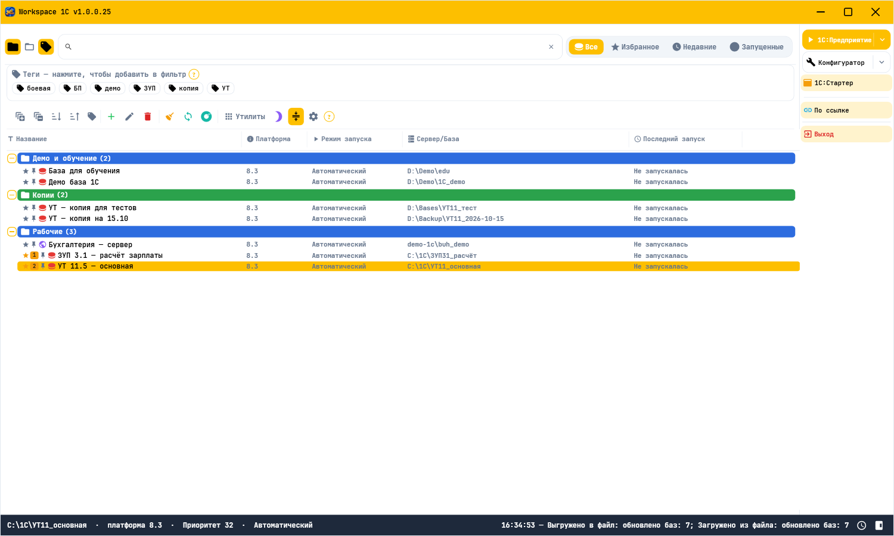

# Workspace 1C

     [](https://t.me/Workspace1C)

> **Кроссплатформенное десктопное приложение на .NET для управления информационными базами 1С:Предприятие 8.3**, заменяющее стандартный список баз 1С современным интерфейсом. Одна кодовая база собирается под обе ОС: **WPF** на Windows и **Avalonia 11** на Linux.



**Workspace 1C** — новое название программы «Управление конфигурациями 1С». Возможности
сохранены полностью, нумерация версий начата заново с **1.0.0.0** (последняя версия под
прежним названием — 0.3.12.70); актуальная версия — **1.0.0.47**.

## 📣 Telegram-канал

Новости проекта, анонсы выпусков, советы и обсуждение — в Telegram-канале
**[t.me/Workspace1C](https://t.me/Workspace1C)**. Подписывайтесь, чтобы первыми узнавать
о новых версиях и делиться идеями.

## 📥 Скачать

Готовые исполняемые файлы (один файл, установка .NET не требуется) — на странице
[Releases](https://github.com/sivatorov/Workspace1C/releases/latest):

| Платформа | Файл | Запуск |
|---|---|---|
| Windows 10/11 x64 | `Workspace1C.exe` | двойной щелчок |
| Linux x64 | `Workspace1C-linux-x64` | `chmod +x Workspace1C-linux-x64 && ./Workspace1C-linux-x64` |

Программа сама проверяет наличие новых версий в этом репозитории и предлагает обновиться.

### Командная строка

Программа умеет запускать базы, выводить список и общаться с Telegram без открытия окна —
удобно для ярлыков, скриптов, планировщика ОС и агентов разработки (обе платформы):

| Флаг | Назначение |
| --- | --- |
| `--run "Имя базы"` | Запускает базу в «1С:Предприятии» без открытия окна |
| `--run "Имя базы" --designer` | Запускает базу в «Конфигураторе» |
| `--list` | Выводит список баз с Id |
| `--telegram-send --text "…" [--kind success]` | Уведомление о прогрессе в Telegram |
| `--telegram-confirm --prompt "…" [--timeout N]` | Подтверждение inline-кнопками «Да/Нет» с ожиданием ответа |
| `--json` | Машиночитаемый вывод в едином контракте (глобальный флаг) |
| `--profile <id>` | Использует указанный профиль |

Единые коды возврата: **0** — успех, **1** — ошибка, **2** — не найдено, **3** — частичный
успех, **4** — отказ подтверждения (нажата «Нет»), **5** — таймаут подтверждения.
Команды выполняются без GUI (в т.ч. из планировщика ОС).

Телеграм-мост для агентов разработки (Roo Code / Claude Code) описан в
[`docs/telegram-dev-bridge.md`](docs/telegram-dev-bridge.md): настройка бота, команды,
коды выхода и правила интеграции.

### Переход с «Управление конфигурациями 1С»

- Просто запустите Workspace 1C: при первом старте список баз, группы, настройки, профили и
  задания **копируются** из каталога данных прежней версии программы в новый каталог
  `%APPDATA%\Workspace1C` (Linux — `~/.config/Workspace1C`). Старый каталог не удаляется.
- Портативная установка продолжает работать с каталогом `Workspace1C-Data` рядом с exe.
- Автозапуск при старте ОС, если был включён, нужно включить заново в настройках Workspace 1C.
- Прежняя версия обновлений больше не получает: новые выпуски публикуются только здесь.

---

## 🗺️ Карта возможностей

Карта собрана по местам интерфейса: где искать каждую возможность.

### Главное окно: список баз
| Где в программе | Что там делается | Зачем |
| --- | --- | --- |
| Вкладки «Все / Избранное / Недавние / Запущенные» | Четыре среза списка и вложенные папки для баз | Быстро добраться до нужной группы баз |
| Закладки 1-9 (Alt+1…9) и закрепление | Открывает избранную базу и держит важные сверху | Запуск с клавиатуры без поиска |
| Поле поиска и метки баз | Находит базу по названию и тегам | Отфильтровать большой список |
| Палитра команд | Ищет базу и команду интерфейса по названию | Не искать нужное по меню глазами |
| Мультивыделение строк списка | Применяет действие сразу к нескольким базам | Обслуживать группу баз за один раз |
| Контекстное меню базы | Открывает базу в 1С:Предприятии или в конфигураторе | Запустить базу в нужном режиме |
| Зелёная точка у имени базы | Показывает, что база сейчас запущена | Не открывать базу второй раз |
| Кнопка «+» на панели инструментов | Создаёт пустую базу или базу из шаблона .cf и .dt | Завести новую базу |
| Вкладки «Все / Избранное / Недавние / Запущенные» | Переключение вкладок ускорено: контейнеры строк переиспользуются (1.0.0.31, issue #21) | Меньше задержка и память при частом переключении |

### Свойства информационной базы
| Где в программе | Что там делается | Зачем |
| --- | --- | --- |
| Версия платформы, разрядность и вид клиента | Выбирает версию платформы, разрядность, тонкий или толстый клиент | Запускать базу на нужной платформе |
| Учётные данные для запуска и хранилища | Разводит логин и пароль для запуска, конфигуратора и хранилища | Держать разные учётные данные для каждого режима |
| Скрипты до и после запуска | Выполняет свои команды и внешнюю обработку при старте базы | Дорабатывать запуск базы под себя |
| Флаг «Приватная база» | Скрывает базу из списков, пока профиль не разблокирован | Скрыть конфиденциальные базы от посторонних |

### Контекстное меню базы
| Где в программе | Что там делается | Зачем |
| --- | --- | --- |
| «Администрирование» | Дублирует базу и выгружает её в файл | Поставить эксперимент на копии, не трогая рабочую базу |
| «Пользовательские действия…» | Подставляет параметры базы в свою команду | Свои сценарии для одной базы или группы |

### «Утилиты»: копии и задания
| Где в программе | Что там делается | Зачем |
| --- | --- | --- |
| «Задания по расписанию», кнопка «Сценарии…» | Хранит шаблоны имён, папки и формат выгрузки | Настроить копирование один раз и переиспользовать |
| «Задания по расписанию» | Выполняет копии и обновления по времени | Обслуживать базы без участия человека |
| «Задания по расписанию», связка «Копия - обновление» | Сначала копирует базу, потом обновляет конфигурацию | Обновлять базу с запасной копией |
| «Задания по расписанию» | Догоняет задания, пропущенные во время простоя | Не пропускать запланированные копии после выключения |
| «Утилиты» | Показывает сделанные выгрузки и возвращает базу из них | Поднять базу из готового архива |

### «Утилиты»: обслуживание
| Где в программе | Что там делается | Зачем |
| --- | --- | --- |
| «Центр обслуживания» | Доступность, копии, размер и свободное место по всем базам, фильтр «Только проблемы» | Видеть проблемы всех баз на одном экране |
| «HTML-отчёт по базам» и «Экспорт списка в CSV» | Отчёт по видимым базам и выгрузка списка для Excel | Передать состояние баз коллегам |
| «Очистка кэша 1С» | Показывает размеры кэша и удаляет его по базам | Освободить место от старых кэшей |
| Поиск потерянных баз | Ищет базы 1С на дисках и предлагает их добавить | Вернуть в список забытые базы |
| «Инспектор процессов 1С» | Показывает процессы платформы и базы, которые они держат | Понять, кто держит базу |
| Контекстное меню файловой базы | Ставит и снимает блокировку сеансов по расписанию | Не пускать пользователей на время обслуживания |
| Контекстное меню файловой базы, Ctrl+Alt+Q | Проверяет целостность файловой базы | Убедиться, что база не повреждена |
| «Блокировка приложения» | Закрывает интерфейс паролем | Отойти от компьютера, не закрывая программу |

### «Утилиты»: обновления 1С
| Где в программе | Что там делается | Зачем |
| --- | --- | --- |
| «Проверка обновлений конфигураций» (F9) | Находит новый релиз и предлагает цепочку версий | Обновиться, когда прямого обновления нет |
| «Актуальные релизы» (Alt+F9) | Проверяет типовые конфигурации и качает их пачкой | Держать типовые базы на свежих релизах |
| «Обновление платформы 1С» (Ctrl+F9) | Ставит версию на Windows, на Linux готовит команду установки; удаляет старые | Обновить платформу на рабочих местах |
| «Задания по расписанию», тип «Обновить приложение» | Ставит новую версию программы по расписанию | Держать программу на свежей версии |

### «Утилиты»: серверы, службы и хранилище
| Где в программе | Что там делается | Зачем |
| --- | --- | --- |
| «Серверы 1С» (Ctrl+Alt+S) | Показывает кластеры, процессы и сеансы сервера | Видеть состояние сервера 1С |
| «Серверы 1С», сеансы и блокировки | Закрывает лишние сеансы и снимает блокировки | Разблокировать базу, которую держат |
| «Серверы 1С», вкладка «Базы» | Создаёт и удаляет базы сервера | Завести базу прямо на сервере 1С |
| «Импорт из кластера 1С» | Добавляет базы сервера в список приложения | Забрать базы кластера в свой список |
| «Импорт из кластера 1С» | Работает на rac 8.5.x: перебор форматов идентификатора кластера (1.0.0.30/1.0.0.31, issue #25) | Импортировать базы с новых серверов 1С |
| «Импорт из кластера 1С» | Берёт сервер из справочника «Серверы 1С» (1.0.0.30, issue #27) | Не вводить адрес/порт/логин заново |
| «Серверы 1С», кнопка «Диагностика сети…» | Проверяет доступность сервера и его портов | Найти причину недоступной базы |
| «Управление службами» (Ctrl+Shift+S) | Запускает, останавливает и группирует службы системы | Управлять службами 1С из одной программы |
| «Хранилище конфигурации» | Показывает версии, даёт сравнение и захват объектов | Работать с хранилищем без конфигуратора |
| «Пакетное обновление из хранилищ» | Обновляет выбранные базы из хранилища по очереди | Обновить много баз за один проход |
| «Обозреватель метаданных» | Показывает дерево объектов конфигурации без конфигуратора | Найти объект, не открывая базу |
| «Сравнение конфигураций» | Отчёт об отличиях базы и файла .cf или двух файлов | Понять, что изменилось между базами |

### «Утилиты»: списки баз и данные
| Где в программе | Что там делается | Зачем |
| --- | --- | --- |
| «Синхронизация с ibases.v8i» | Забирает базы из файла и выкладывает их обратно | Обмен базами со старым списком 1С |
| «Импорт из StartManager» | Забирает базы и группы из списка StartManager | Перейти с другого менеджера баз |
| «Экспорт и импорт списка баз» | Переносит список баз между установками в JSON | Переехать на другой компьютер без потерь |
| «Экспорт в файл *.v8i…» / «Импорт из файла *.v8i…» | Сохраняет и загружает список баз в произвольный файл ibases.v8i (1.0.0.31, issue #29) | Обмен базами с другим профилем, не затрагивая основной список |
| Контекстное меню при мультивыделении, «Для выделенных (N)…» | Меняет сервер и путь сразу у многих баз | Перевести группу баз на другой сервер |
| «Утилиты», раздел «Информация» | Отправляет отчёты о копиях и заданиях в Telegram и на почту | Узнавать о сбоях без проверки программы |

### Настройки, трей и система
| Где в программе | Что там делается | Зачем |
| --- | --- | --- |
| Настройки, Отображение, Колонки | Меняет состав, ширину и порядок колонок | Видеть в списке только нужные поля |
| Настройки, вкладка «Темы» | Выбирает тему, набор иконок и свои цвета | Оформить программу под себя |
| Настройки, вкладка «Темы» | Акцентные цвета и контраст HEX-текста по фактическому фону (1.0.0.30/1.0.0.31, issue #26) | Цвета не сбрасываются, текст читается в любой теме |
| Настройки, Отображение, «Заголовок окна» | Дополняет заголовок переменными %computer_name% и др. (1.0.0.31, issue #28) | Видеть, на каком компьютере открыта программа |
| Настройки, вкладка «Клавиши» | Назначает горячие клавиши команд | Подстроить сочетания под себя |
| Настройки, Настройки, «Режим функциональности» | Ограничивает набор команд: пользователь, специалист, разработчик | Не показывать лишнее обычному пользователю |
| Настройки | Переключает язык интерфейса между русским и английским | Работать на привычном языке |
| Настройки, Базы, Обслуживание | Включает автозапуск при старте ОС | Программа готова к работе сразу после входа |
| Портативный режим | Держит настройки рядом с программой | Работать со сменного носителя |
| Кнопка компактного режима на панели инструментов | Сжимает отступы строк и высоту заголовка | Больше строк на экране |
| Значок в системном трее | Сворачивает окно в трей и держит меню под рукой | Не держать окно на экране |
| Настройки, Базы, Обслуживание, Интеграция | Регистрирует базу в меню файлового менеджера | Открывать базу прямо из проводника |

## ✨ Возможности

> Карта выше — основной источник «где искать». Здесь — детали и история версий
> (полный список изменений по выпускам — в [`CHANGELOG.md`](CHANGELOG.md)).

- **Запуск баз** в режимах «1С:Предприятие» и «Конфигуратор»; выбор версии и линии платформы, разрядности (32/64), тонкого/толстого клиента, веб-клиента; автопоиск установленной платформы.
- **Управление списком**: вкладки **Все базы / Избранное / Недавние**, иерархические группы с вложенностью, избранное `Alt+1…9`, закрепление, поиск и мультифильтр по тегам, сортировка; переход к базе в общем списке из любой вкладки — **«Найти в списке»** (горячая клавиша **Ctrl+T**, пункт контекстного меню базы): раскрытие цепочки групп, выделение строки и прокрутка к ней именно в разделе **«Все базы»** (строка в «Закреплённых» не перехватывает переход).
- **Теги баз** — назначение прямо в строке списка: кнопка «+ тег» открывает поле с выбором из существующих тегов (выпадающий список) или свободным вводом нового; теги отображаются чипами под названием базы и участвуют в мультифильтре панели «Теги».
- **Горячие клавиши для избранных (закладки баз 1–9)** — избранные базы получают слот с номером (`1`…`9`), до 9 закладок; в списке баз у закладки отображается бейдж с номером. Установка: `Ctrl+Shift+P`, `Ctrl+Shift+[1..9]`, меню закладок (`Ctrl+B`) или звёздочка в строке. Перемещение: `Ctrl+[1..9]` (с раскрытием свёрнутой группы), меню закладок (`Ctrl+B`). Очистка: `Ctrl+Alt+X` (все), удаление конкретной. Запуск: `Alt+<номер>` — «1С:Предприятие», `Ctrl+Alt+<номер>` — «Конфигуратор», `Alt+E` — все базы с закладками.
- **Мультивыделение баз и пакетные операции** — `Ctrl+щелчок` отмечает/снимает базу, `Shift+щелчок` выделяет диапазон от последней обычной строки до цели; помеченные строки подсвечиваются вторичным фоном. При N > 1 в контекстном меню появляется блок **«Для выделенных (N)…»**: назначить тег, переместить в группу, добавить в избранное, выполнить сценарий резервирования, проверить доступность, удалить (обе платформы).
- **Массовая замена в строке подключения баз (меню «Утилиты», блок «Для выделенных (N)…»)** — окно **«Заменить в строках подключения…»**: поиск по полю строки подключения (сервер, порт, имя ИБ на сервере, путь файловой базы, веб-URL или вся строка) с режимами «Точное совпадение / Префикс / Подстрока / Регулярное выражение» и учётом регистра; области «Все базы / Выделенные (N) / Текущая группа»; предпросмотр «база | поле | было → станет» с подсветкой изменённых строк и сводкой (изменяемых баз / без совпадений / без подключения); подтверждение перед применением; кнопка **«Отменить последнюю замену»** (в окне и в «Утилитах»); автосоздание JSON-бэкапа списка перед операцией; приватные базы не затрагиваются; прочие параметры строки (`Usr/Pwd/SchJobDn/disstt`) сохраняются (обе платформы).
- **Пользовательские действия в контекстном меню базы/группы (подменю «Пользовательские действия…»)** — произвольные команды через системный shell с подстановкой параметров базы (`{ИмяБазы}`, `{СтрокаПодключения}`, `{Каталог}`/`{ПутьИБ}`, `{Id}`, `{Тип}`, `{Сервер}`, `{ИмяНаСервере}`, `{ИмяГруппы}`, `{Пользователь}`, `{Пароль}`, `{ВебURL}`, `{Порт}`, `{Дата}`; поддерживается и прежний синтаксис `%…%`) и экранированием подстановок для cmd/PowerShell/sh; область применения — база / группа / обе; выполнение для всех баз группы и для выделенных (N) баз с параллельным запуском; таймаут по умолчанию 30 с; подтверждение по умолчанию (можно отключить для действия или в настройках); горячие клавиши действий; приватные базы исключаются при заблокированном профиле; пароль в командах маскируется в истории запусков (обе платформы).
- **Командная палитра `Ctrl+K`** — быстрый поиск по базам и командам интерфейса: `Enter` выполняет выбранное (для баз — «1С:Предприятие», `Shift+Enter` — Конфигуратор); избранные базы — вверху списка.
- **Настраиваемые горячие клавиши** для запуска и действий интерфейса (вкладка «Клавиши» в окне настроек): включая «Меню закладок» (`Ctrl+B` по умолчанию) и «Меню служб» (`Ctrl+Shift+Alt+S` по умолчанию, 1.0.0.15, issue #11). С 1.0.0.16 (issue #15) вкладка «Клавиши» использует надёжную компоновку (внешний StackPanel + самодостаточные строки: подпись 170px + поле HotkeyBox, отступ 6px) — добавление любых новых хоткеев не вызывает наложение надписей (двойная надпись исправлена в 1.0.0.15); все 30 полей сохранены (включая «Меню служб» Ctrl+Shift+Alt+S).
- **Создание ИБ** — пустая или из шаблона (`.cf`/`.dt`), файловые и клиент-серверные; редактирование, удаление, выгрузка `.dt`/`.cf`, тестирование, физическое удаление каталога. Последние использованные параметры запоминаются и подставляются при следующем открытии окна: сервер СУБД, порт и тип базы («Файловая»/«Клиент-серверная») — и после успешного создания, и после отмены.
- **Дублирование базы (контекстное меню → «Администрирование»)** — файловая ИБ: копия каталога рядом с исходным и запись в списке; клиент-серверная ИБ (0.3.9.100): клон на сервере через выгрузку `.dt`/`.cf` → `CREATEINFOBASE` → восстановление данных (режимы «Данные и конфигурация» / «Только конфигурация», с параметрами СУБД и целевым сервером). Новая запись — с новым Id, чистой историей; наследует подключение, авторизации и теги; для запущенной базы копирование запрещено.
- **Drag & drop добавление баз из проводника** — перетащите каталог файловой ИБ или файл `1Cv8.1CD` из проводника (Windows) / файлового менеджера (Linux) в главное окно: база добавится в список автоматически (несколько путей за один drop; дубликаты пропускаются).
- **Очистка кэша 1С** с отображением размеров по базам и остатков от удалённых баз.
- **Синхронизация с `ibases.v8i`** (импорт/экспорт, автоматическая по режиму), **импорт из StartManager**, резервные копии профиля. Выборочный экспорт и добавляющий импорт отдельных баз — через окно-чеклист (Настройки → Базы → Список). Дедупликация групп при импорте безопасная: удаляются только настоящие дубликаты (одинаковый ID или имя+родитель), группы с детьми/базами не теряются, дети перевешиваются на сохранённую группу. Если папки «пропали» из-за прежних версий — достаточно удалить `deleted_groups.json` из каталога данных (см. ниже): группы, удалённые ранее вручную, перестанут «не возвращаться», а диагностика импорта в журнале (`logs/`) покажет количество групп до/после, число баз без группы и пары «удалён дубликат → сохранена группа».
- **Экспорт/импорт списка баз в JSON (меню «Утилиты»)** — полный перенос состояния списка между установками: базы со всеми полями (подключение файловая/клиент-серверная/веб, имя, группа, теги, закладки 1–9, закрепление, приватность, внешняя обработка, скрипты pre/post запуска, раздельные учётные данные, параметры запуска, порядок сортировки), иерархия групп целиком, избранное и закрепление; приватные базы — при разблокированном профиле. Импорт — добавляющий (дубликаты по строке подключения пропускаются) со сводкой перед подтверждением.
- **HTML-отчёт по базам (меню «Утилиты»)** — самодостаточный HTML-файл со сводным отчётом по видимому списку баз (стили встроены, внешних зависимостей нет): шапка с датой/временем и профилем, сводка карточками (всего/доступно/недоступно по последним результатам проверки, базы с копиями, объём ИБ, проблемные базы), таблицы по группам (имя, группа, тип, строка подключения, доступность, конфигурация/версия, размер, последняя копия, дата изменений, теги, закладка) с подсветкой проблемных строк по критериям Центра обслуживания (недоступна / нет копии / копия старше 7 дней / мало места / кэш больше 1 ГБ / новый релиз); навигация «Только проблемы» и ссылки-якоря по группам; приватные базы скрыты, как в CSV-экспорте. Открывается в любом браузере, пригоден для печати/рассылки.
- **Поиск потерянных и забытых баз 1С на дисках** с инкрементальной отдачей результатов, поиском по каталогу и добавлением найденных баз в программу и/или `ibases.v8i`.
- **Профили пользователей** с паролями (PBKDF2-SHA256), миграция данных.
- **Приватные базы** — флаг «Приватная база» в свойствах: база скрывается из всех
  списков (дерево, поиск, теги, трей, командная палитра, недавние), пока профиль
  не разблокирован паролем; команда «Открыть приватные базы» в меню «Утилиты»
  и авто-разблокировка при входе с паролем профиля; запуск приватной базы через
  CLI отклоняется.
- **Локализация** (русский/английский, подключение языков без пересборки).
- **Темы оформления**: 8 встроенных полноценных тем — **Светлая**, **Тёмная**, **Синяя**, **Зелёная**, **Material Design**, **macOS**, **Windows XP**, **Glass** (отдельная вкладка **«Темы»** в настройках, обе платформы); тема задаёт цветовую схему (2 палитры), стиль кнопок управления окном (Fluent/Minimal/Classic/Material/MacOS/WindowsXp/Glass — включая macOS-«светофор» из трёх цветных кругов и полупрозрачные кнопки Glass), набор иконок и оформление меню «Утилиты», выбор сохраняется и восстанавливается после перезапуска. Клик по карточке темы показывает её в предпросмотре (большое окно с кнопками управления окном, кнопками заголовков, мини-галереей иконок набора и палитрой темы), а выбор сохраняется только по «Применить»/«ОК»; «Отмена» возвращает прежнюю тему. **Шесть наборов иконок** — Fluent, Outline, Material, MacOS, WindowsXp, Glass (суффиксные словари `IconsMaterial/IconsMacOS/IconsWindowsXp/IconsGlass`, отсутствующие иконки бесшовно фолбэчатся на Fluent); глифы кнопок управления окном следуют активному набору. Собственные цветовые схемы с двумя палитрами и живым предпросмотром продолжают работать; автогенерация пары светлой и тёмной палитр из одного базового цвета («Создать схему из цвета…»). Темизация распространяется на все окна приложения, включая диалоги «Сценарии резервирования» и «Задания по расписанию».
- **Структура меню «Утилиты»: группа «Новинки программы»** (1.0.0.2, issue #4, Windows и Linux) —
  компоновка меню гарантированно содержит группу «Новинки программы»: пункты-новинки,
  отсутствующие в файле, добавляются в группу автоматически; если группы нет в файле — она
  создаётся в конце корня; менять можно только её местоположение (скрыть папку в настройках
  структуры нельзя — чекбокс видимости отключён). В рабочем меню (1.0.0.3) папка видима
  **только если в ней есть пункты**: при отсутствии новых пунктов она не показывается,
  а при появлении новых становится видимой безусловно.
- **Произвольные поля базы** (1.0.0.3, issue #6, Windows и Linux) — на вкладке «Идентификатор»
  окна свойств базы таблица «Произвольные поля» (колонки «№» и «Значение поля», высота 4–5
  строк) с кнопками «Добавить / Изменить / Удалить»; добавление и правка — в модальном окне
  (закрывается по ESC, фокус в поле «Значение»); рядом — кнопка «Сценарии…» для открытия
  списка сценариев. Значения подставляются в сценарии запуска скриптов и пользовательские
  действия токеном `%Additional_N%` (например, `%Additional_1%` — первая строка); в форме
  правки сценария список «Подстановки» содержит пример `%Additional_1%`. С 1.0.0.5 (issue #6):
  при открытии таблица дополняется пустыми строками до минимума (5 строк), при сохранении
  хвостовые пустые строки обрезаются (внутренние пустые подставляются как пустое значение),
  заголовки таблицы раскрашены контрастно (обе платформы). С 1.0.0.7 (issue #6): двойной
  клик по строке таблицы открывает окно правки значения (заголовок и пустая область
  не реагируют; невыбранная строка перед правкой выделяется).
- **Окна с общим хромом** (Windows): единая «стеклянная» рамка второстепенных окон с собственными кнопками заголовка; максимизация занимает строго рабочую область монитора и не перекрывает панель задач, системный хоткей Win+Up работает, двойной клик по полосе заголовка разворачивает/восстанавливает окно (как в главном окне) (issue #368).
- **Проверка доступности всех баз (кнопка «Доступность»)** — пакетная проверка баз с **индикатором хода**: пока база проверяется, её значок становится серым с часиками, результат каждой базы публикуется сразу по мере готовности, а по завершении выводится итог «Проверено N баз: доступно M, недоступно K» (ограниченный параллелизм — до 4 баз одновременно; повторный запуск во время проверки игнорируется).
- **Индикатор «база сейчас запущена»** — зелёная точка у имени базы, если процесс 1С с параметрами подключения этой базы обнаружен среди запущенных (опрос раз в 10 с: Windows — WMI, Linux — /proc).
- **Автообновление из GitHub Releases** с единым диалогом обновления и **многопоточной загрузкой** (HTTP Range, до 8 сегментов с докачкой каждого и динамической балансировкой: завершившийся сегмент берёт следующий незанятый диапазон, поэтому все соединения работают до конца файла, а «хвост» не докачивается одним потоком) — провайдеры, режущие скорость на одно соединение, больше не тормозят скачивание; при любом сбое параллельного режима загрузка автоматически переходит в однопоточный путь.
- **Проверка обновлений конфигураций 1С (F9)** — проверка для выбранной ИБ по ресурсу обновлений 1С, подсветка нового релиза и загрузка дистрибутива; авторизация выполняется через портал 1С (логин/пароль на `login.1c.ru`, учётные данные ИТС — из справочника `its_accounts.json`), последняя версия определяется со страницы проекта на `releases.1c.ru`, дистрибутив скачивается с этого же ресурса. Страница личного кабинета («Личные данные») после POST считается успешным входом, а детектор формы входа опирается на поля `username`/`password` (не только на токен `execution`) — ложного «вход не подтверждён» при корректных кредах нет. При сбое входа (неверные данные, лимит попыток, изменённая форма входа, запрос капчи) показывается понятная причина: отдельное сообщение, если портал запросил подтверждение (капча), и совет проверить ту же пару логин/пароль на `login.1c.ru` в браузере (режим инкогнито) — если браузер просит капчу или отклоняет пароль, автоматический вход также не сработает; имя используемой учётной записи ИТС и кнопки «Открыть login.1c.ru в браузере» / «Учётные данные ИТС…» — то же поведение в окнах «Обновление платформы 1С» (Ctrl+F9) и «Скачивание версии платформы 1С».
- **Цепочки обновлений конфигурации (issue #352)** — в окне «Проверка обновлений» (F9) при наличии нового релиза проверяется, можно ли обновить текущую версию напрямую до последней (по колонке «Список версий» таблицы релизов на `releases.1c.ru`); если нельзя — строится цепочка обновлений: вариант **«снизу вверх»** (каждый шаг — максимальная версия, на которую можно прыгнуть с текущей) и вариант **«оптимальный»** (минимальное число прыжков), показываемый, если отличается; таблица вариантов с колонками «№» и «Список версий», кнопка **«Скачать цепочку»** (выбор каталога и последовательная загрузка всех версий выбранного варианта с прогрессом «какой файл скачивается и сколько осталось»); при отсутствии данных о совместимости — прежнее поведение (загрузка только последней версии). Скачивание (и «Скачать», и «Скачать цепочку») разрешает **конечный адрес дистрибутива**: переход по странице файлов релиза и промежуточным страницам скачивания до реального архива, с авторизацией на portal.1c.ru и корректным расширением итогового файла (`.zip`/`.rar`/`.exe`/`.7z`); файл пишется во временное имя `.download` и по успеху атомарно переименовывается (при сбое частичный файл не остаётся); **докачка цепочки** — повторный запуск в ту же папку пропускает уже скачанные файлы; окно выше по умолчанию, а при появлении таблицы вариантов поднимается так, чтобы 2–3 строки были видны без прокрутки.
- **Окно «Актуальные релизы» (ALT+F9)** — пакетная проверка отслеживаемых типовых конфигураций.
- **Автообновление платформы 1С (Ctrl+F9)** — окно «Обновление платформы 1С» (меню «Утилиты»): единый список установленных и доступных версий с портала 1С (`releases.1c.ru/project/Platform83`; логин/пароль сайта 1С — из справочника учётных записей ИТС `its_accounts.json`, как у проверки конфигураций) с колонками Версия/Размер/Статус/Совместимые базы; загрузка дистрибутива (многопоточная — HTTP Range, до 8 соединений с докачкой, fallback на однопоточный путь; проверка свободного места); «Скачать и установить» на Windows — тихая установка `/VERYSILENT /SUPPRESSMSGBOXES /NORESTART` с проверкой Authenticode-подписи и запуском с UAC, на Linux — готовая команда `sudo` для `.deb`/`.rpm` с копированием в буфер обмена (для `.tar.gz` — инструкция); «Только скачать»; «Удалить старые версии…» — диалог с чеклистом ВСЕХ установленных версий и пометками «новейшая» / «используется базами» / «используется запущенными процессами» (спорные версии по умолчанию не отмечены и удаляются с отдельным подтверждением); предупреждения перед установкой — запущенные процессы 1С, свободное место, подпись файла, права администратора; уведомление о результате (обе платформы).
- **Список типовых конфигураций** — предопределённый набор + пользовательские, формирование ссылок обновлений по правилу 1С, настройка связи ИБ ↔ конфигурация и определение версии. Поле «Переопределённая ссылка» (в свойствах конфигурации/редакции) понимает **только конечную часть** адреса после `releases.1c.ru/project/` (например `Enterprise13`) — полная ссылка собирается автоматически с подменой ника; полная ссылка вводится целиком (issue #369). В свойствах базы (вкладка «Платформа») — группа **«Привязка»**: текущая привязка (типовая конфигурация · редакция · адрес каталога релизов), кнопки «Связать…» (повторная привязка через окно «Связать с конфигурацией») и «Очистить» (сброс связи) — обе платформы. С 1.0.0.11 список сортируется по любой колонке (щелчок по заголовку, стрелка ▲/▼; по умолчанию — по наименованию), у редакции есть флаг **«Основная»** (кнопка «Сделать основной», колонка ★) — она используется, когда редакцию не удалось определить по версии базы; учётная запись ИТС конфигурации применяется и для баз, сопоставленных с конфигурацией по имени.
- **Сценарии резервирования (DT/CF/ZIP/RAR, до 3 каталогов)** — модель сценария с шаблоном имени и учётными данными, выполнение для выбранной ИБ.
- **Выполнение сценария (SHIFT+CTRL+F5)** — пакетная выгрузка `.dt`/`.cf` через конфигуратор, упаковка в ZIP/RAR и копирование во все каталоги назначения.
- **Задания по расписанию (меню «Утилиты»)** — резервная копия, обновление конфигурации ИБ из `.cf` (`/LoadCfg` + `/UpdateDBCfg`), связка «Копия → обновление», проверка целостности файловой ИБ (`chdbfl`, тихий запуск с ожиданием результата) и обновление самого приложения по времени и дням недели (с 1.0.0.2 задание «Обновить приложение» поддерживает повтор по расписанию, как проверки обновлений платформы и конфигураций); выполняются фоновым планировщиком, пока приложение запущено. **Догоняющее выполнение**: если компьютер был выключен в плановый момент, при следующем запуске задание выполняется сразу — один раз (свежие пропуски не старше 7 суток; к «Обновлению приложения» не применяется), с системным уведомлением «Выполнено пропущенных заданий: N»; отключается в настройках (Настройки → Настройки → «Выполнять пропущенные задания по расписанию при старте»). В окне задания рядом с выбором сценария есть кнопка «Сценарии…» — список сценариев открывается без закрытия окна, а созданные/изменённые сценарии сразу появляются в выборе. Редактирование задания («Изменить») перезаписывает его без дублей, а кнопка **«Скопировать»** создаёт копию с новым Id и именем «… — копия» (issue #370). Список заданий: отбор по типу действия и поиск по всем полям, **F2** — правка строки, **Delete** — удаление, чекбокс «Активно» прямо в строке (в начале, до текста); поля выбора показывают названия, а не внутренние ключи (issue #372).
- **Список выгрузок и восстановление (SHIFT+CTRL+F7, /RestoreIB)** — обзор созданных файлов и загрузка данных обратно в ИБ (в т.ч. без интерактивного конфигуратора).
- **Пакетное обновление конфигураций из хранилищ (меню «Утилиты»)** — окно со списком баз с заполненным адресом хранилища конфигурации и флажками; выбранные базы последовательно обновляются через конфигуратор в пакетном режиме (`/ConfigurationRepositoryF` + `/ConfigurationRepositoryN/P` + `/ConfigurationRepositoryUpdateCfg /UpdateDBCfg`) с построчным журналом (успех/ошибка/время) и итогом; базы, запущенные в данный момент, пропускаются, результат попадает в историю запусков (`RepoUpdate`).
- **Хранилище конфигурации (меню «Утилиты»)** — обозреватель хранилища конфигурации выбранной базы (доступен для базы с заполненным адресом хранилища): подключение к хранилищу (адрес и имя — из свойств базы, логин/пароль — из учётных данных базы с возможностью ручного ввода; **пароль не сохраняется на диск**), список версий хранилища (номер/дата/автор/комментарий), состав выбранной версии (объекты с типами и владельцами), сравнение версий между собой и с текущей конфигурацией базы (отчёт CSV/TXT), выгрузка версии в файл .cf и **захват/отмена захвата всех объектов** (комментарий операции ведётся локально — журнал окна и история запусков базы; платформе при Lock/Unlock не передаётся). Механика — пакетный режим конфигуратора (ключи `/ConfigurationRepositoryF/N/P`, `/ConfigurationRepositoryDumpCfg -v`, `/ConfigurationRepositoryReport`, `/ConfigurationRepositoryLock`/`/ConfigurationRepositoryUnlock`); конфигурация базы должна быть связана с хранилищем, база не должна быть запущена. Ограничение: текстовый формат отчёта по истории не документирован — при его недоступности показывается актуальная версия, и сравнение двух произвольных версий недоступно (состав, сравнение с базой и выгрузка актуальной версии работают).
- **Центр обслуживания (меню «Утилиты»)** — дашборд состояния всех баз: доступность (с временем последней проверки), последняя копия, размер ИБ, **свободное место на диске** (файловые базы: диск/точка монтирования и объём со долей, например «C:\ — 23,4 ГБ (12%)»; ниже порога ячейка подсвечивается красным), кэш (вычисляется при открытии), конфигурация/версия, возраст данных и последний результат проверки обновлений конфигурации. Фильтр «Только проблемы» показывает базы с проблемами (недоступна / копия отсутствует или старше 7 дней / кэш больше 1 ГБ / мало свободного места на диске / обнаружен новый релиз); порог свободного места настраивается (Настройки → Базы → Обслуживание, по умолчанию 10 ГБ, 0 — не предупреждать); кнопки «Проверить доступность» и «Открыть базу» (переход к строке в главном списке), двойной клик — выбрать базу в главном окне.
- **Блокировка сеансов файловой ИБ (CTRL+ALT+L)** — установка/снятие блокировки без открытия «1С:Предприятия»: время начала (+5 мин), длительность (30 мин), сообщение с параметрами `{ДатаНач}`/`{ДатаКон}`, шаблоны «Технические работы» и «Обновление ИБ».
- **Временная блокировка приложения паролем** — защита интерфейса на время отсутствия пользователя: команда «Блокировка приложения» (меню «Утилиты», сразу после пунктов «Серверы 1С» и внешней консоли администрирования, можно назначить горячую клавишу) показывает модальное окно блокировки, и пока пароль не введён, приложение недоступно — окно разблокировки закрывается только верным паролем. Первый вызов предлагает задать пароль (хранится в виде PBKDF2-хэша).
- **Интеграция с проводником Windows** — ассоциация `.1CD` и команды контекстного меню «Зарегистрировать в списке баз» / «Запустить 1С:Предприятие» / «Запустить Конфигуратор» (регистр `HKCU`, без прав администратора; Настройки → Базы → Обслуживание → Интеграция). На Linux функция недоступна.
- **Проверка целостности файловой ИБ (chdbfl, CTRL+ALT+Q)** — быстрый запуск утилиты проверки целостности файловой ИБ без открытия «1С:Предприятия» (контекстное меню файловой базы).
- **Управление службами (меню «Утилиты», сразу под «Серверы 1С», Ctrl+Shift+S)** — окно
  со списком интересующих служб (выбор сохраняется в `services.json` каталога данных
  профиля): кружок статуса (зелёный — запущена) и локализованный текст; кнопки «Обновить /
  Запустить / Остановить / Пауза / Восстановить / Перезапустить» и подменю «Все сервисы»
  (по всем применимым службам), контекстное меню строки с теми же командами; доступность
  кнопок зависит от состояния службы; «Настроить» — чеклист ВСЕХ служб системы (поиск,
  «Выбрать все / Сбросить», уже выбранные отмечены); «Системный диалог» (Windows) открывает
  `services.msc`. Windows — `System.ServiceProcess.ServiceController`; Linux — `systemctl`
  (systemd): при отсутствии systemd действия недоступны, пауза/восстановление не
  поддерживаются, системного диалога нет. Хоткей настраивается в «Настройки → Клавиши»
  (обе платформы). С 1.0.0.11 окно модальное; порядок служб задаётся кнопками «Переместить
  выше / ниже»; команды — цветные иконки с подписями; в «Настроить» службы по алфавиту, ОК/Отмена
  над списком. **«Выдать права»** (Windows) — права текущего пользователя на запуск/остановку
  служб списка одним запросом повышения прав, без запуска программы от администратора.
  **Группы служб** — окно группы (Описание, «Управляемый список» / «Все службы», перенос
  стрелками, порядок членов), иконка-индикатор и статус группы (зелёный — все запущены,
  жёлтый — частично, серый — не запущены); команды группы выполняются по всем её службам
  в порядке списка; новая группа добавляется в начало, группы перемещаются вверх/вниз.
  **Меню служб в трее** — подменю «Службы» над «Синхронизацией с ibases»: «Настроить…»,
  подменю каждой службы и группы (у группы — сначала команды действий, затем её службы),
  «Все сервисы» (Windows и Linux); на Windows Ctrl+правый клик по иконке трея открывает
  меню служб.
- **Экспорт и импорт списка баз в произвольный файл *.v8i (1.0.0.31, issue #29,
  Windows и Linux)** — в настройках (вкладка «Базы» → «Список баз») добавлены кнопки
  «Экспорт в файл *.v8i…» и «Импорт из файла *.v8i…»: список баз и групп приложения
  можно сохранить в любой файл ibases.v8i (например, для подготовки общего списка
  информационных баз в отдельном профиле) и загрузить из любого файла, не затрагивая
  основной список пользователя. Экспорт в существующий файл — аддитивный (чужие записи
  не удаляются), в новый — полный.
- **Добавка к заголовку окна: произвольное дополнение с переменными (1.0.0.31,
  issue #28, Windows и Linux)** — раздел «Заголовок окна» в настройках «Отображение»:
  галочка «Дополнить заголовок программы», поле «Шаблон дополнения» с живым превью
  и кликабельные подсказки переменных `%computer_name%`, `%user_name%`, `%user_domain%`,
  `%computer_ip%`, `%display_server%` (x11/wayland на Linux, «windows» на Windows).
  Заголовок обновляется при запуске и при изменении настроек.
- **«Цветовое оформление»: контраст HEX-текста редактора по фактическому фону
  (1.0.0.31, issue #26, Windows и Linux)** — цвет текста HEX-значений в редакторе цветов
  контрастен фону строки (карточке активной темы приложения), а не фону редактируемой
  палитры: при редактировании светлой палитры в тёмной теме текст больше не сливается
  с формой (и наоборот); сохранённые правки акцентов встроенных тем по-прежнему
  перекрывают дефолтные #FDBF00/#E0A800 при повторном входе.
- **«Импорт из кластера 1С»: ошибка после успешного подключения, прогресс и кнопка
  «Импортировать» (1.0.0.31, issue #25, Windows и Linux)** — перебор форматов передачи
  идентификатора кластера распространён на команду «cluster info» (как в «job list»/
  «infobase summary list»), поэтому загрузка баз кластера на rac 8.5.x больше не падает
  после успешного подключения; при единственном кластере он выбирается автоматически
  (при нескольких — пользователь выбирает сам); неожиданные исключения не оставляют
  «крутящийся» индикатор прогресса.
- **«Вкладки списка баз»: устранено накопление памяти при переключении
  Все/Избранное/Недавние (1.0.0.31, issue #21, Windows и Linux)** — `ReplaceItemWise`
  больше не уходит в полный Reset при частичном пересечении составов (переход
  «Все»(600) → «Недавние»(10) раньше пересоздавал контейнеры всех строк): Reset
  выполняется только при нулевом пересечении, иначе контейнеры оставшихся строк
  переиспользуются; диагностика `CM_TREESWITCH` дополнена замером кучи (`heapMb`).
- **«Правка свойств базы»: строка обновляется сразу даже при активном отборе
  (1.0.0.36, issue #35, Windows и Linux)** — при правке свойств поднимается
  уведомление обо всех свойствах базы (`Infobase.NotifyAllPropertiesChanged`,
  единый помощник `InfobaseEditor.ApplyEdits` в обоих путях редактирования),
  поэтому в плоском режиме (тег/поиск/«Избранное»/без группировки) строка
  больше не «замораживается».
- **«Переход к строке»: всегда на домашнюю строку во «Все базы», а не на копию
  в «Закреплённых» (1.0.0.36, issue #31, Windows и Linux)** — контейнер
  узла-группы ищется строго по ссылке узла (раньше совпадал с первым групповым
  заголовком — «Закреплённые»), поиск проверяет поддерево домашнего узла;
  Reachability-планировщик `RevealPlanner` + диагностика `CM_REVEAL`.
- **«Импорт из кластера 1С»: при единственном кластере он выбирается
  автоматически и список баз показывается сразу (1.0.0.36, issue #25, Windows
  и Linux)** — WPF-окно пересчитывает кнопки/статус по `SelectedClusterId`
  при ручном запуске и при входе из «Серверы 1С».
- **«Переключение вкладок»: диагностика накопления памяти, эксперимент B
  (1.0.0.36, issue #21, Windows)** — `CM_TREESWITCH` дополнен `allocMb` и
  счётчиками реализованных/отсоединённых строк; добавлен флаг
  `CM_TREESWITCH_FLUSH` (сброс Recycling-пула контейнеров после смены вкладки);
  выпуск диагностический, окончательный режим — по замерам автора.
- **Новые иконки приложения (1.0.0.36)** — `app.ico`/`tray.ico` во всех
  размерах; обновлены превью для Linux (`app_icon_preview`/`tray_icon_preview`)
  и иконка AppImage/.desktop (`package/linux/app.png`).
- **«Заголовок окна»: дополнение из шаблона видно сразу после запуска (1.0.0.35,
  issue #34, Windows и Linux)** — после перезапуска заголовок (и видимая шапка
  на Windows) собирается с суффиксом из настройки «Дополнить заголовок программы»
  сразу, тем же путём, что и после «ОК» настроек: заходить в настройки больше не
  нужно (на Windows шапка обновлялась только после открытия/закрытия настроек).
- **«Импорт из кластера 1С»: смена сервера очищает состояние и активирует
  «Подключиться»; прогресс и кнопки не застревают (1.0.0.35, issue #25, Windows
  и Linux)** — выбор другого сервера очищает кластеры, чеклист баз и текст
  ошибки/статуса и сразу делает доступной кнопку подключения; уведомления
  о занятости доставляются окну на UI-поток, поэтому индикатор прогресса
  завершается, а «Импортировать» доступна при отмеченных новых базах.
- **«Вкладки списка баз»: при малом пересечении составов коллекции заменяются
  одним Reset вместо сотен поштучных событий (1.0.0.34, issue #21, Windows
  и Linux)** — при сохранении менее четверти состава `ReplaceItemWise` выполняет
  Reset одним событием (вместо ~590 `Remove`/`Insert` на переход «Все»→«Недавние»),
  снижая нагрузку на контейнеры TreeView на Windows; узлы дерева групп отписываются
  от своих коллекций при удалении (`GroupNodeViewModel.Detach`); лог
  `CM_TREESWITCH` дополнен полем `resetMode` (reset|itemwise) для сравнения замеров
  с 1.0.0.33. Релиз диагностический — финальный порог фиксируется по замерам автора.
- **«Переход к строке»: выделение и прокрутка к целевой базе снова работают
  (1.0.0.34, issue #31, Windows и Linux)** — «Найти в списке» (Ctrl+T) и переход
  к закладке (Ctrl+цифра) раскрывают нужную папку, выделяют строку базы в её группе
  во «Все базы» и прокручивают список к ней, а не оставляют выделение на копии
  в «Закреплённых»: цепочка групп-предков принудительно раскрывается со снятием
  ключей свёрнутых до и после пересборки; окно выполняет единственное явное
  выделение+прокрутку по запросу перехода, независимо от «чистой смены вкладки»
  (регрессия 1.0.0.26–1.0.0.31, фикс 1.0.0.32 не сработал).
- **«Цветовое оформление»: повторный вход в настройки показывает сохранённые
  акцентные цвета (1.0.0.33, issue #26, Windows и Linux)** — редактор цветов при
  открытии сразу строит строки по палитре активной темы: прямоугольники-образцы
  и диалог выбора цвета больше не показывают дефолтные #FDBF00/#E0A800 после
  установки своих цветов и повторного входа.
- **«Импорт из кластера 1С»: ошибка после подключения не блокирует загрузку баз;
  из «Серверы 1С» подставляется кластер (1.0.0.33, issue #25, Windows и Linux)** —
  сбой «cluster info» (используется только для подписи хоста строки подключения) не
  оставляет ошибку в окне импорта; при открытии из монитора передаётся выбранный
  кластер (иначе — единственный; при нескольких — подсказка «выберите кластер»,
  прогресс остановлен); «Импортировать» доступна при отмеченных новых базах.
- **«Вкладки списка баз»: расширена диагностика накопления памяти на Windows
  (1.0.0.33, issue #21)** — `CM_TREESWITCH` теперь показывает число событий коллекций
  дерева (Add/Remove/Reset за смену вкладки), кучу после принудительного GC и
  счётчики поколений сборщика — чтобы отличить отложенное освобождение контейнеров
  от реальной утечки подписок.
- **Список версий платформы: тонкий клиент 1С находится и помечается (1.0.0.32,
  issue #33, Windows и Linux)** — версии, установленные как тонкий клиент (в bin
  только `1cv8c.exe`/`1cv8c`), больше не пропадают из диалога выбора платформы;
  в дереве выбора такие версии помечаются суффиксом «(тонкий клиент)» и оранжевой
  подсветкой — видно, что полные возможности (конфигуратор, сервер и т.п.) недоступны.
- **Горячие клавиши: предупреждение о занятой комбинации и пояснение про цифры
  с модификаторами (1.0.0.32, issue #32, Windows и Linux)** — при сохранении настроек
  «Клавиши» программа предупреждает, если назначенная комбинация уже занята другим
  действием или зарезервирована закладками баз (Alt/Ctrl/Ctrl+Shift/Ctrl+Alt + 1…9);
  на вкладке «Клавиши» добавлено пояснение, что комбинации цифр с модификаторами
  заняты закладками и не назначаются.
- **Переход к строке: выделение и прокрутка снова работают (1.0.0.32, issue #31,
  Windows и Linux)** — «Найти в списке» (Ctrl+T) и переход к закладке (Ctrl+цифра)
  снова выделяют строку базы и прокручивают список к ней: восстановление выделения
  выполняется и при смене вкладки, если запрошен переход к строке (регрессия после
  оптимизации переключения вкладок 1.0.0.26–1.0.0.31).
- **README: карта возможностей дополнена, дублирование убрано (1.0.0.32, issue #30)** —
  карта по местам интерфейса дополнена функциями 1.0.0.27–1.0.0.31 (импорт из кластера
  на rac 8.5.1, акцентные цвета и контраст HEX, импорт через справочник серверов,
  ускорение переключения вкладок, экспорт/импорт *.v8i, добавка к заголовку);
  возвращены раздел «Командная строка» (флаги и коды возврата) и ссылка на скриншот
  `docs/img/main-window.png`; дублирующие карту пункты из блока «Возможности» убраны.
- **«Импорт из кластера 1С» на платформе 8.5.1 (1.0.0.30, issue #25, Windows и Linux)** —
  rac 8.5.x отклоняет `--cluster=<uuid>` и в «infobase summary list» (как в «job list»):
  команда загрузки чеклиста баз перебирает форматы передачи идентификатора кластера
  (`--cluster=<uuid>` / `--cluster <uuid>` / позиционный `<uuid>`) с запоминанием рабочего
  формата по ключу подключения + имени команды; распознаются новые имена ключей/стартeров
  блочного формата 8.5.x («cluster-id», «infobase-summary-id», «displayName»/«display-name»,
  «dbServer»/«dbName»/«securityLevel»); ошибки парсинга rac содержат префикс вывода
  (пароль маскируется) — новые форматы диагностируются быстрее. Для rac 8.3/8.4 поведение
  не изменилось.
- **«Цветовое оформление»: сохранённые акцентные цвета и контраст HEX-полей
  (1.0.0.30, issue #26, Windows и Linux)** — правки «Акцентный цвет»/«Акцент (наведение)»
  встроенных «Светлая»/«Тёмная» больше не сбрасываются на дефолтные #FDBF00/#E0A800 при
  повторном входе в настройки: редактор читает сохранённую активную схему/слот, а не
  «чистый» каталог встроенных схем (WPF и Avalonia); предпросмотр полноценной темы не
  затирает активную схему до подтверждения; сравнение имён тем не зависит от локали.
  Цвет текста HEX-значений (редактор палитры и окно выбора цвета) выбирается по контрасту
  с фоном активной палитры (WCAG) — в тёмной теме текст больше не чёрный и не сливается
  с формой, в светлой остаётся тёмным.
- **«Серверы 1С»: импорт баз из кластера через справочник серверов (1.0.0.30, issue #27,
  Windows и Linux)** — окно «Импорт из кластера 1С» вместо четырёх полей (адрес/порт/логин/
  пароль) использует список серверов из справочника «Серверы 1С»: параметры берутся из
  выбранной записи, пароль — только в памяти окна (на диск не пишется). В окне «Серверы 1С»
  колонка «Базы» расширена до 260 px (кнопки шире после 1.0.0.25 и последняя не влезала),
  под списком баз добавлена кнопка «Импорт» — открывает импорт с сервером, текущим на момент
  нажатия, и сразу подключается. При пустом справочнике в окне импорта — подсказка
  и недоступное «Подключиться». Логика применения результата импорта — общая для WPF
  и Avalonia.
- **«Загрузки»: один индикатор при обновлении приложения и без пересечения фоновой и ручной
  закачки одного файла (1.0.0.28, issue #22, Windows и Linux)** — прогресс self-update
  публикуется только в единый индикатор загрузок (убраны дублирующие статус-бар в WPF
  и окно прогресса в автопути Avalonia); повторный запуск обновления (фон + ручная кнопка +
  задание) не начинает вторую загрузку того же файла — ручной запуск получает предупреждение
  «обновление уже скачивается», файл до конца докачивается одной операцией.
- **«Серверы 1С»: кнопка «СЛУЖБЫ» (1.0.0.13, issue #3, Windows и Linux)** — внизу левой
  колонки окна «Серверы 1С» добавлена кнопка «СЛУЖБЫ» (на всю ширину, текст по центру) —
  открывает подменю служб, как в трее по Ctrl+клик.
- **«Серверы 1С»: свойства базы на двух вкладках (1.0.0.13, issue #3, Windows и Linux)** —
  диалог «Свойства информационной базы» разбит на 2 вкладки — «Основная» и «Настройки»
  (меньше высота, без прокрутки).
- **«Серверы 1С»: удаление базы с выбором варианта (1.0.0.13, issue #3, Windows и Linux)** —
  при удалении базы предлагается «Просто удалить из кластера» или «Удалить с удалением на
  сервере СУБД» (для файловых баз доступен только первый вариант); команда rac
  `infobase drop --drop-database`. С 1.0.0.14 вариант «с удалением на сервере СУБД»
  показывается только для заведомо клиент-серверных СУБД (белый список) — файловая база
  кластера больше не получает его ошибочно.
- **«Серверы 1С»: свойства базы (1.0.0.14, issue #3, Windows и Linux)** — первая вкладка —
  «Настройки» (в ней чаще вносят исправления); вкладка «Основная» стала компактнее —
  чекбокс «Разрешить выдачу лицензий» виден на типовых разрешениях; контент вкладок
  прокручивается; тип СУБД файловой базы в диалоге не подменяется на MSSQLServer.
- **«Серверы 1С»: меню «СЛУЖБЫ» с иконками (1.0.0.14, issue #3, Windows и Linux)** —
  подменю служб приведено к виду контекстного меню основного окна: кружки статусов,
  папка группы, цветные глифы команд.
- **«Управление службами»: иерархический список (1.0.0.14, issue #11, Windows и Linux)** —
  службы показываются внутри папок-групп (как базы внутри групп в основном окне); элемент
  (служба) может находиться ровно в одном месте — в одной группе или в корне (инвариант
  нормализации services.json); исключённые при правке группы службы возвращаются в корневой
  список; «Все сервисы» охватывают корневые службы и членов групп; кнопки «Свернуть все»/
  «Развернуть все» перед «Выше/Ниже». При правке группы в «доступные» попадают только
  службы, не состоящие в других группах И не состоящие в этой же группе.
- **«Управление службами»: «Перенести в группу» (1.0.0.14, issue #11, Windows и Linux)** —
  кнопка рядом с правкой и пункт контекстного меню; диалог выбора группы (или «Без
  группы» — корневой список); перенос между группами и корнем.
- **«Управление службами»: кэш статусов для трея (1.0.0.14, issue #11, Windows и Linux)** —
  Ctrl+клик в трее открывает меню служб мгновенно: статусы читаются из кэша и обновляются
  фоном (~1 с задержка устранена).
- **Меню списка избранного подчиняется скинингу (1.0.0.15, issue #16, Windows и Linux)** —
  меню закладок (Ctrl+B) приведено к виду контекстных меню основного окна: применяются
  стили скина `ModernContextMenu`/`ModernMenuItem` (WPF и Avalonia).
- **«Управление службами»: не разворачиваются все папки при выделении строки (1.0.0.15,
  issue #11, Windows и Linux)** — выделение строки службы больше не раскрывает принудительно
  все группы; группы раскрываются только явным кликом по «+»/стрелке.
- **«Управление службами»: контекстное меню строки и подменю «Все сервисы» — как в главном
  окне (1.0.0.15, issue #11, Windows и Linux)** — стили скина, цветные иконки команд.
- **«Управление службами»: иконки «Свернуть все»/«Развернуть все» как в главном окне
  (1.0.0.15, issue #11, Windows и Linux)** — PackIcon ExpandAll/CollapseAll,
  IconExpandAllBox/IconCollapseAllBox.
- **«Управление службами»: состояние сворачивания групп запоминается (1.0.0.15, issue #11,
  Windows и Linux)** — группы свёрнуты по умолчанию; состояние сохраняется между сеансами
  (новые поля настроек `CollapsedServiceGroups` и `ServiceGroupsStateInitialized`).
- **«Управление службами»: «Переместить выше/ниже» внутри группы (1.0.0.15, issue #11,
  Windows и Linux)** — кнопки меняют порядок служб внутри группы и сохраняют его
  в services.json.
- **«Управление службами»: хоткей «Меню служб» (1.0.0.15, issue #11, Windows и Linux)** —
  по умолчанию `Ctrl+Shift+Alt+S`; по нажатию у курсора показывается контекстное меню служб
  (как подменю закладок по Ctrl+B); настраивается в «Настройки → Клавиши».
- **«Управление службами»: мгновенный Ctrl+ПКМ в трее (1.0.0.18, issue #11, Windows)** —
  Ctrl+ПКМ по значку трея сразу открывает меню служб (раньше Ctrl приходилось удерживать около
  секунды перед нажатием, иначе показывалось штатное меню). Контрол определяется нативно
  (`GetKeyState`), штатное меню подавляется на `MouseDown`, кэш статусов прогревается при
  старте; на Linux нативные треи не передают Ctrl+ПКМ — подменю «Службы» доступно из нативного
  меню (ограничение платформы).
- **«Управление службами»: меню служб по Ctrl+ПКМ закрывается по клику вне меню и ESC
  (1.0.0.20, issue #11, Windows)** — меню служб показывается нативным механизмом трея
  (подмена `ContextMenuStrip` на `MouseDown` вместо ручного `Show()`), поэтому закрывается
  так же, как обычное меню: клик по другому окну и ESC.
- **«Управление службами»: экранирование `_` в WPF-меню служб (1.0.0.18, issue #11, Windows)** —
  имена служб/групп с `_` (например `S_DB`) в меню по хоткею «Меню служб» (Ctrl+Shift+Alt+S)
  и в меню «СЛУЖБЫ» отображаются как есть: символ не пропадает, буква не подчёркивается
  (`ServiceTrayMenuBuilder.EscapeMenuText`).
- **«Очистка истории запусков»: сброс даты последнего запуска (1.0.0.17, issue #18, Windows
  и Linux)** — «Очистить историю» теперь полностью очищает историю запусков базы: удаляет все
  записи И сбрасывает `LastLaunchDate`, поэтому база уходит из раздела «Недавние» (раньше
  оставалась там — режим фильтрует по дате последнего запуска). В модель добавлен чистый метод
  `Infobase.ClearLaunchHistory()`, который вызывают оба окна; повторный запуск снова создаёт
  запись истории и дату.
- **«Очистка истории запусков»: кнопка «Очистить историю» при одной отмеченной базе (1.0.0.16,
  issue #17, Windows)** — кнопка активируется сразу при отметке флажка хотя бы одной базы
  (раньше — только при выборе всех через «Выбрать все»); Avalonia-версия работала корректно.
- **Настройки → «Клавиши»: надёжная компоновка (1.0.0.16, issue #15, Windows)** — внешний
  StackPanel и самодостаточные строки (подпись 170px + поле HotkeyBox, отступ 6px): добавление
  любых новых хоткеев не может вызвать наложение надписей; все 30 полей сохранены (включая
  «Меню служб» Ctrl+Shift+Alt+S).
- **«Управление службами»: иконки в меню служб (1.0.0.16, issue #11, Windows и Linux)** —
  в меню по хоткею «Меню служб» (Ctrl+Shift+Alt+S) добавлены статусные кружки служб, папка
  с кружком статуса у групп, цветные глифы команд (Запустить/Остановить/Пауза/Восстановить/
  Перезапустить), иконки «Настроить» и «Все сервисы»; в трее (Windows/WPF) у групп — микс-
  иконка «папка + кружок статуса» (зелёный — все запущены, жёлтый — частично, серый — не
  запущены; на Linux нативные меню не поддерживают цветные иконки — ограничение платформы);
  строки-папки групп служб получили недостающий нижний отступ (WPF и Avalonia).
- **«Серверы 1С»: кнопка максимизации убрана у окна создания и удаления базы кластера
  (1.0.0.21, issue #3, Windows и Linux)** — `SuppressMaximizeButton` добавлен в
  `RacInfobaseCreateWindow` и `RacInfobaseDropWindow` (WPF), в Avalonia-версиях
  `CanResize=false`; ресайз у окна создания сохранён, максимизация подавлена (Win+Up,
  двойной клик по шапке); большие окна максимизацию сохранили.
- **«Серверы 1С»: вариант «Удалить с удалением на сервере СУБД» — для ВСЕХ баз списка
  кластера (1.0.0.21, issue #3, Windows и Linux)** — в кластере 1С бывают только
  клиент-серверные базы (инвариант кластера), поэтому второй вариант удаления предлагается
  всегда, независимо от распознанного `dbms`; белый список СУБД остался только
  диагностической подписью в диалоге удаления и больше не блокирует вариант.
- **«Серверы 1С»: цветной кружок статуса на папках-группах меню «СЛУЖБЫ» (1.0.0.22, issue #3,
  Windows и Linux)** — микс-иконка «папка 📦 + кружок статуса справа-снизу» (зелёный/жёлтый/
  серый), как в меню служб трея и главного окна, добавлена группам в меню «СЛУЖБЫ» окна
  «Серверы 1С» (WPF и Avalonia).
- **«Серверы 1С»: ошибка «Вызывающим потоком должен быть STA» при добавлении базы (1.0.0.22,
  issue #3, Windows)** — предупреждения в `ServerMonitorViewModel` (создание/изменение/удаление
  базы и другие действия) показываются в UI-потоке через `_dispatchToUi`, а не из фонового
  продолжения после `ConfigureAwait(false)`.
- **«Серверы 1С»: типы СУБД при создании/редактировании базы кластера (1.0.0.16, issue #3,
  Windows и Linux)** — список типов СУБД ограничен четырьмя значениями rac (MSSQLServer,
  PostgreSQL, IBMDB2, OracleDatabase); убраны SQLite, ServerODBC, FILE и подсказка про
  файловую базу; ошибочное сообщение про «файловую базу в кластере» убрано; вариант «Удалить
  с удалением на сервере СУБД» предлагается только для известных клиент-серверных СУБД.

> История изменений по выпускам — в [`CHANGELOG.md`](CHANGELOG.md).

- **Поддержка схем вывода rac 8.5.4.1878 (0.3.9.321, issue #324)** — парсер list-команд монитора «Серверы 1С» и импорта из кластера понимает новые ключи (`conn-id`/`connected-at`/`blocked-by-ls`/`application` у соединений; блоки блокировок со стартером `connection` + `object`/`descr`), точное имя кластера из `cluster list`; `job list` пробует оба формата параметра `--cluster` (`--cluster=<uuid>` и `--cluster <uuid>`).
- **Вход на portal.1c.ru: 302-редиректы и классическая CAS-форма (0.3.9.323, issue #323)** — пробная проверка «живой» сессии следует за 302 (кроме `login.1c.ru` и `/error/403`) до финального 2xx — releases.1c.ru отвечает редиректом на канонический URL и для живой сессии, такой probe больше не вызывает лишний вход; в журнал добавляются состав полей POST и имена заголовков ответа (`Location`); для классической формы login.1c.ru тело POST собирается ровно как в рабочем коде 1С (8 полей, без лишних hidden-полей, на которые CAS отвечает 200 кабинетом вместо 302 с билетом).
- **Серверы 1С (CTRL+ALT+S)** — встроенный монитор серверов 1С (меню «Утилиты») вместо запуска внешней оснастки: слева — панель справочника **«Сервера управления»** (список записей с описанием и кнопки «Добавить / Изменить / Удалить»); подключение к серверу выполняется по кнопке **«Подключиться»** (первая строка правой панели — «Подключиться», «Обновить», «Диагностика сети…») или **двойным кликом по строке списка** (простое выделение строки подключение не запускает — её удобно выделять для правки); адрес:порт (1540 — агент сервера `ragent`, 1545 — сервер администрирования RAS) и логин/пароль администратора кластера берутся из записи справочника (`server_list.json` каталога данных профиля) и на форме не вводятся; просмотр кластеров, рабочих процессов (PID, память, потоки, CPU), сеансов (пользователь, база, время старта, состояние, блокировки), соединений (в т.ч. описание соединения `descr`), блокировок объектов, информации о выбранном кластере (`rac cluster info`) и **вкладка «Базы»** — список информационных баз кластера (`rac infobase summary list`), **добавление базы** полным диалогом создания (`rac infobase create`: имя, тип СУБД, сервер СУБД/каталог файловой базы, имя БД/файла, пользователь и пароль СУБД, локаль, уровень безопасности, «создать базу на сервере СУБД», «запретить регламентные задания») и **удаление базы** с подтверждением (`rac infobase drop`); при выборе базы сеансы/соединения/блокировки фильтруются на клиенте по уже загруженному снимку (без rac-вызовов и без зависания — параметр `--infobase` на платформе пользователя не работает), активный фильтр виден строкой «Фильтр по базе: <Имя>» с кнопкой «Сбросить»; завершение сеанса / разрыв соединения с подтверждением; **сортировка колонок кликом по заголовку** с видимой стрелкой ▲/▼ на всех вкладках; **поддержка новых версий rac**, отдающих list-команды блоками «ключ : значение» (а не таблицами) — все вкладки заполняются; единственный кластер выбирается в списке сразу; **переключатель автообновления и интервал 5/10/15/30/60 с** на второй строке панели рядом с выбором кластера и статусом подключения; при нераспознанном выводе rac — понятная ошибка «Ошибка разбора данных от кластера» с остановкой автообновления (без бесконечных повторов), ручное «Обновить» остаётся доступным; данные получаются командами утилиты `rac` (поиск `rac` в каталоге `bin` платформы 1С) на обеих платформах; пароль администратора кластера хранится в записи справочника. Внешняя оснастка осталась пунктом «Консоль администрирования серверов (внешняя)». С 1.0.0.11: вертикальные линии и изменяемая ширина колонок в таблицах; окно не перекрывает главное; список баз — на одном уровне с вкладками, всегда по алфавиту (кнопки «А→Я / Я→А»); **«Изменить» открывает полный диалог свойств базы** (как в консоли кластера: СУБД, выдача лицензий, блокировка начала сеансов, регламентные задания, внешнее управление сеансами, профили безопасности) — свойства читаются `rac infobase info` с логином/паролем администратора ИБ из списка баз программы или введёнными в диалоге.
- **Диагностика подключения к серверу 1С (контекстное меню клиент-серверной/веб-базы → «Администрирование», а также «Диагностика сети…» в окне монитора серверов)** — проверка сетевой доступности сервера 1С: резолв DNS (разрешённые IP-адреса), ICMP-пинг с задержкой (на Linux без прав — «не проверено»), TCP-проверка портов с измерением RTT и таймаутом, отличающим «порт закрыт» от «файрвол/потеря сети»; кнопка «Проверить порты 1С» — стандартные порты 1540 (агент `ragent`) / 1541 (кластер) / 1545 (RAS); сводная карточка хоста и подсказки по типичным проблемам (DNS-ошибка, остановленный сервис, файрвол, кластер слушает другой порт); для веб-баз хост/порт берутся из URL публикации (обе платформы).
- **Быстрая TCP-проверка в проверке доступности баз (Настройки → «Быстрая TCP-проверка порта кластера…»)** — опциональный quick-fail перед COM-подключением клиент-серверных баз: закрытый порт кластера даёт мгновенное «недоступно» без ожидания длинного COM-таймаута; открытый порт — проверка продолжается как обычно (ложных результатов нет; по умолчанию выключено).
- **Импорт из кластера 1С (меню «Утилиты»)** — добавление информационных баз сервера 1С в список приложения: подключение к агенту сервера (`ragent`, порт 1540) или серверу администрирования (RAS, порт 1545) с логином/паролем администратора кластера, выбор кластера и чеклист найденных баз (`rac infobase summary list`) с колонками «Имя», «Описание», «Кластер», «Подключение», «Статус»; базы, уже присутствующие в списке приложения (по строке подключения), приходят со снятым флажком и пометкой «уже есть в списке», файловые ИБ кластера не импортируются; опция «Создавать группу по имени кластера» (по умолчанию включена, недостающие группы создаются при добавлении); сводка «Будет добавлено баз: N» перед подтверждением; пароль администратора кластера не сохраняется на диск и вводится при каждом открытии окна (обе платформы).
- **Внешняя обработка при запуске ИБ** — поле «Внешняя обработка» в свойствах базы; выбранная `.epf/.erf` автоматически запускается при открытии базы в режиме «1С:Предприятие» (ключи `/Execute` и `/C` в строке запуска).
- **Пользовательские скрипты при запуске базы (функция №8)** — произвольные команды «Выполнить перед запуском» и «Выполнить после запуска» в свойствах базы (вкладка «Запуск»): выполняются через системный shell (`cmd /c` на Windows, `sh -c` на Linux) при каждом запуске этой базы — и в «1С:Предприятии», и в Конфигураторе, из окна, трея, командной палитры, закладок и CLI (`--run`). Pre-команда ожидается до 30 секунд; при ошибке или таймауте пользователь предупреждается, но запуск базы не блокируется; post-команда запускается без ожидания завершения (fire-and-forget). Команды фиксируются в истории запусков базы (`pre:`/`post:` в деталях записи).
- **Действие по двойному щелчку на базе** — единая настройка запуска «Запустить 1С:Предприятие», «Запустить Конфигуратор» или «Ничего»; глобально (Настройки → Базы) и индивидуально для каждой ИБ (в свойствах: «Автоматически» — наследование глобального, либо явное действие; переопределяет глобальное).
- **Автозапуск при старте ОС** — запуск вместе с операционной системой: ключ реестра `HKCU\...\Run` на Windows (без прав администратора) / автозапуск десктоп-окружения `~/.config/autostart` на Linux (Настройки → Базы → Обслуживание).
- **Сохранение копии экрана по хоткею (Ctrl+F12)** — снимок рабочего стола (Windows, все мониторы) или главного окна (Linux) сохраняется в PNG в настраиваемый каталог (Настройки → Клавиши → «Копия экрана», каталог — в Настройки → Базы → Обслуживание).
- **Режимы функциональности: Пользователь / Специалист / Разработчик** — выбор режима в окне «Настройки» (Настройки → Настройки → «Режим функциональности») с пояснением каждого режима прямо в окне. В режиме «Пользователь» в контекстном меню базы остаются только запуск, избранное и закрепление; на текущем этапе «Специалист» и «Разработчик» дают одинаковый полный набор операций со списком баз (состав меню не различается), а реальные разработческие инструменты конфигуратора запланированы на последующие этапы дорожной карты.
- **Параметры запуска по умолчанию из `1CLaunch.cfg`** — ключи `configpath` (asp/usp/sp), `configdir`, `appmode`, `selectmodeoff`; приоритет аргументов командной строки над файлом; подстановка как значений по умолчанию при запуске 1С.
- **Раздельные учётные данные для запуска и хранилища (функция №7 StartManager)** — отдельные логин/пароль для режимов «1С:Предприятие», «Конфигуратор» (с признаком «Авторизация как для 1С:Предприятия») и Хранилища конфигурации; каждый набор передаётся ключами командной строки (`/N` `/P`, `/ConfigurationRepositoryN` `/ConfigurationRepositoryP`) при запуске соответствующего режима, единый резолвер `InfobaseAuthResolver`.
- **Портативный режим / установка на сменный носитель** — при наличии `portable.dat` рядом с exe (или env-флага `CONFIG_MANAGEMENT_PORTABLE=1`) настройки хранятся рядом с приложением (`Workspace1C-Data`) и переносятся вместе с носителем.
- **Колонка «Дата изменений» файла ИБ (функция №3 StartManager)** — настраиваемая колонка списка баз с датой и временем последнего изменения файла информационной базы (`LastWriteTime`); видимость, ширина и порядок задаются в Настройки → Отображение → Колонки.
- **Автосохранение состояния списка (раскрытые группы)** — раскрытие/сворачивание групп списка баз сохраняется между сеансами и периодически автосохраняется (по умолчанию раз в 10 секунд) только при наличии изменений (`AutoSaveListState`, `ListStateAutoSaveIntervalSeconds`).
- **Экспорт списка баз в CSV (меню «Утилиты»)** — выгрузка всех видимых сейчас баз (приватные скрыты; учитываются режим списка, поиск и теги) в CSV-файл для Excel: имя, полный путь группы, тип, строка подключения, теги, закладка 1–9, закрепление, дата изменений файла ИБ и размер. UTF-8 с BOM, разделитель «;», экранирование по RFC 4180; имя файла по умолчанию `Bases_ГГГГ-ММ-ДД.csv` (обе платформы).
- **Инспектор процессов 1С (меню «Утилиты»)** — таблица всех запущенных процессов платформы 1С: база (сопоставление командной строки со списком, иначе — «Неизвестная база»), режим (1С:Предприятие / Конфигуратор / Служебный по ключам DESIGNER/CONFIG, /Execute, /C), пользователь, время запуска, PID и краткая строка подключения (в подсказке — полная командная строка). Кнопка «Обновить» и автообновление раз в 5 секунд; «Завершить процесс» — с подтверждением и предупреждением о несохранённых данных (только процессы 1cv8, перезапуск списка после завершения); двойной клик по строке с известной базой — переход к ней в главном окне (обе платформы).
- **Статистика использования баз (меню «Утилиты»)** — аналитика по истории запусков всех баз: таблица «Имя базы | Запусков | Последний запуск | Первый запуск | Дней с последнего запуска» (сортировка по умолчанию — по числу запусков убыванием, фильтр «Только используемые» — базы без истории скрываются), сводка (всего баз, баз с запусками, всего запусков, среднее на базу, самая запускаемая база) и распределение запусков по дням недели текстовой гистограммой. Учитываются все записи истории запусков каждой базы (включая служебные режимы и запуски из CLI/трея/задач), для баз без истории — «—» в колонках дат (обе платформы).
  с эталонным файлом `.cf` или двух файлов `.cf` между собой: отчёт об отличиях по объектам
  метаданных (добавленные / изменённые / удалённые, сгруппированные по типам, со статусами,
  числом файлов и размерами) и экспорт в CSV и TXT. Сравнение выполняется через выгрузку
  конфигураций в XML-файлы (`/DumpConfigToFiles`) без открытия графического конфигуратора;
  каждый `.cf` распаковывается во временную базу (обе платформы).
- **Сравнение конфигураций (меню «Утилиты»)** — сравнение конфигурации выбранной базы
- **Обозреватель метаданных конфигурации (меню «Утилиты»)** — окно для просмотра метаданных
  выбранной информационной базы или файла `.cf` **без интерактивного конфигуратора**:
  выгрузка XML через `/DumpConfigToFiles` (для `.cf` — распаковка во временную базу),
  дерево «Конфигурация → подсистемы → типы → объекты» с ленивой загрузкой при раскрытии
  (объекты вне подсистем — раздел «Без подсистемы»); детали объекта (синоним, комментарий,
  реквизиты/табличные части/формы/команды, признак иерархичности, размер, путь в выгрузке);
  поиск по имени с подсветкой совпадений и автораскрытием путей (лимит результатов — 500,
  при превышении — подсказка «уточните запрос»), фильтр по типу; экспорт списка в CSV/TXT
  (Excel, UTF-8 BOM, разделитель «;»); **открытие из отчёта сравнения**: «Сравнение
  конфигураций» → результат → «Обозреватель метаданных…» (режим «База ↔ .cf» — база
  предвыбрана и загрузка стартует сразу). Ограничение: только метаданные — тела модулей и
  макеты не разбираются; большие конфигурации выгружаются длительно (подсказка в окне;
  перед выгрузкой из запущенной базы — предупреждение).
- **Клонирование клиент-серверной ИБ (0.3.9.100, функция №10)** — команда «Дублировать базу» для серверной базы создаёт копию на целевом сервере 1С: полная копия (данные + конфигурация: выгрузка `.dt`, `CREATEINFOBASE`, восстановление) или только конфигурация (выгрузка `.cf`, создание с `/UseTemplate`); диалог с параметрами сервера/Ref/СУБД, окно прогресса с этапами «Выгрузка → Создание → Загрузка», человекочитаемые ошибки из лога платформы (обе платформы).
- **Уведомления в Telegram и по email (меню «Утилиты» → «Информация»)** — результаты резервного копирования, заданий по расписанию (включая проверки обновлений платформы и конфигураций) и сообщение о новой версии приложения отправляются в Telegram-бота и/или на почту (SMTP, порт 587 + STARTTLS). Фильтр по событиям и режим «только ошибки и предупреждения», кнопки «Проверить» с тестовой отправкой; настройки — в `notifications.json` профиля, токен и пароль маскируются в журнале (обе платформы). В поле «ID чата» можно вводить ссылку вида `t.me/c/1234567890` (`https://t.me/c/…` тоже работает) — она автоматически преобразуется в `chat_id="-1001234567890"`; для подгрупп/тем вида `t.me/c/1234567890/1234` дополнительно передаётся `message_thread_id="1234"`. Прежние форматы (число, `@channel`) работают без изменений.
- **Системные уведомления ОС о завершении фоновых операций** — при свёрнутом в трей приложении завершение резервной копии (успех/ошибка, имя базы и сценария), задания по расписанию (успех/ошибка, имя задания и тип) и обнаружение новой версии приложения показываются системным уведомлением (Windows — balloon-tip значка трея, Linux — `notify-send`); отключаются в настройках (Настройки → Настройки → «Системные уведомления»).
- **Системный трей**, компактный режим интерфейса (сжимает отступы строк списка и высоту
  собственного заголовка окна), виртуализация списков.
- **Механизм отладочных флагов (issue #347, 0.3.9.315; с 0.3.9.316 — в каталоге профиля)** —
  файл-конфиг **`trace.json`** лежит в каталоге данных **активного профиля** — рядом с
  `settings.json` (Windows: `%APPDATA%\Workspace1C\profiles\<Id>\`,
  Linux: `~/.config/Workspace1C/profiles/<Id>\`; в legacy-режиме без профиля и
  в портативном режиме — каталог данных приложения) и несёт флажки диагностики. По умолчанию
  **все флаги выключены** — логи закрытых тикетов больше не «капают». Файл создаётся при
  каждом старте (если отсутствует) и пишется в **pretty-print** — с переносами строк и
  отступами, стабильный порядок ключей. С 0.3.9.320 конфиг **не дублируется** в корне
  каталога данных: если файл уже есть в папке активного профиля — новый рядом с
  `profiles.json` не создаётся (временный дубль, образовавшийся до выбора профиля,
  удаляется при переносе; issue #349). При переходе с 0.3.9.315 существующий конфиг из
  корня каталога данных переносится в профиль автоматически (миграция); старый JSONL-журнал
  0.3.9.308–0.3.9.314 (первая строка `{"ts":…`) при первом старте 0.3.9.315 уже переименован
  в `trace_menuclose_legacy.json` (история сохраняется). Конфиг перечитывается при изменении
  файла **без перезапуска**:

  ```json
  {
    "version": 1,
    "CM_COLUMNS": false,
    "CM_MENUCLICK": false,
    "CM_MENUCLOSE": false,
    "CM_REDIRECT": false
  }
  ```

  | Флаг | Что включает | Файл/куда пишется |
  |---|---|---|
  | `CM_COLUMNS` | Диагностику колонок списка (стартовый дамп + изменения ширины, issue #309/#343). **Явный `false` выключает диагностику ВСЕГДА** — даже при установленной env `CM_COLUMNS_TRACE=1`/`CM_COLUMNS=1` (записей `CM_COLUMNS: total=…` нет ни в общем логе, ни в стартовом дампе); env — только запасной способ **включения**, если флаг в конфиге отсутствует либо `true` | Общий журнал приложения (logs) |
  | `CM_MENUCLOSE` | Журнал событий меню/кликов дерева: `MenuOpened`/`MenuClosed`/`MenuClosedCursor`, `MouseDown`/`MouseUp` (WPF), `PointerPressed`/`PointerReleased` (Avalonia), `Activated`/`Deactivated`, `TryApply`/`Fallback`/`Dump500ms`/`EnsureStableStart`/`EnsureStable`, с 0.3.9.314 также `LastPlainClick` и стабилизация `clickBeforeMenuClose`, с 0.3.9.316 — fallback `menuClosedOverRow` (восстановление выделения строки под курсором после закрытия меню попапом) и предикат `ShouldRestoreSelectionForRowUnderCursor`, с 0.3.9.317 — надёжный сигнал `MenuClickDuringOpen` (клик по попапу самого меню, восстановление БЕЗ привязки к давности), итоговое решение `MenuCloseDecision`, возврат клавиатурного фокуса дереву `MenuOpenedFocus`/`MenuFocusRestore` и предикаты `ShouldRestoreSelectionAfterMenuClose`/`ShouldReturnKeyboardFocusToTree` — стабилизация выделения работает всегда, лог — под флагом | `logs\trace_menuclose.json` (`AppDataDirectory/logs/`, ~1 МБ, круговое усечение) |
  | `CM_MENUCLICK` | Отладку правого клика/открытия контекстного меню (по тексту #347); в этой версии — псевдоним на `CM_MENUCLOSE` | там же |
  | `CM_REDIRECT` | INFO-диагностику редиректов/входа портала 1С (`[Updates] Редирект…`, `Вход запущен…`, инвентаризация cookie, POST-диагностика, звено CAS `security_check`/`alive=True`, issue #323/#330/#334); итоговые WARN/ERROR пишутся всегда | Общий журнал приложения (logs) |

  Включить флаг: открыть `trace.json` в редакторе, заменить `false` на `true` для нужного
  флага и сохранить — приложение подхватит значение при следующем обращении (перечитывание
  по времени изменения файла). Окружение (`CM_COLUMNS=1`, `CM_MENUCLOSE=1`, `CM_REDIRECT=1`,
  прежнее `CM_COLUMNS_TRACE=1`) — только запасной способ **включения**: явный `false` в
  конфиге имеет приоритет над env (выключить флаг через env нельзя). Прежний
  `menuclose_trace.json` (0.3.9.306) продолжает дописываться, если уже существует (обе
  платформы).

[](https://infostart.ru/1c/articles/2764888/)

> 📌 **Публикация на Infostart:** [страница программы](https://infostart.ru/1c/articles/2764888/) (опубликована под прежним названием «Управление конфигурациями 1С»)

---

## 🔍 Проверка доступности баз

Кнопка **«Проверить доступность всех баз»** (панель команд) помечает базы списка по фактическому
состоянию. Проверка идёт в фоне, а результат виден **интерактивно**:

- пока база проверяется, её значок становится **серым с часиками**, в подсказке — «Проверка доступности…»;
- результат каждой базы публикуется **сразу по мере готовности**: значок меняется на иконку типа базы
  (янтарная — файловая, синяя — веб, фиолетовая — клиент-серверная); если база **недоступна**,
  иконка типа остаётся той же (форма не меняется), но становится **красной** — сразу видно,
  файловая это база или серверная, даже когда она не прошла проверку;
- в строке состояния обновляется прогресс «Проверка доступности: i из N…», по завершении —
  итог «Проверено N баз: доступно M, недоступно K»;
- проверки выполняются с ограниченным параллелизмом (до 4 баз одновременно), повторный запуск
  во время проверки игнорируется.

### Как именно проверяется доступность

| Тип базы | Что проверяется |
|----------|-----------------|
| **Файловая** | Наличие каталога или файла базы по пути из строки подключения (`Directory.Exists` / `File.Exists`) |
| **Клиент-серверная** (Windows) | Реальное внешнее подключение к базе через COM-коннектор 1С (процесс-агент `ComReadHost`, `ReadConfigurationInfo`) с таймаутом из настройки **«Таймаут определения свойств конфигурации»** (по умолчанию 30 секунд) |
| **Клиент-серверная** (Linux) | COM-коннектор на Linux недоступен, поэтому такие базы считаются недоступными (см. примечание) |
| **Веб** | Заполненность адреса веб-публикации |

> ⚠️ **Важно:** красная иконка означает «не прошла данную проверку» и **НЕ равна**
> «нельзя войти в конфигуратор». Конфигуратор запускается локальным процессом `1cv8` и не
> проверяет соединение так, как это делает внешний COM-коннектор. Частые причины «красных»
> клиент-серверных баз при работающем конфигураторе: COM-коннектор не зарегистрирован
> (`comcntr.dll`), сетевые задержки/брандмауэр, отсутствие права на внешнее соединение или
> большое число баз (очередь из таймаутов). Таймаут задаётся настройкой
> «Таймаут определения свойств конфигурации» (по умолчанию 30 секунд). Список баз можно проверить повторно —
> результаты перезаписываются, а до запуска проверки иконки показывают расчётное состояние
> по параметрам подключения.

---

## 🖥️ Технологии

| Технология | Назначение |
|------------|------------|
| **.NET 10** | Платформа разработки (`net10.0-windows` / `net10.0`) |
| **WPF** | Графический интерфейс (Windows) |
| **Avalonia 11** | Графический интерфейс (Linux) |
| **MVVM** + **Microsoft.Extensions.DependencyInjection** | Архитектура и внедрение зависимостей |
| **MaterialDesignThemes** | Иконки и современный интерфейс (Windows) |
| **System.Text.Json** | Хранение данных в JSON-файлах |

---

## 📦 Требования

### Windows
- **Windows 10 / 11**
- **.NET 10 SDK** (для сборки из исходного кода)
- Установленная платформа **1С:Предприятие 8.3**

### Linux
- **.NET 10 SDK** (для сборки; self-contained публикация не требует runtime)
- Установленная платформа **1С:Предприятие 8.3 для Linux** (клиент `1cv8`)
- Зависимости пакета: GTK3, glib2, `xdg-utils`; для трея на GNOME Shell может потребоваться расширение **AppIndicator**

---

## 🔧 Сборка и запуск

```bash
git clone https://github.com/sivatorov/Workspace1C.git
cd Workspace1C

# Сборка
dotnet build "Workspace1C/Workspace1C.csproj"

# Запуск
dotnet run --project "Workspace1C/Workspace1C.csproj"
```

Целевой TFM и набор файлов выбираются автоматически по ОС: на **Windows** — WPF (`net10.0-windows`), на **Linux** — Avalonia (`net10.0`). Также доступны скрипты [`build.sh`](Workspace1C/build.sh), [`build.ps1`](Workspace1C/build.ps1) и упаковка в single-file, AppImage и `.deb`.

---

## 🐧 Linux

Linux-порт выполнен и включает Avalonia UI, сервисы платформы 1С (`1cv8`, `readelf`, `/proc`), системный трей, сборку в AppImage и `.deb`. Целевые дистрибутивы — Ubuntu LTS, Debian, ALT Linux, Astra Linux (x64). Реализована диагностика окружения при старте (в т. ч. детектор виртуализации и программного рендера) и корректная работа безрамочных модальных окон, что повышает стабильность в виртуализированных средах и на оконных менеджерах X11. Подробнее — в [`Workspace1C/LINUX_PORT.md`](Workspace1C/LINUX_PORT.md).

```bash
# Сборка single-file linux-x64
./build.sh Release publish

# Упаковка в AppImage
./package/linux/appimage.sh

# Упаковка в .deb
./package/linux/deb/build-deb.sh
```

---

## 💾 Хранение данных

Данные сохраняются в `%APPDATA%\Workspace1C` (на Linux — `~/.config/Workspace1C`): `infobases.json` (базы), `groups.json` (группы), `settings.json` (настройки интерфейса), `deleted_groups.json` (полные пути пустых групп, удалённых вручную: пока под путём нет баз, импорт их не возвращает; удаление файла «возвращает» группы), `services.json` (список служб окна «Управление службами»), `ColorSchemes/` (цветовые схемы), `logs/` (журнал приложения).

---

## 🧩 Архитектура

Приложение построено по паттерну **MVVM** (Models / ViewModels / Views / Services) с единой кодовой базой для Windows и Linux. Подробности — в [`ARCHITECTURE.md`](ARCHITECTURE.md). Полная история изменений — в [`CHANGELOG.md`](CHANGELOG.md).

---

## 📜 Лицензия

Проект распространяется с **открытым исходным кодом** и доступен бесплатно. Исходный код размещён в этом репозитории GitHub и в разделе **Файлы** публикации на [Infostart](https://infostart.ru/1c/articles/2764888/). Подробнее — в [`LICENSE`](LICENSE).

---

## 🤝 Вклад и контакты

Буду рад любым улучшениям — сделайте форк, создайте ветку и отправьте pull request. По вопросам и предложениям создавайте [issue](https://github.com/sivatorov/Workspace1C/issues) в репозитории.

- 📣 Telegram-канал: [t.me/Workspace1C](https://t.me/Workspace1C)
- 🐞 Ошибки и предложения: [Issues](https://github.com/sivatorov/Workspace1C/issues)
- 📦 Выпуски: [Releases](https://github.com/sivatorov/Workspace1C/releases)
- 📝 История изменений: [CHANGELOG.md](CHANGELOG.md)
